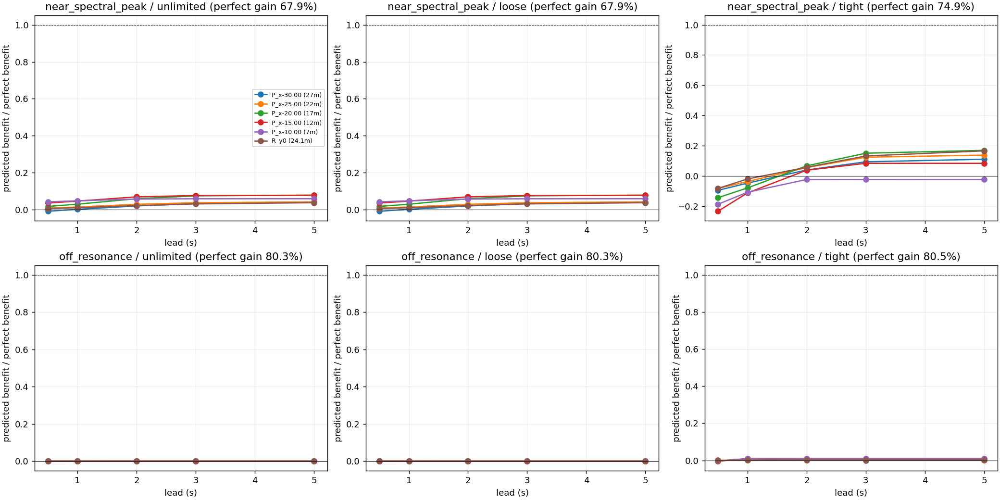
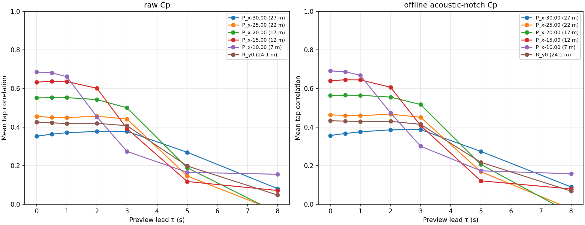

# 建筑高风速预报与主动控制

**分组**：AI 气象 / 气候大模型与风工程　**状态**：搁置　**时间**：2026-10-14 – 2026-10-14

## 阶段结论（测试性质，非正式结题）

小时级预报已被官方预警覆盖；秒级预视只拿到完美收益 0–17%，卡在来流预测

## 原始任务

# 任务书 · A2 图像向量：用我们自己的图找文献参考图（10-16 17:5x）
A1 判定：全量 50 对配对 96%（过）；20 道找图题英文 19/20（过）、中文 12/20。按上级任务书，A1 过线就做 A2。****

## 目标
给全量 386,894 张缩略图（台式机）算图像向量，用 10 张我们自己的图检索，判断"拿模拟图找文献参考图"能不能做到前 5 有相关图 ≥6/10。

## 要做的
1. 选一个开源图文模型（CLIP / SigLIP / OpenCLIP 一类；优先对图表、线图有效的；CPU 能跑），写明名称、版本、许可证、权重来源；权重下到台式机，不下到 工作站。
2. 台式机给全部缩略图编码（≤12 核 nice 10，B 句级在另用 ≤8 核，别动它），向量存；实测速度、耗时、体积。
3. 用 10 张查询图（scp 到台式机）各取前 10：每张查询出一张拼图（查询图 + 前 10 缩略图 + 各自图注前 80 字 + 来源/页），放，并列。**不要自己判命中**，Lead 按 判。
4. 加一个对照：同一 10 张图，若模型支持文本编码，用 README 里"判相关的标准"那句英文做文本→图检索，同样出前 10 拼图 `qNN_text_top10.jpg`，看文本描述是否比以图找图好。
5. ：模型、编码耗时与体积、单次查询耗时、问题与局限。

## 交付
10-18 18:00 前。

## 边界
- 只写台式机 与；不动 、ftkb；工作站 不跑编码、不收向量。
- 图片不外送（不交 Gemini/联网服务），只在台式机与上述目录。
- SSH 复用共享 socket，stdin 只用 /dev/null 或普通文件；socket 断了停下报 Lead；编码用 setsid nohup 跑，不挂在 ssh 会话下。0 CU。
- 用到的模型在回报里列引用，Lead 补 PUBLIC_CITATIONS.md。

## 项目报告

# A2 建筑高风速预报与主动控制

## 目标
预报（小时–天）做控制模式切换、秒–分钟前馈、实时反馈三层，判断 AI 预报能供给哪层；控制含主动质量阻尼器类与主动气动外形，风为统一输入。

## 当前状态
10-14 开节点。14:38 第一步：Grok 快查已发并回来（14:39，报告，仅摘要级）；14:5x 第二步 Deep Research（--gemini）已发（brief），已借用 A3 Grok 报告 cb8bff 的前馈结论不重查（其第 6 节数字后经 A3 审查 判无出处，已弃用，改引 A3 已核出处）。原计划：（brief），报告回来后读 A3 的 Grok 报告（前馈部分借用），再写 Deep Research（--gemini）第二份 brief，结论送 

Deep Research 15:0x 回来，Lead 核出处后送审 ****（3 位，15:1x 发出，等结果）。送审包。

审查 （E 有保留、A 不支持、D 有保留）已裁 →。原最小试验（AI 预报→TPU→超阈值）撤销。新最小试验已派 ideas ****（排队中）：本线 Silsoe LBM 提前 τ 预测 + 带行程限制主动质量阻尼器预视前馈，工作站 CPU，0 CU，任务书。

### 三层表（审查后定稿）
| 时间尺度 | 控制动作 | 所需提前量与精度 | 有无先例（出处页码） | AI 预报能否供给 |
| --- | --- | --- | --- | --- |
| 小时–天 | 只含慢动作：质量块回中与机械锁定、油压/备用电源准备与人工复核、慢速机械外形或 TLD 注排水、整场风暴行程预算 | 文献未给执行耗时与最迟决策时刻；"需要小时级"是假设 | 无"按天气预报切换"的书面运行规程（三方检索均未找到，不称不存在）；投运装置按加速度/行程阈值实时触发（PAFC：Zhou & Li 2022 Eng Struct 269:114840 摘要，"按运行原则精确触发"、阻尼比 0.6%→2–7%，无阈值） | 能，但增量小：慢动作已由官方台风/飓风预警覆盖；飓风强度 AI 全球模型无技巧（DeMaria 2025 卡，event_step0，第 14 行）→ **暂不做** |
| 秒–分钟 | 近场预视前馈 / 预视 MPC；降增益、半主动换档（毫秒–秒级，实时传感即可） | 预视秒数：无已核出处（A3 Grok 第 6 节数字经 A3 审查 弃用）；风机激光雷达前馈稳态湍流下有效：Guo 2023 WES 8:149 §5.2 塔底前后弯矩 DEL 至多 −16.7%、Bossanyi 2014、Schlipf 2018（A3 已核） | 无工程实证；研究/方案级：Abdelaziz & Hobeck 2022 SPIE 12046（10.1117/12.2630805，周边建筑测压+GRU 预测窗口+气动角板，1:400 风洞，RMS 转动加速度至多 −75%，题名已核、内容转引审稿人 D）；US5592791A（1997 专利，楼角外伸杆上游测风前馈，Lead 核原文）；Klein 1972、Soong & Skinner 1981、Abdel-Rohman 1983 同步测风气动附件（转引 Korkmaz 2011 期刊页 2130）；理论 Marzbanrad 2004 Eng Struct pp.1463–1471 | 不能——需现场近场测风；**本节点窄口**；本线 LBM τ=0 相关 7 m 0.67→27 m 0.35（本线数据） |
| 实时 | 加速度/位移反馈 | 无 | 常规 | 不需要 |

**预视统计已有结果**：近场速度对迎风 Cp 的预视秒级（相关减半 2.6–6.5 s，本线数据）。控制第二轮 ideas（10-14 16:1x 派出）先做控制模型自检：不饱和下完美预视须降加速度 RMS ≥30%，再测预测预视占完美预视收益的比例，任务书，交付。

**一句结论（10-14 定）**：搁置。AI 天气预报只能服务小时级慢动作，增量小；秒级近场预视原理上收益大（完美预视降加速度 68–80%），但用稀疏上游探针预测只拿到其 0–17%，瓶颈在来流预测技巧。原因、缺的条件与重启条件见。

（旧暂定）AI 天气预报驱动建筑控制价值低，搁置这一层；值得继续的是秒级近场预视前馈（有研究级先例、无工程实证），先用本线数据量出可用提前量与对行程受限阻尼器的增益，再定是否转正或并入 A3 的下击暴流预视试验思路。

## 已定决定
- 2026-10-14 文献结论裁决与方向收窄 → 

## 试过与结果
| 日期 | 做了什么 | 结果一句 |
| --- | --- | --- |
| 10-14 | Grok 快查 | 建筑/桥梁几乎无"上游来流预视"或"数值预报"驱动的风振控制先例；现有"预测"多为 MPC 状态外推/扰动估计；实际 ATMD 按加速度阈值启动与锁定（数字仅片段，未核）。三处问题：2004 预视控制 DOI 实指另一篇（Xie 2004 干扰效应）；台北 101 TAO DOI 查不到；"约 0.75–1.5 s 有效预视"是 Grok 用本线 30 m 推算的，不当文献证据 |
| 10-14 | 最小试验第二轮 v3（ideas，工作站 CPU 20.5 s，0 CU） | 修正前馈后完美 8 s 预视降加速度 RMS 68%（近谱峰）/80%（远共振）；速度探针预测预视只拿到完美收益的 0–17%，360 组合仅 4 组（近谱峰紧行程，降 10.3–12.6%）过闸门，判别力弱；远共振最好 0.8% → 瓶颈在来流预测技巧 |
| 10-14 | 最小试验 v2（ideas，工作站 CPU 14.5 s，0 CU） | 预视统计：迎风 11 点 Cp 相关减半的提前量 2.6 s（面距 7 m）→6.5 s（27 m），陷波后不变（2.7–6.6 s），本线单次实现。控制：所有预测预视组合未过闸门，但**完美 8 s 预视也只降 0.4–0.9%**，且宽松档行程仍触限——控制模型无判别力，控制结论不成立，已派第二轮 |
| 10-14 | Deep Research（--gemini） | 确认建筑/桥梁真实来流预视基本空白；找到真正的预视控制文献 Marzbanrad 2004；给出 Citicorp、京桥成和、横滨 Landmark、广州塔、PAFC 运行逻辑表（未核原文）；未找到按预报切换的运行规程。不采用：用本线 30 m 推 1–2 s（违反任务书）、车辆/登机桥案例、无引用的"台风前数小时人工预热" |
| 10-14 | Lead 核原文 Abdelaziz 2021 | 已核（PDF 第 1 页摘要）：预测器 ANN 按当前风况查板角，稳态 2D FSI，"初步结果"振幅降至多 94%；属"按风况调度"，不是来流预视 |

## 参数来源表
| 参数 | 取值 | 来源或"假设" | 查过哪些地方 |
| --- | --- | --- | --- |
| PAFC ATMD 启动/锁定阈值 | 公开文献未找到 | Grok 片段 0.01 m/s²/2.2 m 不采用 | Grok、DR、Crossref/OpenAlex 摘要（取不到） |
| Citicorp TMD 唤醒阈值 | 0.003 g 两周期 | DR 转述（vibrationdata/buffalo 网页），未核原文 | pages 无命中 |
| 京桥成和 AMD 行程/出力 | ±25 cm / 1 tf | DR 转述，未核 | — |
| 最小试验 TPU 缩尺/α | 1/400，α=1/4、1/6 | TPU 官网工况页（10-13 核） | |

## 未决与下一步
- 相关–τ–距离表已抄送数字孪生风洞根 Lead，对方已存档、读法无异议。A2 搁置后对方不再专门转空场建筑位置来流动压（作业 1542028）；重启需要时直接向数字孪生风洞 Lead 要，对方随时提供。
- 层级约束（根 Lead 10-14）：本节点为二级，不开三级子项目；细分用任务；任务书不让工具 bot 再转。
- Grok 报告回来 → 读 A3 Grok 报告 → Deep Research brief（--gemini）→ 审查 3 位 → 定 GPU 最小试验候选。
- 本线数据参照：Silsoe LBM 来流→迎风 Cp 相关随面距单调下降（7 m 0.67 → 27 m 0.35），（本线数据，非文献）。

## 文献依据
- 知识库（10-14 search）：无预报/预视驱动结构控制卡片。本地全文（ pages）有可读线索、尚无卡片：Abdelaziz 等 2021 JWEIA 212:104601 智能立面控制（Zotero U8L4S2VK，PDF 第 1 页）；Korkmaz 2011 主动结构控制综述（T8ADPIGM，PDF 第 18 页=期刊页 2130，引 Abdel-Rohman 1983 气动附件、Nissen 2004 桥梁主动气动稳定）；Kareem 1978（2F6RHVB9，PDF 第 55 页=期刊页 32）。待建卡核对。

## Liang Hu 注

## 结果图

## 目录

- `results/`：结果表与说明
- `reviews/`：多模型审稿人审查后的裁决
- `figures/`：结果图
- `code/`：试验脚本（原样保存，路径已改为相对路径，运行前需按各脚本说明准备数据与环境）
