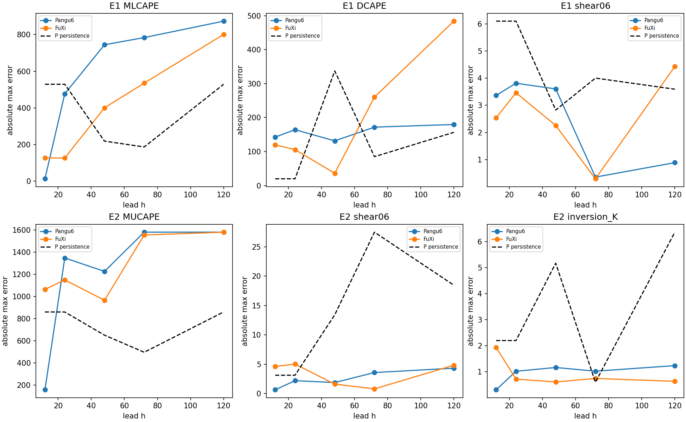
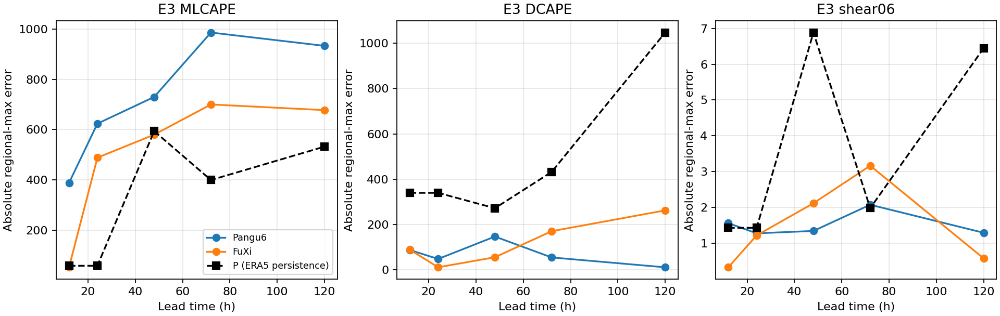
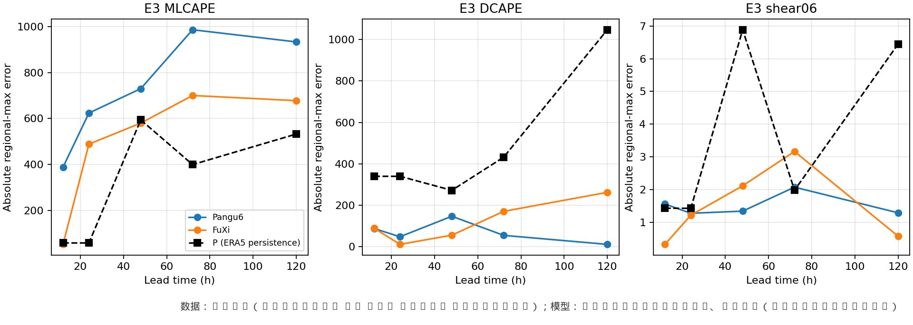
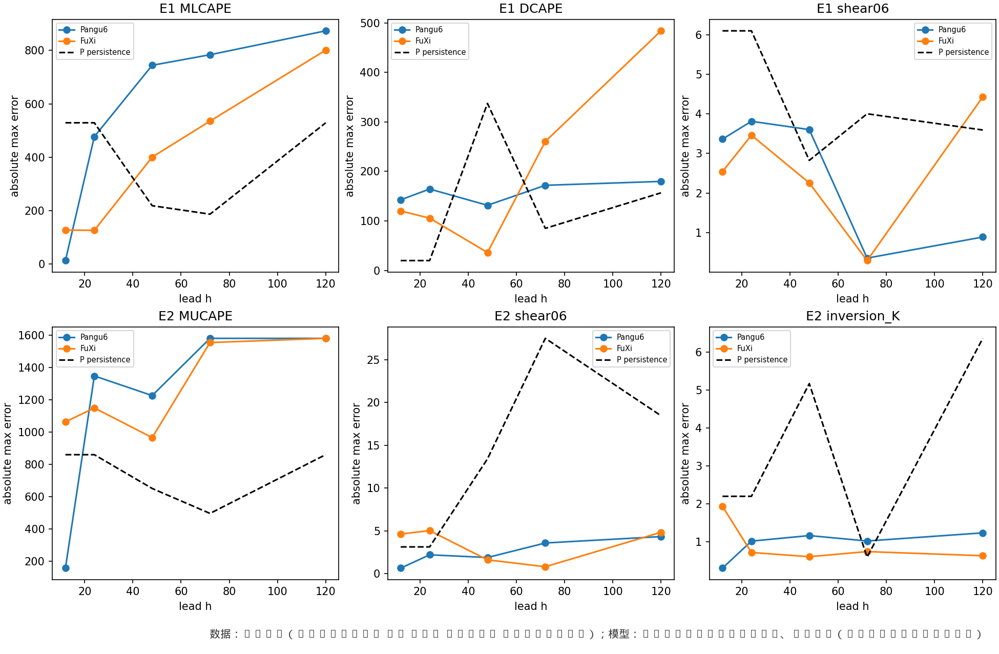
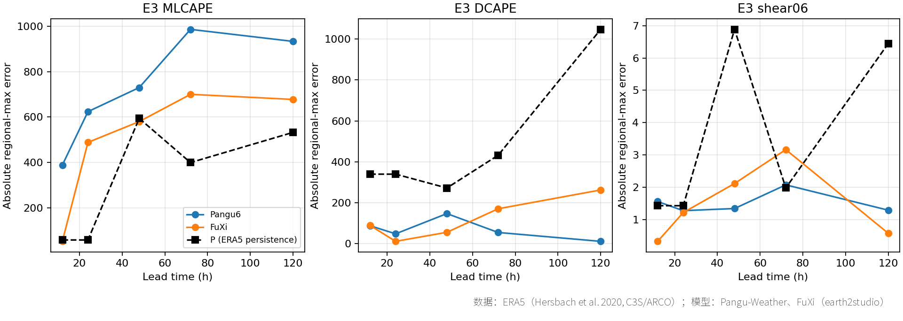
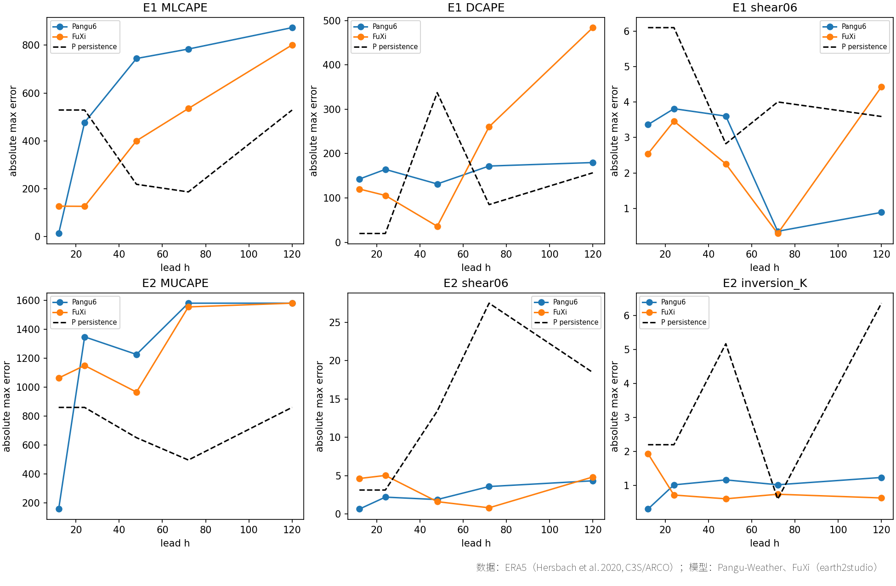

# AI 气象大模型预报用途（强风背景场、风电、CFD）

**状态**：搁置　**时间**：2026-10-13 – 2026-10-13

## 结论

10-13：三事件回算，AI 全球模型给对流背景场只到 12–24 h 且不稳定（CAPE 是瓶颈，风切/DCAPE 多好于持续性）；后报用 ERA5 更好；最有希望的是 AI 驱动 WRF（需 WRF 线、正式项目规模）；<11.3 CU

## 原始任务

# 任务书：AI 气象大模型用于短临/短期预报——对我们研究（强风背景场、风电、CFD）的用途（实验室子项目，Liang Hu 10-13 批准开立）

## 来源
Liang Hu 10-13 在「自建/本地模型用途」子项目对话中提出：AI 气象模型若能做预报（尤其短临），可为龙卷、雷暴、台风提供背景场；对风电可能更有用；对 CFD 是否有参考价值。相关卡：（220 m 全球 LES，物理模式，非 AI）、（城市微气候生成式模型）、（台风近地风廓线物理约束网络）、。

## 已知（父项目已做，别重复）
- 父项目页 「附带成果」2b 行：AI 天气模型对**后报重建**增量小（ERA5 更好）；0.25° 不解析下击暴流；Feldmann 2024（arXiv 2406.09474）CAPE/切变季节技巧与 IFS 相当但平滑；Hua 2025 GRL（10.1029/2024GL109611）Pangu 一天提前量。WRF Lead 回复：0.01 K 扰动致强风面积差约 5 倍，不建议 AI 生成 WRF 初值扰动。
- GitHub：earth2studio（NVIDIA，Apache-2.0）、ecmwf ai-models（Apache-2.0）、GraphCast→weathernext、Pangu、Aurora、geoarches。
- Colab A100 high-mem 可用（80 GB/167 GB/194 GB 盘）。

## 要回答
1. 强对流/龙卷/台风：AI 全球模型（GraphCast、GenCast、Pangu、Aurora、FuXi 等）与 AI 短临模型（雷达外推类）各能提前多久、给出什么（环境参数、路径、强度、近地风），与 IFS/GFS/HRRR 比如何；能否作为 WRF/CM1/CFD 的背景场或筛选工具。
2. 风电：轮毂高度风速/功率预报、爬坡事件——AI 模型的表现与已有先例。
3. CFD：作为降尺度链的边界条件、生成式湍流/入流场、方法借鉴——有哪些可核先例。
4. 回算（reforecast）对我们的价值：可预报性、历史事件附近的廉价集合。

## 步骤与边界
- 先 综述（默认档或 --gemini；问及开源实现时列 GitHub），结论按规矩 
- 再挑一个最小试验：建议在 Colab 上用 earth2studio/ai-models 对一个已知事件（如 Wister 2018-08-10 或一个美国登陆台风）做多个起报时刻的回算，与 ERA5 比环境参数/路径；判据预先写定；≤20 CU，用完 stop。不上超算。
- 别线数据只读；涉及 WRF/CM1 线的事先问对方 Lead 是否已在做。
- 交付：项目页判断表（问题/用途/已有数据/最小试验/成本/推荐度）、综述审查编号、最小试验结果、一句话结论（值得继续/搁置/待转正）。status 只用 探索中/搁置/待转正/已转正。

## 项目报告

# AI 气象大模型用于短临/短期预报的用途

## 目标
判断数据驱动天气模型（GraphCast/GenCast、Pangu、Aurora、FuXi 等）和 AI 短临模型，能否给龙卷/雷暴/台风提供背景场、能否服务风电预报、对 CFD 有无可用之处，以及回算（reforecast）对我们的价值。交付判断表、综述审查编号、一个最小试验和一句结论。任务书：（Liang Hu 10-13 批准）。

## 当前状态
10-13 14:00 **搁置**（可行性已答完）。三事件回算（Wister、Akron、ALTU）：预设三判据同时满足的最大提前量 Pangu 12/12/无、FuXi 24/无/12 h，不稳定；瓶颈是 CAPE（MLCAPE 在 ALTU 上 Pangu 五个提前量全不过，误差为持续性的 1.2–11 倍），风切和 DCAPE 多数组合好于持续性。综述审查 已裁决。两段试验合计粗估 <11.3 CU（≤20 上限）。带来源角注的图已出：、（旧图保留）。

**搁置原因**：我们做历史事件后报，环境直接用 ERA5/HRRR 分析场更好；直接用 AI 全球模型做下击暴流背景场，热力环境只到 12–24 h 且不稳定，0.25° 看不到风暴本身；CM1 线的瓶颈在观测候选，不在环境数据。
**缺什么条件 / 什么情况下重启**：(1) 本组转向预报类工作（提前几天判断强对流大风环境、风电预报）；(2) WRF 线愿意试"Pangu 驱动 WRF vs GFS 驱动"（先例 Xu 2024 ERL、Liu 2024 JGR:MLC），这是最有希望的方向，但属于正式项目规模；(3) 要做多事件统计时，先用 AWS AIWP 现成回算（2022-01 以后、GFS/IFS 初值 00/12 UTC，需先确认含气压层变量）；(4) 若以 CAPE 为目标，换 37 层输出或后处理模型（如 Hua 等 arXiv 2505.11750 的 Transformer 后处理）。重启用，单事件约 2–3 CU。

## 已定决定
- 2026-10-13 综述审查裁决：GraphCast 权重 2026-08 起可商用；NowcastNet–HRRR 改引 Das 2024；回算读法限定口径 → 
- 2026-10-13 最小试验判据与口径（13 层 ERA5 作主参照、日变化对齐持续性基线、三条同时满足）→ 
- 2026-10-13 开工安排与最小试验方向（多起报时刻回算，不是单时刻比对）→ 

## 判断表（审查 裁决后定稿，10-13；推荐度为内部优先级判断）
| 问题 | 我们的具体用途 | 已有数据/先例 | 最小试验 | 成本 | 推荐度 |
| --- | --- | --- | --- | --- | --- |
| 1 强对流环境背景场（直接用 AI 全球模型） | 提前判断有利环境、决定排不排 WRF/CM1；不作 CM1 多事件筛选（CM1 Lead） | 本组回算；Feldmann 2024 arXiv 2406.09474、Hua 2025 GRL 10.1029/2024GL109611（摘要） | 已做三事件：本组 n=3、区域最大值、对日变化对齐持续性判据下，最大可用提前量 Pangu 12/12/无、FuXi 24/无/12 h；风切与 DCAPE 多数组合好于持续性，MLCAPE/MUCAPE 是瓶颈 | <11.3 CU | 低-中 |
| 1′ AI 大尺度场驱动 WRF | 延长 WRF 驱动场可用时效 | Xu 2024 ERL 10.1088/1748-9326/ad41f0（Pangu→WRF 暴雨 TS 维持 8.5 天 vs GFS 约 3 天）、Liu 2024 JGR:MLC 10.1029/2024JH000207（台风强度误差较全球模式降 32%、较 ERA5 驱动 WRF 降 23%）；CM1 只能取探空 | 未试，需 WRF 线配合 | — | 中 |
| 1b 对流尺度 AI 与短临 | 0–12 h 雷暴、阵风 | StormCast arXiv 2408.10958、WoFSCast GRL 10.1029/2024GL112383（数值模式代理）；FuXi-Nowcast arXiv 2512.08974（含阵风）；NowcastNet 第三方评估 Das 2024 10.1038/s41612-024-00834-8（CSI 0.30 vs HRRR 0.04，>16 mm/h） | 暂不：无 CAM 训练归档与雷达训练数据 | — | 中（观察） |
| 1c 台风 | 路径/强度背景场 | DeMaria 2025 AIES 10.1175/AIES-D-24-0085.1（路径与最佳业务模式相当、强度系统性偏弱）；近地廓线需另接 WRF 或 类重建（未验证接 AI 预报） | 视需要 | — | 中 |
| 2 风电 | 轮毂高度风/功率 | GenCast Nature 10.1038/s41586-024-08252-9（97.2%/1320；风电为理想化功率曲线汇总）；Hardy 2025 10.1002/met.70038（0.18 vs 0.63 是 ERA5 即时重建；AIFS 预报约第 3 天后优于 IFS） | 不做（非本组主线） | — | 对风电本身中-高；对本组主线低 |
| 3 CFD | 降尺度链边界、入流 | FuXi-CFD Nat Commun 10.1038/s41467-026-70562-5（30 m 地形风含 TKE、测风塔验证；训练为中性稳态 RANS）；城市微气候 CFM（相对 LES） | 不做 | — | 低-中（不适用于下击暴流瞬态入流） |
| 4 回算/可预报性 | 提前量统计、历史事件集合 | AWS AIWP（Radford 2025 BAMS 10.1175/BAMS-D-24-0057.1；Pangu/FCNv2 2020-10 起、GraphCast operational 2022-01 起，GFS/IFS 初值 00/12 UTC）；HENS GMD 18:5575；Vonich arXiv 2504.20238（已知未来的初值优化，非预报能力） | 候选：用 AIWP 取 2022 年后多事件（需先确认档内含气压层变量） | 免跑模型，仍需取数诊断 | 中 |

## 试过与结果
| 日期 | 做了什么 | 结果一句 |
| --- | --- | --- |
| 10-13 | Pangu 与 FuXi（GraphCast 业务版训练期覆盖事件、ERA5 版无现成封装，改用 FuXi）对 Wister 18 UTC、Akron 06 UTC 从提前 12/24/48/72/120 h 回算，对 13 层 ERA5，基线为日变化对齐持续性，预设三判据 | 三判据同时满足的最大提前量：Wister Pangu 12 h、FuXi 24 h；Akron Pangu 12 h、FuXi 无。逐参数看：0–6 km 风切多数提前量误差仅为持续性的 0.1–0.6；CAPE 在 ≥24–48 h 后**比持续性还差**（误差比 1.5–4）。判据 2 按任务书字面把 J/kg、m/s、K 混合平均，实际由 CAPE 主导（任务书写法缺陷，按原口径裁决，不改）。13 层算的 MLCAPE 比 37 层低约 500 J/kg，垂直分辨率本身是大误差源。FuXi 镜像权重未与原权重逐文件核对 |
| 10-13 | 补第三事件 ALTU 2023-07-03 18 UTC（CM1 线给定），同判据；另出三事件站点格点+3×3 参数表 | Pangu 五个提前量全不过（MLCAPE 单项全否），FuXi 仅 12 h 过；13 层 MLCAPE 532 vs 37 层 797 J/kg；模型"地面露点"是最低等压层代理值 |

## 未决与下一步
- 10-13 线内试行规则（10-13 至 10-20）：重启时，固定题库的批量纯问答杂活（摘要初筛、文献单值抽取、表格字段提取、标签初判）默认用 ` 10% 由 Claude 复核记一致率，<90% 的任务类型退回原做法；回算、诊断、科学判断、送审不适用。
- 综述（ 默认档）回来 → 核引文 → ` → 裁决后定判断表。
- ideas 已回（10-13 12:30），Lead 已复核 metrics.json 逐参数误差比。ALTU 补跑 回来后定稿第 1 行。
- CM1 已回（10-13）：未在做；对其多事件验证 B 帮助有限，只作环境对照；给了 ALTU 2023-07-03 与站点参数清单 → 已补进试验（排在 后，判据不变）。
- 事件定义来源：WRF Lead 10-13 回复；Akron 依据卡片 2DPBW6VX PDF pp.1–2、9–11。
- 试验设计注意：父项目审查 取消过"单事件同一时刻 AI 场 vs ERA5"的比对（AI 模型就是在 ERA5 上训练的，得不出新信息）。本试验比的是**不同提前量**下环境参数误差的增长，并以持续性（起报时刻 ERA5）为基线；且要核对事件日期不在各模型训练期内（GraphCast/Pangu 训练截至 2017，Wister 2018 在测试期，待核原文）。

## 文献依据
- 10-13 展示页引用已补进 「AI 气象模型预报用途」一节（ERA5/ARCO、Pangu、FuXi、GraphCast、earth2studio、ai-models、MetPy 与判断表依赖的 18 篇文献）；回算目录加，带角注新图已出。
- 父项目页 「附带成果」2b 行：Feldmann 2024（arXiv 2406.09474）、Hua 2025 GRL（10.1029/2024GL109611），尚未入库建卡。
- ：220 m 全球 LES 是**物理模式**，非 AI；仅摘要核过。
- ：生成式三维瞬时城市风温场，仅摘要。
- ：台风近地廓线物理约束网络，仅摘要。
- ：AI 预报 + 自有观测网，优越性说法未核。
- ：天气模型改作强迫气候模拟器（arXiv 2605.29976）。
- 开源： 2b 行（earth2studio、ai-models Apache-2.0；Pangu、Aurora 权重条款待核）。

## Liang Hu 注
- 10-13（Liang Hu 原话要点）：做预报（尤其短临）有用，可为龙卷、雷暴、台风提供背景场；对风电应该更有用；问这类大模型对 CFD 是否也有参考价值。批准开立："开吧，你推进"。

## 结果图

## 目录

- `results/`：结果表与说明
- `reviews/`：多模型审稿人审查后的裁决
- `figures/`：结果图
- `code/`：试验脚本（原样保存，路径已改为相对路径，运行前需按各脚本说明准备数据与环境）
