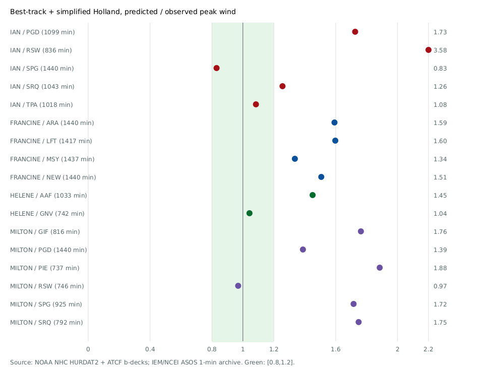
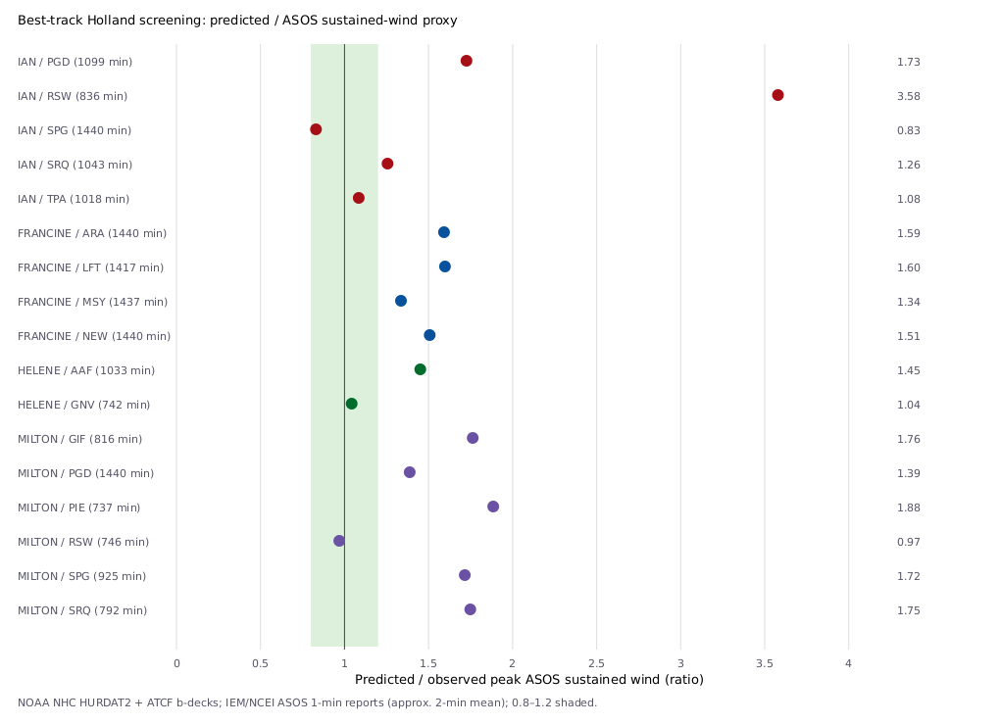
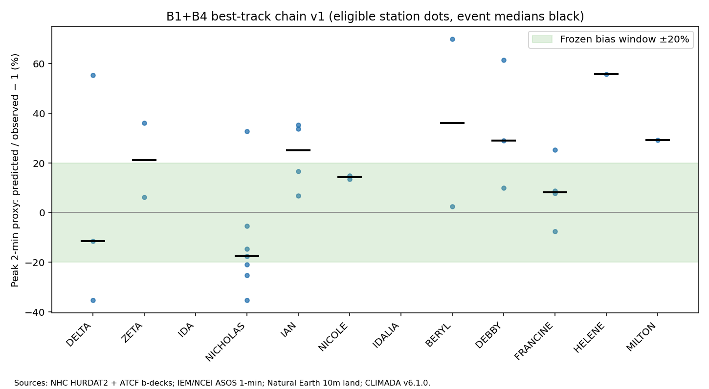
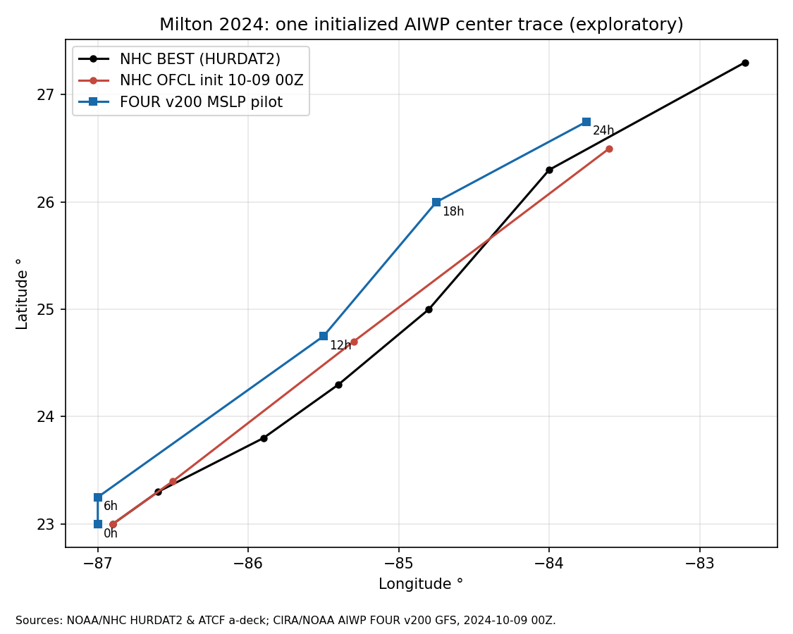
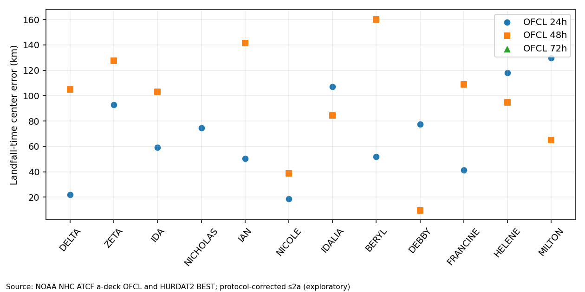
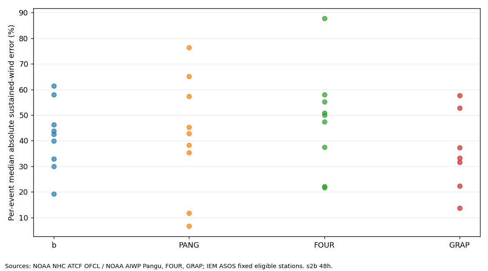

# B1+B4 登陆飓风：AI 路径与集合到站点峰值风

**分组**：AI 气象 / 气候大模型与风工程　**状态**：搁置　**时间**：2026-10-14 – 2026-10-16

## 阶段结论（测试性质，非正式结题）

48 h 误差比 1.021 过但事件 5/9 不足；两链都偏低 35–38%，输入假设盖住路径影响

## 原始任务

# 任务书：H2 登陆飓风站点留一重建（2026-10-14）；按既定授权做，中途不必求批。

## 目标
良态风阶段（r1/r2）结论：密站网插值够用，站稀处 ERA5+残差克里金好约 13%。H2 问：登陆飓风时（背景场最差、站点断报多），"参数化台风风场 + 残差克里金"能不能比纯插值和 ERA5 背景明显更准地重建站点风，尤其是每站的事件峰值？这是实验室 I 节点（损失–风速库）要用的场景。

## 事件与数据（只读复用 B 节点资源，不改 B 的文件；需要的脚本复制到本目录再改）
- 事件（10-14 按上级指示修订）：B 节点 中 v1 同一批 10 个（Delta、Zeta、Ida、Nicholas、Ian、Nicole、Idalia、Debby、Helene、Milton）+ BERYL 2024 附加单列；有效站 <8 的事件只列不判。
- 参数化风场：复用 B 节点 （CLIMADA 6.1.0 Holland 2008 + 方向海陆粗糙度 + 时距换算；预注册 、勘误），不在本试验里调它的系数。
- 观测：登陆前后各 12 h、路径 300 km 内全部 ASOS/AWOS 的 METAR 小时持续风与阵风（IEM，写法同 r1 的）；ERA5 10 m 风（ARCO-ERA5，同 r1）。
- 断报：峰值窗口内缺测的站单独列出、不进主评分（B 节点发现约一半站在飓风中断报），报告数量。

## 方法
IDW、普通克里金、ERA5 直插、ERA5+残差克里金、Holland 直插、Holland+残差克里金；可加"Holland 与 ERA5 加权"一种，但权重事先固定，不按结果调。学习方法不做（r2 中不如残差克里金）。逐站留一。

## 指标与判据（事先写定）
- 主指标：每站事件峰值（窗口内最大小时持续风）的 RMSE 与偏差；副指标：逐小时 RMSE、阵风峰值误差（阵风只与阵风比）。
- 判据：最好的"背景+残差"方法比最好纯插值的峰值 RMSE 低 ≥20% 且 ≥2/3 站更好 → 飓风场景值得做融合；10–20% 或只满足其一 → 有条件；<10% → 插值够用。每个事件单独报，再报合计。
- 加报：按到风暴中心距离分组（<1×、1–3×、>3× RMW）的峰值误差。

## 边界
工作站 本地 CPU，0 CU；只在 写；时间一律 UTC；平均风与阵风不混；假设参数写进参数来源表，不得写成文献值；新外部数据写 PUBLIC_CITATIONS.md。

## 交付
（逐事件与合计方法对比表、判据结论一句、断报站清单、按距离分组、参数来源表）、一张峰值预测 vs 实测散点图（标数据来源）、脚本。回报只写结论和数字。

## 项目报告

# B1+B4 登陆飓风：AI 路径与集合到站点峰值风

## 目标
AI 全球模型路径（+ NHC 官方强度）驱动公开参数化飓风边界层风场模型，站点峰值风能否达到 NHC 官方预报驱动同一模型的水平；加 AI 集合后离散能否覆盖 ASOS 实测。判断值不值得继续（Liang Hu 三维边界层模型到位后替换风场模型、扩大事件数）。任务书。

## 判据（10-14 开跑前写定，不得事后放宽）
- 主指标：每事件每站峰值阵风（或 1 min 持续风）预报/实测比的中位绝对误差、中位偏差；登陆点 ±150 km 内各站。
- 三链：(a) 最佳路径（HURDAT2/扩展最佳路径含 RMW）；(b) NHC 官方预报路径+强度；(c) AI 路径（AIWP）+ NHC 官方强度。同一风场模型，提前量 24/48/72 h（以登陆时刻为准）。 (b)(c) 只用业务可得信息，OFCL 不报 Pc/POCI/RMW，不得用事后 b-deck（10-14 审查 补，属输入合规、不改判据）；补充链 (c′) WeatherNext Cyclones 只报告、不进判据。
- **B1 值得继续**：(c) 在 48 h 的中位绝对误差 ≤ 1.1 × (b)，且 ≥ 2/3 事件上 (c) 不差于 (b)；**同时** (a) 中位偏差在 ±20% 以内（否则问题在风场模型，不在 AI，结论写"风场模型不合格"，不评 AI）。
- **B4 值得继续**：集合 10–90% 区间对站点实测的覆盖率在 60–95%。B4 只在 B1 过闸后做。
- 达不到写清差在哪，不放宽。

## 边界（10-15 起，Liang Hu 10-14 加严）
- 工作站 不跑计算、不存计算数据：风场计算、站点配对、AIWP/GFS/HURDAT2 大文件下载一律在 Colab 会话或 TACC /work 做和存（CRC 组空间约 95%，大数据优先 TACC）；工作站 只放脚本、单项 <200 MB 的小结果、图和报告；确需临时放 >1 GB 先报 B 节点。
- 上超算仍走 ComputeOps 资源申请 + 登记，预检与提交分两条命令；CRC 默认单节点。
- 现状（10-15 02:00 核）：本节点 工作站 上无计算在跑； 共 44 MB，无 >200 MB 文件。v2c 的 GDEX 实读当时在内存解码、未落盘。重启时任务书按本节写。

## 当前状态
**搁置（10-14，6 位审稿人都支持）。** 按重新冻结的 s2b 协议，B1 未过闸：48 h 同质 9 个事件、22 站，Pangu/OFCL 中位绝对误差比 1.021（满足 ≤1.1），但只有 5/9 个事件不差于 OFCL（需 ≥6/9）；按 10 个事件的分母为 5/10。B4 按顺序不做。这个结果不能说 AI 路径整体更好或更差。

**为什么不行**
- 两链在 48 h 都偏低 35–38%。来自预注册的输入假设：起报时刻的压差 Δp0 按 OFCL 强度缩放外推（H08 只用压差，不直接用 Vmax）、RMW 冻结在起报时刻（Nicole 200 nmi、Milton 5 nmi）、OFCL 强度本身偏低。各占多少没有拆开。
- 路径确实影响站点风，但方向不一致：Pangu 只在 4/9 个事件上路径更近（中位 91 km，OFCL 105 km）。
- 每个事件只有 1–4 个合格站，34/67 站在强风段断报，样本偏向外围站。

**缺什么条件、什么情况下重启**：见裁决 R1–R4——业务可得的尺度和气压输入，或 Liang Hu 的模型；≥15 个可评事件且每个事件 ≥3 站；截尾处理方案；换主链必须事先预注册。任何重启都是新版本协议，不翻转本次判闸。

**留给 B 节点的资产**：、v1 风场与 ASOS 配对、850 hPa 追踪器与 AIWP 远程读取、三链结果。

## 已定决定
- 2026-10-14 v2 准备到此停：严格站类高度后只有 13 例，不冻结、不跑 (a)，等重启触发 → 
- 2026-10-14 v2b 核查回来后：补齐前置并出预注册定稿候选，仍不判闸 → 
- 2026-10-14 v2 可行性回来后不开 v2 判闸，派小时同质池定向核查 → 
- 2026-10-14 B1 未过闸，节点搁置，B4 不做；撤回「路径被淹没」的归因；重启条件重写为 R1–R4 → 
- 2026-10-14 Colab 口径更正（B 节点 Lead，按 Liang Hu 原话）：不设单试验上限，预计 >100 CU 先报；用完必须 stop，同一轮只派一个执行方
- 2026-10-14 段 2 协议修正 s2b：OFCL 12 h 插值、同质样本（Nicholas 48 h 不可评）、主 (c) 用 Pangu、(c′) 不用 Liang Hu 凭据；判据不变 → 
- 2026-10-14 (a) 链 v1 过 ±20% 闸；接受约 2 min ASOS 代理口径；派段 2 → 
- 2026-10-14 文献审查 裁决：OFCL 无 Pc/POCI/RMW，(b)(c) 不得用事后 b-deck；AI 路径先查 CIRA/Weather Lab，自追踪用 850 hPa 环流；补 (c′) WN-C；增量口径收窄为「AI 路径 + 经典参数化边界层 → 美国 ASOS 三链对比，已检索范围未见」 → 
- 2026-10-14 层级规矩（根 Lead 定）：本节点为二级，不开三级子项目；B4 要独立时报实验室 Lead，由 B 节点开同级节点；工具 bot 不得再转委托
- 2026-10-14 B1 与 B4 合开（上级节点定）→ 
- 2026-10-14 段 1 极简模型 +50.7% 判为实现不完整，派段 1b 用完整模型预注册复测同一闸 → 
- 2026-10-14 第一步分两段：先"取数可行性 + 事件清单 + 风场模型实现 + (a) 链"，(a) 链过 ±20% 闸后再做 (b)(c) → 

## 试过与结果
| 日期 | 做了什么 | 结果一句 |
| --- | --- | --- |
| 10-14 | Grok 快查（b99be0）+ Lead 核对 | DeMaria 2025 摘要核实：AI 路径≈业务、强度系统偏弱（首 24 h 最明显）→ 强度用 NHC；AIWP README 无 TC 路径文件→需自行追踪；未见「AI 路径→参数化风场→站点风」先例（仅 Grok 一家，未经 Deep Research 印证） |
| 10-14 | 段 1：极简 Holland + 常数 0.85，(a) 链 5 事件试算 | QC 后 4 事件 17 站，中位绝对误差 50.7%、中位偏差 +50.7%，未进 ±20%；Idalia 三站登陆前断报；属代理筛选，非正式闸 |
| 10-14 | 段 1b：v1 预注册（CLIMADA H08 + 粗糙度 + 时距换算），(a) 链 12 事件 | 10 事件 29 站：持续风偏差 +9.9%（过闸）、中位绝对误差 21.0%；阵风偏差 −0.9%、中位绝对误差 11.2%；34/67 站截尾 |
| 10-14 | AIWP 远程切片（Milton，FOUR，Colab CPU） | 登陆区 msl/u10/v10/u850/v850 共 88 MB、337 次请求、39 s；MSLP 最低点简易追踪只作演示 |
| 10-14 | 段 2：(b) OFCL 链（s2a 插值修正，探索性）；Pangu Milton 48 h 试跑 | (b) 24 h：10 个事件 29 站，持续风偏差 −5.1%、中位绝对误差 29.3%；48 h：9 个事件 22 站，偏差 −37.9%、中位绝对误差 41.1%；Pangu 跑 Milton 一例约 0.95 GB、7.8 分钟，只为证明能跑通；截尾下限：(a) 2/19、(b) 48 h 11/19 站的模型峰值低于断报前的观测下限；(c′) 需要登录，没取到 |
| 10-14 | 段 2b：s2b 协议，三链 48 h 判闸 | 同质 9 个事件、22 站：OFCL 中位 | 41.1%，Pangu 41.9%，比 1.02；事件 5/9 → 未过闸。FCN2 比 1.21、3/9；GraphCast 比 0.68、5/7（子样本）。离路径距离分层：(a) >3×RMW 偏高 +35%；(b) 48 h 远站偏低 −58% | 、 |
| 10-14 | v2 可行性核查（只数事件，不配对） | 分钟口径 7 个预筛候选、小时口径潜在 14；R1 路线有、环境场与 Holland 拟合未闭合；不开 v2 |
| 10-14 | v2b 小时同质池定向核查 | 2020–24 恰好 15 事件×≥3 站（零余量）；Isaias 无 Pangu；GFS 环境场 12/15 已核 |
| 10-14 | v2c 前置补齐（站类高度、环境场、业务时刻） | 严格站类高度后 13 事件×≥3 站，不够 15；2020 环境场可取；H08 适配器缺 |
| 10-14 | GitHub 仓库表（API 实查） | CLIMADA（480★，GPL-3）、TCRM（99★，含 Kepert BL）、TempestExtremes（151★，BSD-2，追踪器）、TCHazaRds、ParaTC、weathernext（Apache-2.0，B4 自跑集合备选） |

## 参数来源表（B 节点共用）
| 参数 | 取值 | 来源或"假设" | 查过哪些地方 |
| --- | --- | --- | --- |
| Holland B | 由每时刻 Vmax、Pc、POCI、RMW 反算；样例约 2.1–2.8，限定 0.5–4 | 假设：Holland 梯度风压差关系（Wang 等 2020 PDF 第 5 页式 7）；Vmax/0.85 取梯度风属本试验假设 | 查 HURDAT2、ATCF b-deck、Vickery 2009 PDF 第 23–24 页；未取得直接 B 观测 |
| RMW | b-deck 第 19 栏，6 小时线性插值，海里换米 | 数据源：NHC ATCF b-deck；CIRA EBTRK 仅更新到 2021，HURDAT2 本身无 RMW | 查 CIRA EBTRK 页面及 README，逐风暴 b-deck；缺失时不代填 |
| POCI | b-deck 第 17 栏，6 小时线性插值 | 数据源：NHC ATCF b-deck，非任意设 1010 hPa | 查 b-deck 结构及 EBTRK 文档 |
| 梯度风→近地系数 | 0.85（全海陆相同） | 假设/简化；Vickery 2009 PDF 第 23–24 页说 0.85 为同批样本试调的比较基线，绝非其完整边界层模型；敏感范围 0.65–0.90 未完成 | 查 WTPZS77N 卡及原文，未实现其 slab/粗糙度过渡 |
| 空气密度 | 1.15 kg m^-3 | 假设（范围 1.10–1.25；未用实况气温湿度） | 查 Wang 等 2020 PDF 第 4–5 页；本试验无热力场 |
| 海陆粗糙度 | 暂未入模型（Vickery 示例海 0.0013 m、陆 0.03 m） | 明确缺项，不得宣称做过暴露订正；来源 WTPZS77N 卡，Vickery 2009 PDF 第 12、15、22 页 | 查 WTPZS77N 卡及原文；站点方向性土地覆盖未取 |
| 阵风因子/平均时距 | 未入主指标：ASOS sknt 为约 2 min 持续风代理，gust_sknt 为 5 s 峰值；不互当 1 min / 3 s | ZR7S3SEJ 候选卡 PDF 第 2–3、5–6 页记录不同时距与粗糙度，2KXRIJJB 候选卡 PDF 第 2–4 页限定约 2 s 条件；未有合格的站点特定换算 | 查两张待独立复核卡、IEM 1min 字段；未假设统一阵风乘数 |
| v1 CLIMADA H08 | CLIMADA 6.1.0，commit bb9595944fcf673152ea53e61efbafeb0b1e4406；原生 10m 1min Holland 2008 + 平移矢量 | 开源实现 第 1131–1257 行；非 Vickery slab，0.9 默认折减见源码第 61–69 行 | 查 GitHub 固定 tag 与实际运行包、v1 预注册 |
| v1 方向暴露 | Natural Earth 10m 陆地多边形；沿模型来流反向 2/5/10 km 三点多数判陆/海；z0 陆 0.03m / 海 0.0013m；500m 参考对数廓线比 | z0 源 WTPZS77N 卡、Vickery 2009 PDF 第 12/15/22 页；500m 参考及单类地表是假设（范围 200–1000m、陆 z0 0.02–0.07m） | 查 Vickery 卡、Natural Earth 10m land、CLIMADA 不含站点方向暴露订正 |
| v1 平均时距 | 1min→约2min sknt ×0.97；1min→5s gust_sknt 陆 ×1.30、海 ×1.20 | 全是假设，范围分别 0.95–1.00、陆 1.15–1.45、海 1.10–1.35；Vickery 与 Skerlj 2005 候选卡 ZR7S3SEJ PDF 第 2–3/5–6 页是平均定义/暴露依据，不直接给上述因子 | 查 ZR7S3SEJ、2KXRIJJB 候选卡（1992 PDF 第 2–4 页约2s/10min，不能直接套）；v1 未按观测调参 |
| s2 (b)(c) 起报尺度与环境压 | CARQ τ=0 的 RMW/POCI 持续；无则同 cycle OFCL τ=0；二者都无则该 cycle 缺失 | 业务可得资料加持续假设，绝无事后 b-deck | 查 NHC ATCF a-deck 逐周期、审查裁决；见 |
| s2 (b)(c) 未来中心压 | Δp(t)=Δp0×[OFCL V(t)/V(0)]^(1/0.644)；POCI 恒定；CARQ 起始压优先 | 指数借 Atkinson–Holliday 1977（西太平洋），大西洋锚点缩放是假设，非文献验证 | DTIC 摘要与 Knaff–Zehr 2007 原文复述；缺值补法见 |
| s2 AI 850hPa 追踪 | 5×5 ζ 平滑、200 km 圆内均值、前一中心 350 km 搜索及气旋环流 >0 | 具体阈值均假设，追踪方向据 DeMaria 2025 PDF 第 14–15 页；并非复刻其 Table A2 | 查原文附录与；MSLP 只作辅助 |

## 未决与下一步
- 搁置。v2 材料停在 （PREREG_v2 候选未冻结）。重启触发：① Liang Hu 的三维边界层模型到位（替换 H08，同时解决 B 的适配问题）；或 ② 2026 季进 HURDAT2 且 AIWP 补上 Isaias 周期、HOMR 历史高度核实后，事件 ≥15×≥3。重启时先决定是否收 7.9 m（26 ft）ASOS 站做高度订正（收入后 Delta、Milton 各 3 站，可到 15，但零余量），须在看任何误差前写进预注册
- 10-14 v2 可行性核查已回（、 未冻结）：分钟 ASOS 口径只有 7 个预筛候选；小时口径潜在 14 个（Eta 未核）；分钟与小时峰值不能混池；R1 选 OFCL 风圈 + Knaff 2007 RMW 先验 + Knaff–Zehr 2007 ΔP（要 GFS 的 V500/Penv），Holland 逆拟合是工程假设。结论：**现在不开 v2 判闸**，仍搁置
- 10-14 20:4x 派定向核查 （排队中）：只用小时站一种采样重算 150 km 站数（旧 11 + Eta/Elsa/Fred/Henri + 2026 季 ≥50 kt 登陆），并核 GFS 业务归档能否算 V500/Penv；任务书；0 CU。达到 ≥15 事件 ×≥3 站且环境场可得，才起草冻结 v2
- 10-14 21:54 定向核查已回：单一小时 METAR 口径，2020–24 年**恰好 15 个事件 ×≥3 站**（170 站–事件），都有同起报 Pangu 与 OFCL，余量为 0；2026 季只有 Isaias 一个 ≥50 kt 登陆，但没有 Pangu 对象；GFS f048 环境场 12/15 可取，2020 三例 AWS 404；V500 现用 10 m 风，层次待按原文核
- 10-14 22:0x 派 （排队）：补 2020 三例环境场、核 V500 层次、按 NCEP 发布时间表定业务时刻规则、逐站核 ASOS/AWOS 与风速计高度后重数事件、查 Isaias，交可冻结的 （小时口径为主、(a) 链同口径重过 ±20%，QC 后不足 15×3 不判闸）；任务书；0 CU。回来后 Lead 冻结，再只跑 (a)
- 10-14 22:20 前置补齐已回：2020 三例 GFS 环境场从 NCAR GDEX 实读可算（V500 改用 850 hPa，依据 Knaff 等 2014，KZ07 原文没写层次）；业务时刻按 NCEP 发布时间表统一退一个周期取 f054（属代理）；按 NWS 2025 ASOS 设备清单、风速计 8–12 m 的条件性快照，只有 **13 个事件 ×≥3 站**（Delta、Milton 各 1 站），历史高度均未经 HOMR 证实；Isaias 的 Pangu 周期是数据空洞；CLIMADA H08 的 B 是内生算出的，风圈只能拟合 RMW，适配器未写、未验证。**Lead 决定 v2 准备到此停，不冻结、不跑 (a)**，见决策
- 预注册里「新模型峰值时刻的观测窗完整性」一项没交付，作为解释上的局限保留

## 文献依据
- 2026-10-16 数据：NOAA HRD 下投探空 10–300 m 台风风廓线 7,524 条（Ma 等 2026，Zenodo 10.5281/zenodo.21868265，CC BY 4.0；Liang Hu 批 X2 并指示存档）→ （CRC 备份）。可用于廓线形状、10–300 m 风切与 H08/经验廓线对照（海上）、重启 B1+B4 时的廓线约束；不是陆面廓线。不改本节点状态与闸门。
- （10 张分高度模型卡）
- （Vickery 2009 边界层/近地换算）
- （Hurricane Gust Factors Revisited）、（Gust factors applied to hurricane winds）：阵风因子/时距换算
- （DeMaria 2025）：AI 路径与 GFS/ECMWF 相当，可作指引（PDF pp. 5–8、11–13）；强度几乎总偏弱，72 h 后平均绝对误差约 40 kt，无强度技巧（PDF pp. 6–9、13）→ 本节点 (c) 链用 NHC 强度；「AI 路径 + 其他强度」拼接作者未验证，属本节点工程推论（PDF pp. 1、11–13）；未公开 AI 路径文件（PDF p. 14）；非登陆专门样本
- （Radford 2025，AIWP 数据集）
- R1 输入方法卡（10-14）：（风压关系式 7，还要 φ、c、Penv、V500；PDF 第 4–5 页，期刊第 74–75 页）、（Rankine x 不等于 Holland B）、；索引。光靠 OFCL 的 Vmax 和风圈闭合不了 Holland 参数，需要分析场或 AI 场补 Penv、V500
- 近邻先例（10-14 litwiki 建卡，均与本节点不同：都不是「AI 路径 + 参数化边界层 → 美国 ASOS 站点峰值风」）：
 - ：NHC 风速概率，官方预报加误差分布生成 1000 个成员，用 radii-CLIPER 风场；用 best-track 风圈网格验证，不是站点峰值（PDF p. 11–12；期刊 pp. 1583–1584）——B4 的业务基线
 - ：加 GPCE 分层，Brier score 改善 1%–4%（PDF p. 11；期刊 p. 596）
 - ：WN-C 至少 50 个成员；风速概率用 IBTrACS 风圈评价；原文写明「per-location winds are left for future work」（PDF p. 7；期刊 p. 686）——本节点增量的直接定位
 - ：Pangu/AIFS 驱动三向耦合 WRF（香港 7 个 TC），路径误差比 IFS 驱动低 28%–34%；不做站点峰值验证（PDF p. 3、10）
 - ：Pangu 网格风订正加降尺度，浙江 2513 站 2-min 小时风 MAE 降 38.8%；不用参数化风场，不比峰值（PDF p. 12–13）
- Radford 等 2025 BAMS 10.1175/BAMS-D-24-0057.1（AIWP 数据；PUBLIC_CITATIONS 已有）

## Liang Hu 注

## 结果图

## 目录

- `results/`：结果表与说明
- `reviews/`：多模型审稿人审查后的裁决
- `figures/`：结果图
- `code/`：试验脚本（原样保存，路径已改为相对路径，运行前需按各脚本说明准备数据与环境）
