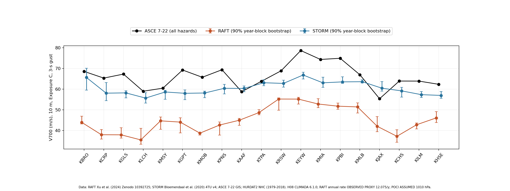
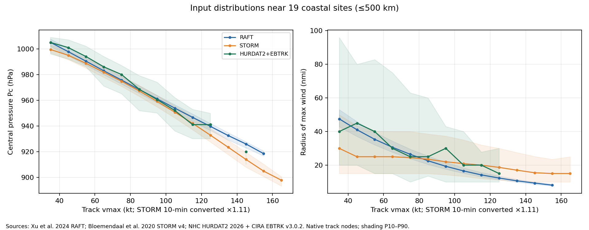
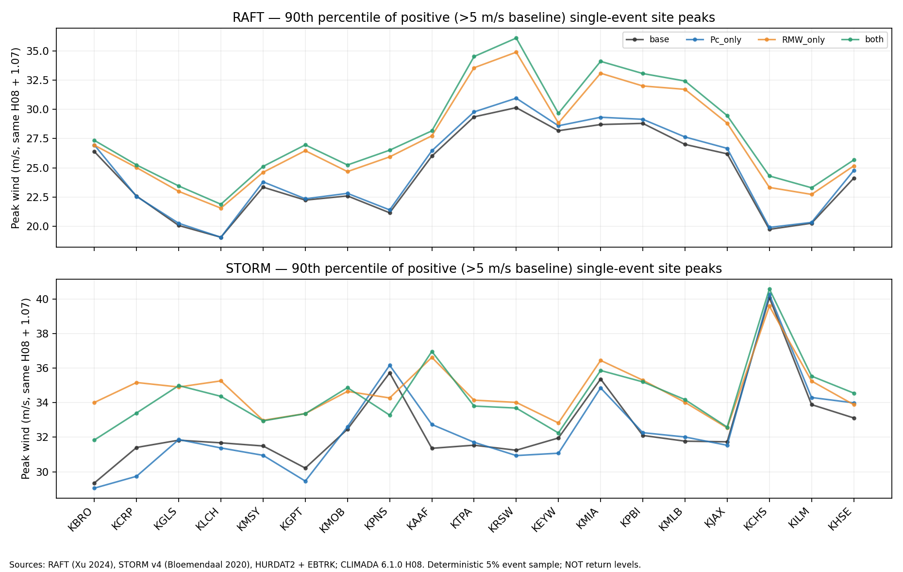
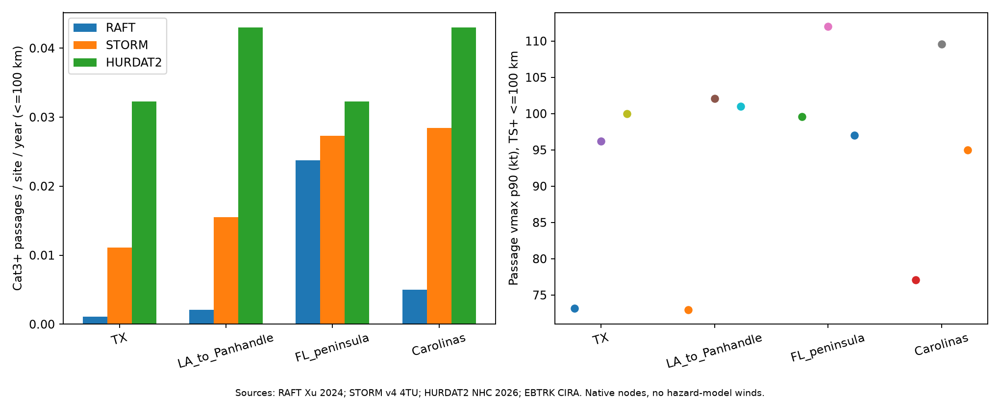
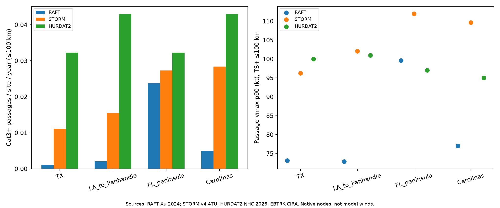

# B2 AI 混合合成台风到沿海设计风速

**分组**：AI 气象 / 气候大模型与风工程　**状态**：搁置　**时间**：2026-10-14 – 2026-10-16

## 阶段结论（测试性质，非正式结题）

STORM 过闸 0，RAFT 偏低约 31%，主因 RAFT 近岸几乎不出 Cat3+

## 原始任务

# 任务书：B2 设计风速——AI 混合合成台风目录 → 参数化风场 → 沿海站点重现期风速（10-14）

上级：B 台风/飓风风场节点（页）。本节点页。

## 要回答的问题
用 AI/机器学习参与生成的合成台风目录，接上我们已过闸的参数化风场模型，算出的美国沿海站点 50/700 年重现期风速，和传统统计合成目录、和 ASCE 7-22 设计风速相比差多少？判断"AI 合成台风 → 设计风速"这条路值不值得继续（Liang Hu 模型到位后替换风场模型）。

## 已知（B 节点 Lead 已查，不用重查）
- Grok 快查报告（只是线索，文献结论尚未）：（引文核对同目录 citations.md，8/8 DOI 存在）。要点：做设计风速的都是混合方法（统计路径 + 机器学习强度、或 NeuralGCM 路径 + 动力强度），没找到纯生成模型直接出设计风速的；AI 天气/气候模型自由运行的台风强度普遍偏弱。
- **RAFT**（Xu 等 2024, Scientific Data, 10.1038/s41597-024-02952-7）：北大西洋 4 万个合成台风，路径为统计方法、强度变化由 MLP 神经网络（SHIPS 环境因子）给出，含 6 h 路径、Vmax、Pmin、RMW。Zenodo 10392725，CC BY 4.0，主文件 约 154 MB（B 节点 Lead 已用 Zenodo API 核）。等效年数/年发生率要从论文原文查。
- **STORM**（Bloemendaal 等 2020, Scientific Data）：全球统计合成目录，本地有 PDF（Zotero 3K6K2RM5）。作传统对照。
- 其他线索：Bose、Pintar & Simiu 2023 AIES（10.1175/AIES-D-22-0060.1，耦合 ML 路径+强度，NIST）；Gao & Xi 2026 GMD SPIN（NeuralGCM 路径 + FAST 强度，10.5194/gmd-19-7303-2026）——查是否有公开目录可下载；Snaiki & Wu 2019 JWEIA（知识增强深度学习边界层风场代理，本地 PDF Zotero MEK53ESY）。
- 风场模型：沿用 B1+B4 已过 (a) ±20% 闸的 CLIMADA 6.1.0 H08 + 海陆粗糙度。

## 第一步要做的
1. 选 10–20 个美国墨西哥湾/大西洋沿岸站点（建议 ASOS 机场站，覆盖得州到北卡、佛州），写进页面。
2. RAFT 与 STORM（北大西洋部分）各自过同一个风场模型，按各自等效年数算站点 1 分钟或 3 秒阵风（口径统一并写清换算）50 年、700 年重现期风速。
3. 对照：ASCE 7-22 风速图对应站点值（风险类别 II 的 700 年；查可公开取得的途径，不用 Liang Hu 凭据）；有条件再加 HURDAT2 历史经验值作参考。
4. 判据开跑前写进页面（不得事后放宽），建议：RAFT 链 700 年风速与 ASCE 7-22 偏差中位绝对值 ≤15%，且不比 STORM 链差（中位绝对偏差不超过 STORM 的 1.1 倍）→ 值得继续；否则写清差在哪（目录强度、风场模型、换算口径）。可自行细化，但要先冻结。
5. 文献：基于 Grok 报告要采用的结论，Deep Research 额度恢复后发第二步（``），结论 ` litwiki 建卡（RAFT、STORM、Bose 2023、SPIN、Snaiki 2019），结论引卡片和页码。GitHub 仓库表：RAFT/STORM/SPIN/NeuralGCM 相关代码。

## 边界
- Colab 不设单试验上限；预计 >100 CU 先停下报 B 节点 Lead；用完 `colab stop`；同一轮只派一个执行方。RAFT 降雨文件（每个约 1.8 GB）不要下载，只要轨迹 nc；不往 工作站 放 >5 GB 数据。
- 不上超算。文章没写的参数先查后假设，页面维护参数来源表。新用到的数据/代码写进，图表注明数据来源。
- 你是二级节点：不开三级子项目；给 ideas 的任务书写明工具 bot 不得再转。
- 结果写到。交付：站点表、三方对比表与图、判据结论（值得继续/搁置）、花费。
- 与 EVA/设计荷载线：只读，不派他们的 bot；若需他们已有的飓风设计风速资料，报 B 节点 Lead 去问。

## 项目报告

# B2 AI 混合合成台风到沿海设计风速

## 目标
用 AI/机器学习参与生成的合成台风目录（RAFT：统计路径 + MLP 强度），接上 B1+B4 已过 (a) 闸的参数化风场（CLIMADA 6.1.0 H08 + 粗糙度），算美国墨西哥湾/大西洋沿岸站点 50/700 年重现期风速；和传统统计目录 STORM 过同一风场链的结果、和 ASCE 7-22 设计风速相比。判断"AI 合成台风 → 设计风速"值不值得继续（Liang Hu 模型到位后替换风场模型）。任务书。

## 判据（10-14 19:25 冻结，EVA 与设计荷载线均已回复后；不得事后放宽）
**统一口径**：站点 10 m、开阔地貌（z0 = 0.03 m，对应 ASCE Exposure C）、3 s 阵风，记 V50、V700（MRI 50、700 年）。依据：Vickery 等 2010 按 10 m 开阔地貌（z0=0.03 m）峰值阵风给 300/700/1,700 年图，类别 II 为 700 年（卡，PDF 第 1、5–8 页 / 期刊页 613、617–620；该文未明写"3 s"）；"3 s"取自 ASCE 7-22 第 26 章，ASCE 7-22 的基本风速 V 是 10 m（33 ft）Exposure C 的名义 3 s 阵风（精读 第 23 行，Ch. 26；风险类别 II 对应 700 年的页码待 ideas 核原文补）。所有站点一律按开阔地貌算，不做站点实际方向暴露订正（ASCE 图本身就是统一 Exposure C）。

- **闸 0（风场链合格）**：STORM 链 V700 相对 ASCE 7-22 的站点中位偏差在 ±20% 以内。不过 → 结论写"风场/换算链不合格"，不评 AI（与 B1+B4 (a) 闸同一逻辑）。
- **闸 1（值得继续）**：RAFT 链 V700 相对 ASCE 7-22 的站点中位绝对偏差 ≤ 15%，**且** ≤ 1.1 × STORM 链的中位绝对偏差。两条都满足 → 值得继续；否则搁置并写清差在哪（目录强度/频率、风场模型、换算口径）。
- **只报告、不进闸**：V50 三方对比；按海岸分段（得州–路易斯安那 / 密西西比–佛州狭长地带 / 佛州半岛与群岛 / 佐治亚–北卡）；重现期的抽样不确定性（按年重抽样 bootstrap）；时距/阵风换算和 STORM 10 min→1 min 换算的敏感性；若查到 SPIN 或 Bose 2023 公开目录，作第三条链只报告。
- **ASCE 值取不到时怎么判（冻结时事先写定）**：ASCE 7-22 站点值只从公开途径取（ATC Hazards by Location 等，不用 Liang Hu 凭据；不从规范 PDF 读图凑数）。19 站中取得 ≥12 站 → 闸 0、闸 1 只在取得的站上算，照常判。取得 <12 站 → 不判闸 0/闸 1，降为**相对比较**：RAFT 相对 STORM 的 V700 站点中位绝对差 ≤15%，且四个海岸段的中位差都不超过 ±25%，记"RAFT 与传统目录一致、可继续（未对规范检验）"；否则记"RAFT 与传统目录不一致"并写清差在哪。相对比较的结论不得写成与设计风速相当。
- **设计荷载线资料只读**（10-14 设计荷载 Lead 答复）：可引 ASCE 7-22 风接口精读 （needs_review）、（PDF 页 = 印刷页 + 61）、规范原文。不改他们的计算器；不引用他们线上名为"B2/C0"的数值产物去对照或背书（那是他们自己的，不是本节点）。
- **分层报告（母项目 10-14 补，只报告不进闸）**：H08 已知外围大范围偏高约 +2.5 m/s（H 节点）、近核 <1 RMW 低估。每站 V50、V700 报超越贡献按台风路径离该站 <1、1–3、>3 倍 RMW 分档各占多少（按超过该重现期风速的风暴，以峰值时刻的距离/RMW 归档）；站点再按离海岸距离 <10、10–50、>50 km 分档分别报偏差。
- 常数、站点、方法写进 （带时间戳）后才算任何站点风速；之后不改，要改记 v2 并保留 v1。

## 站点（10-14 19:25 冻结，19 个 ASOS 机场站，得州到北卡）
KBRO 布朗斯维尔、KCRP 科珀斯克里斯蒂、KGLS 加尔维斯顿、KLCH 查尔斯湖、KMSY 新奥尔良、KGPT 格尔夫波特、KMOB 莫比尔、KPNS 彭萨科拉、KAAF 阿巴拉契科拉、KTPA 坦帕、KRSW 迈尔斯堡、KEYW 基韦斯特、KMIA 迈阿密、KPBI 西棕榈滩、KMLB 墨尔本、KJAX 杰克逊维尔、KCHS 查尔斯顿、KILM 威尔明顿、KHSE 哈特拉斯角。
只用站点坐标（IEM 站点表），不需要 ASOS 风记录。某站若取不到 ASCE 值，记缺失，不换站。

## 当前状态
**10-14 22:30 搁置**（6/6 支持；裁决）。
- **结果**（主版本 v6，RAFT 年率 HURDAT2 观测代理 12.075 场/年）：闸 0 过（STORM V700 对 ASCE 7-22 中位 −8.87%，19/19 站）；闸 1 不过（RAFT 中位绝对偏差 30.95%，>15% 且 >1.1×9.21%）。四个海岸段 RAFT 全偏低；V50 也低 −29%，偏低是整体分布性的，不是尾部抽样。年率 10–20、POCI ±5 hPa、换算 1.03–1.12 都不改判。
- **为什么不行**：共同风场链由 STORM 过闸 0 控制，单位/输入/绘点经 4 位审稿人对 CLIMADA 6.1.0 源码核过，未发现可解释 30% 的实现错误。H08 只用气压差、不读目录 vmax，所以本链检验的是 **RAFT 用经验式给出的 Pc/Rmax**，不是它的 AI 强度模型本身。偏低来自经验式 Pc–vmax（截距 1030 hPa 接 POCI 1010）、Rmax 回归偏小、近岸衰减，还是共同假设，本轮**未定量分离**；作者自报（Rmax 低约 19%、登陆 99 分位低约 8 kt，卡 NR_xu_2024_raft PDF 第 6–7 页）只是方向线索。
- **缺什么**：能直接用 vmax 的风场模型（或自洽的 Pc–vmax 关系），以及 RAFT Pc/Rmax/近岸强度对 HURDAT2/EBTRK 的分布对比。
- **什么情况下重启**：前置工作——Liang Hu 的风场模型到位，或先做 RAFT Pc/Rmax/近岸强度对 HURDAT2/EBTRK 的分布诊断（首个假设：线性 Pc 式接纯气压 H08 在强台风端损失约 10–15%，审稿人 E 估算，未复算）；**触发**——据此写新的预注册，在同一冻结门槛下重跑，闸 0 仍过且闸 1 过才算重启成功，不得以本轮 ASCE 误差反调任何参数。有新的公开 AI 合成目录且自带 Pc/Rmax（SPIN 当前没有）也可按同法重试。
- **10-15 00:10 B2 收口（状态维持搁置）**：归因完成——主因是 RAFT 目录本身在近岸（尤其墨西哥湾、卡罗来纳）几乎不出 Cat3+ 过境，不是 Pc/RMW 经验式，也不是风场模型。所以换成直接用 vmax 的风场（H10）救不回来，因为 vmax 本身在近岸就偏弱。**重启条件改写**：只有出现新的 AI 合成目录（或 RAFT 新版）时，先用本诊断的"近站 Cat3+ 过境率对 HURDAT2"表做低成本筛查（0 SU），各段过境率与观测同量级才进入设计风速链，并按原冻结门槛与 19 站重新预注册。原始公开数据副本已从 工作站 删除（可重取）。
- **10-14 23:30 诊断 v1 回**：Pc 经验式与 RMW 都不是主因，无可预注册修正，不起草重启 PREREG；剩余差异在"近站强风暴的强度×过境频率"，已派 ideas 最后一步：近站强风暴过境频率 RAFT/STORM 对 HURDAT2（产物），做完 B2 收口。
- **10-14 22:45 重启前置诊断已派**（实验室 Lead，状态仍搁置）：ideas （排队中），RAFT/STORM 的 vmax/Pc/ΔP/Rmax 对 HURDAT2+EBTRK，同一 H08 链分别替换 Pc、Rmax 看单场站点峰值风变化，查 CLIMADA 直接用 vmax 的风场模型；不碰 ASCE、不重算重现期；任务书，产物。回来后判断是否起草重启 PREREG（起草报 B 节点，跑闸前报实验室 Lead）。
- 报告勘误 （14.5 场/年来源错、相对比较不是闸、两项未披露核对）。

10-14 19:20 开立；EVA、设计荷载两线均答不重复、无可借站点值或目录，19:25 判据与站点冻结（含 ASCE 取不到时的相对比较规则）。第一轮派 ideas（取数、PREREG、两链计算、ASCE 取值、GitHub 仓库表）。文献：Grok 快查已有（只是线索，未审）；Deep Research 本月额度用完，第二步待恢复后补，基于它的结论再 ` litwiki 建卡。

## 已定决定
- 2026-10-14 22:30 搁置（审查 6/6 支持）→ 
- 2026-10-14 19:25 两线回齐，判据冻结（补 ASCE 取不到时的相对比较规则、设计荷载线资料只读与禁用项）→ 「补充 2」
- 2026-10-14 母项目补两条边界：等 EVA/设计荷载线回复后再冻结判据；加 RMW 距离与离岸距离分层报告 → 「补充」
- 2026-10-14 B2 开工、判据与站点草案、闸 0 前置 → 
- 2026-10-14 B2 开立（B 节点 Lead）→ 

## 边界
- **工作站 不跑计算、不存计算数据（Liang Hu 10-14 加严，10-15 写入）**：风场/目录诊断、批量算例、大下载一律在 Colab（CPU/GPU）或 CRC/TACC 跑和存；工作站 只放脚本、单项 <200 MB 的小结果、图和报告；确需临时放 >1 GB 先报 B 节点。公开原始数据（RAFT/STORM/HURDAT2 大文件、GFS/ERA5 场）放 Colab 会话或 TACC /work。上超算走 ComputeOps 资源申请 + 登记，预检与提交分两条命令；CRC 默认单节点、组空间约 95%，大数据优先 TACC。重启时任务书按此写；下文旧条目里"工作站 本地优先"作废。
- Colab 不设单试验上限，预计 >100 CU 先停下报 B 节点 Lead；用完 `colab stop`；同一轮只派一个执行方。RAFT 降雨文件不下载，只要轨迹 nc；工作站 不放 >5 GB。
- 不上超算。先查后假设，参数来源表在下。新数据/代码写，图表注数据来源。
- **EVA 线回复（10-14，经母项目转）**：EVA 只做雷暴大风与机制分层极值，与 B2 不重复、无禁区；没有 ASCE 7-22 站点值或飓风目录可借（ASCE 资料属设计荷载线，回复待到）。两条注意：① B2 的飓风阵风系数/时距换算不得直接套到雷暴或混合气候 EVA（EVA 候选条目）；② B2 结果若以后要和雷暴侧合成混合气候设计风，先经母项目通知 EVA 线对接口径，混合气候合成与重现期结论最终归 Liang Hu。可参考但多半用不上：Cook ASOS 德州四站阵风事件清单 （只读；未按热带气旋分类、阵风未标准化为 3 s），B2 不用。
- 二级节点：不开三级；工具 bot 不得再转。EVA/设计荷载线只读，需要它们的资料报 B 节点 Lead 去问。

## 试过与结果
| 日期 | 做了什么 | 结果一句 |
| --- | --- | --- |
| 10-14 23:54 | 过境频率归因（只用观测； + ADDENDUM） | 站点 100 km 内 Cat3+ 过境（每千条风暴）：TX 段 RAFT 0.09 / STORM 1.04 / 观测 3.45；LA–狭长地带 0.17 / 1.45 / 4.14；佛州半岛 1.97 / 2.55 / 2.07；卡罗来纳 0.42 / 2.66 / 3.45。RAFT 近站 TS 级过境不少，但过境时达到 Cat3+ 的极少（墨西哥湾约低 20 倍），佛州半岛接近观测——与 V700 偏低分段一致（墨西哥湾最深）。答：(iii) 两者都有，以近岸强度尾部为主；观测 Cat3+ 样本小，只看量级 |
| 10-14 23:20 | 重启前置诊断 v1（只比观测输入，不碰 ASCE；同一 H08 链 5% 样本 2,351 场配对替换，基线与主链逐条一致） | RAFT 近站 Cat3+ ΔP p90 71.6 hPa（观测 87、STORM 88.9），RMW 分布窄（p99 52 vs 观测 150 nmi）。**只换 Pc**：受影响站点峰值中位 0.0%，Cat4/5 +1.84%，审稿人 E 的"损失 10–15%"不成立（观测静态眼墙检验中位 2.87%）；**只换 RMW**：中位 +4.2%，STORM 同样替换 +16.7%，且逐节点抽样有跳变，不能定修正。两者都解释不了约 30%。CLIMADA 6.1.0 H10 `vmax_from_cen=False` 可让目录 vmax 进入风场（源码第 249–318、503–508 行），未做观测验证。现在没有可预注册的修正 |
| 10-14 21:41 | litwiki 新卡接入页码（PREREG_v7 来源补注，结果后、不改参数不重判） | 订正：v1 写的"STORM 14.5 场/年"无原文依据，STORM 生成文北大西洋 Poisson λ=10.8（KHFQRECZ PDF 第 4 页）；STORM 始终按自身 10,000 年统计，判闸不受影响；14.5 只作 RAFT 年率敏感性。RAFT 作者自报偏低只作方向线索，不作定量归因 |
| 10-14 21:50 | 年率改 HURDAT2 同期同门槛观测代理（1979–2018，TS/HU ≥35 kt 且 ≥24 h，483 场 = 12.075 场/年 → 3,313 等效年；PREREG_v5/v6，只重算后处理，0 CU） | 判闸主版本：闸 0 过（−8.87%，不变）；闸 1 仍不过（RAFT 30.95%，>15% 且 >1.1×9.21%）；10/14.5/20 场/年与无寿命过滤均 29–31%，不改判。注：v6 落纸晚于 14.5 版结果（决定早于结果），ideas 已如实标注 |
| 10-14 21:30 | 第一轮 v3 主链：RAFT 4 万条 / STORM v4 1 万年过同一 H08 链，19 站对 ASCE 7-22（公开 GIS，V700 19/19，V50 18/19 KEYW 无值） | 闸 0 过（STORM V700 中位 −8.87%）；闸 1 不过（RAFT 中位绝对偏差 30.40% > 15%，且 > 1.1×STORM 9.21%）；四段 RAFT 全偏低 −26%～−40%，非单站；换算 1.03–1.12、POCI ±5、年率 10–20 均不改判；RAFT V700 尾部仅约 3 个风暴支撑；SPIN 第三链（借 RAFT Pc/RMW 式）V700 46.5–64.8 只报告；约 8.7 CU。拟搁置，待审 （6 份） |
| 10-14 | Grok 快查（B 节点发） | 做设计风速的都是混合方法；AI 自由运行的台风强度普遍偏弱；RAFT 数据公开（Zenodo 10392725，CC BY 4.0）；8/8 DOI 存在。只是线索 |

## 参数来源表
（风场链参数沿用 B1+B4 页的参数来源表，本页只列 B2 新增的）
| 参数 | 取值 | 来源或"假设" | 查过哪些地方 |
| --- | --- | --- | --- |
| STORM 年数 | 10,000 年（每盆地 10 个 1,000 年文件；北大西洋 Poisson λ=10.8/年，KHFQRECZ PDF 第 4 页；"14.5/年"无依据，已订正） | Bloemendaal 等 2020 风速概率文 PDF 第 8 页（Zotero UKPE6ZD3） | 待 ideas 核数据说明 |
| STORM 风速时距 | 10 m 10 min 平均持续风 | 同上 PDF 第 2、8 页 | 10 min→1 min 换算系数待查（先查后假设） |
| RAFT 等效年数/年发生率 | 12.075 场/年（3,312.6 等效年），敏感性 10/14.5/20 | 假设（观测代理）：HURDAT2 2026-09-23 版 1979–2018 TS/HU ≥35 kt 且热带寿命 ≥24 h，匹配 Xu 2024 PDF 第 3–4 页的 33 kt 起始与 <1 天剔除（PREREG_v6） | Xu 2024 PDF 第 3–5、9 页、Zenodo 字段、 |
| RAFT 风速时距、RMW 来源、环境气压 | 待查 | — | 同上 |
| STORM/RAFT 环境气压 POCI | 1010 hPa，敏感性 1005/1015 | 假设（两目录轨迹文件无此字段，H08 必需） | 两文原文、Zenodo/4TU 字段、 |
| 输出口径 | 10 m、z0=0.03 m、3 s 阵风 | Vickery 等 2010（Zotero GPEGNRXQ）PDF 第 8 页 | ASCE 7-22 原文页码待补 |
| 1 min→3 s 阵风系数（开阔地貌） | 海面 1 min → 开阔地 3 s 总乘 1.07，敏感性 1.03–1.12（PREREG_v1） | 首选候选：Simiu 等卡 2E23NHAE（10 m 开阔水面 1 min ↔ 开阔地形 3 s，PDF 第 1–3 页、表 1；EVA-STEP3-C07 限定只在口径一致时用） | ASCE 7-22 条文说明 Durst 曲线、阵风因子卡 ZR7S3SEJ |
| 海面基线→开阔陆面换算 | 沿用 v1 公式（500 m 参考对数廓线，陆 z0=0.03 m） | B1+B4 （假设，范围 200–1000 m） | 同 B1+B4 |
| ASCE 7-22 站点值 | 待取 | 公开途径（ATC Hazards by Location 等），不用 Liang Hu 凭据 | — |

## 未决与下一步
- **21:50 年率版回**：按 HURDAT2 观测代理率（12.075 场/年）为判闸主版本，RAFT 30.95% 仍不过，结论不变； 证据包是 14.5 版，裁决时一并核 v6。
- **21:30 第一轮结果回**：闸 0 过、闸 1 不过，拟搁置；放弃路线按规矩先审，`` （count 6）在跑，裁决后定状态。年率仍用 14.5/年（未按 19:54 改 HURDAT2），但 10–20/年敏感性只动 V700 −3.4%/+1.5%，不可能补上 30% 的差，交审稿人确认。
- 20:35 核：补充 回报——补充 1、2 已在现有方案里，未重复开算；**19 站 ASCE 7-22 V700 已从公开 GIS 取齐**（≥12 站，闸 0/闸 1 照常判，不走相对比较）。ideas 开算前自查出 RMW 量纲错（CLIMADA `tctrack_to_si` 要海里，原脚本传米被重复换算），写 PREREG_v3（20:06）作废前 6 批、改到 重算；同时把 Pc>POCI 的处理改为照 CLIMADA 默认裁剪（v1 原写"剔除"）。均在任何站点统计和判闸之前，无调参。另写 PREREG_v4_SPIN（第三链只报告，借 RAFT 的 Pc/RMW 经验式，POCI 假设 1010）。B2 Lead 复核 B1+B4 链：B-deck RMW 原生就是海里、直接传入，**B1+B4 结果不受此错影响**。
- 注意：ideas 文件名 PREREG_v3 是量纲修正，不是 B2 Lead 19:54 要求的 RAFT 年率改 HURDAT2（ 仍排队，将作下一版 PREREG）；该决定早于任何结果，年率只影响经验重现期的缩放，后处理即可改，判闸以 HURDAT2 年率版为准。
- 19:54 核：ideas 已开工，PREREG_v1（19:50）、v2（STORM 改用去重的 v4 版）已写，尚未算站点风速。B2 Lead 已要求算之前出 v3：RAFT 年发生率主值改用同期、同门槛的 HURDAT2 实测年均数，STORM 的 14.5 场/年降为敏感性
- （已完成）第一轮与年率版，已搁置
- （已完成 10-14）litwiki 建卡 7 张；Bose 2023 最终版页码未核，暂不引其页码
- Deep Research 第二步：额度恢复后发（``），结论 `

## 文献依据
- 2026-10-16 数据：NOAA HRD 下投探空 10–300 m 台风风廓线 7,524 条（Ma 等 2026，Zenodo 10.5281/zenodo.21868265，CC BY 4.0；Liang Hu 批 X2 并指示存档）→ （CRC 备份）。可用于廓线形状、10–300 m 风切与 H08/经验廓线对照（海上）、重启 B1+B4 时的廓线约束；不是陆面廓线。不改本节点状态与闸门。
- 卡片（litwiki 10-14 建，索引），均在 ：
 - RAFT `NR_xu_2024_raft.mdyear` 是环境年（PDF 第 3、5 页）；强度为 10 m 1 min，Pc、Rmax 由经验式给出、无环境气压（PDF 第 4 页式 2–3）；作者自报 51 个美国沿海城市登陆 99 分位风约低 8 kt、Rmax 平均低约 19%（PDF 第 6–7 页）——预期 RAFT 链偏低的方向。
 - STORM 生成文 、风速概率文。
 - Vickery 2010 ：10 m 开阔地峰值阵风，类别 II = 700 年。
 - SPIN ：全体合成轨迹公开，Zenodo 10.5281/zenodo.20795548，CC BY 4.0（PDF 第 19 页 / 期刊页 7321）→ 可作第三条链只报告。
 - Bose 2023 ：目录仅"合理要求下索取"，不公开；最终版 PDF 页码未核。
 - Snaiki & Wu 2019。
- Grok 快查报告（线索，未审）见上表
- ASCE 7-22：
- Vickery 2000 路径模型：

## Liang Hu 注

## 结果图

## 目录

- `results/`：结果表与说明
- `reviews/`：多模型审稿人审查后的裁决
- `figures/`：结果图
- `code/`：试验脚本（原样保存，路径已改为相对路径，运行前需按各脚本说明准备数据与环境）
