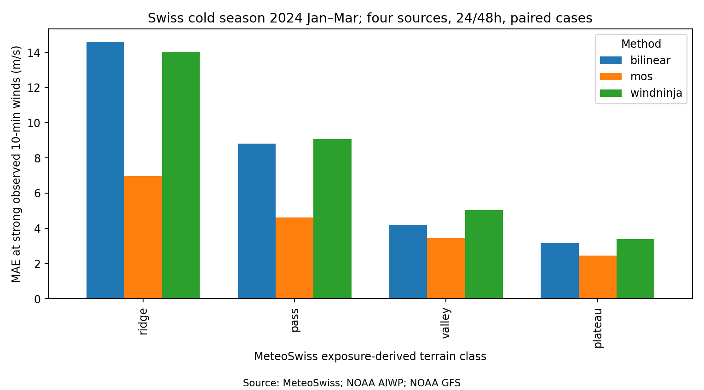
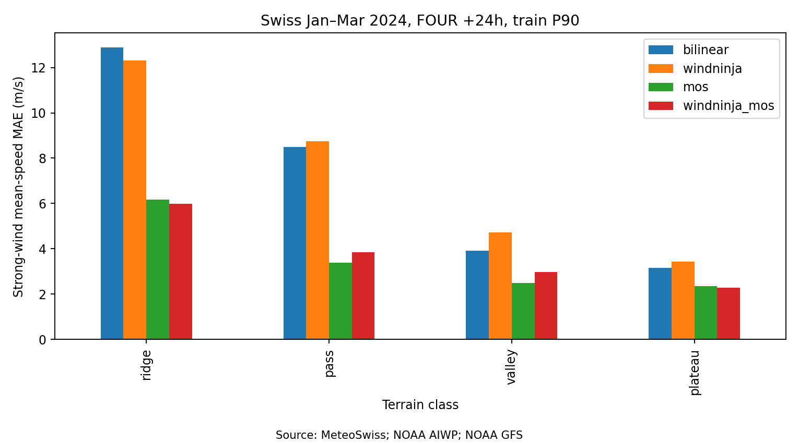

# 复杂地形风预警

**分组**：AI 气象 / 气候大模型与风工程　**状态**：搁置　**时间**：2026-10-14 – 2026-10-14

## 阶段结论（测试性质，非正式结题）

瑞士 12 站：物理降尺度在单站订正外无增量

## 原始任务

## 项目报告

# E 复杂地形风预警

## 目标
判断"AI 中尺度/全球预报 → 地形微尺度降尺度 → 桥址/输电线/山区强风预警"这条链值不值得继续。交付：已有工作与空白 + 开源代码可用性表、一句结论（值得继续/搁置）、一个判据预先写定的最小示范候选（站点、预报源、降尺度方法）。Liang Hu 10-14：须与城市风场分开做，尺度与研究群体不同。

## 当前状态
**搁置**（10-14 21:05）。示范 v2 按冻结判据四条全不过：强风合并 MAE 双线性 6.38、WindNinja 6.70 m/s（−5.1%，3/12 站）；订正后 3.25 对 3.50，无增量；全时次 3.04 对 3.09。0.25° 预报强风系统偏低（−6.4 m/s，山脊站最重，站点比模式地形高 500–830 m），单站 4 扇区 MOS 把误差减半，WindNinja 几乎不起作用。共约 0.42 CU。重启条件见 ：学习型降尺度（FuXi-CFD/DEVINE）先预注册再试；有桥址/输电线数据时改做站点订正 + 阵风；LBM 地形先验只在学习型降尺度有增量后再接；Deep Research 额度恢复后补跑。

## 层级与边界
二级节点：不开三级子项目，细分用任务；派活只到"本节点 → bot → 工具"，任务书不让工具 bot 再。Colab 不设单试验上限（10-14 18:3x 口径更正，原 ≤20/≤10 CU 作废），单试验预计超过 100 CU 先停下报 A 节点；用完必须 stop，同一轮只派一个执行方；超算单作业 ≤50 SU（ComputeOps 申请、 登记、预检与提交分两条命令）；观测只用公开且可再分发的数据；预报源与取数复用 A1 脚本 （AIWP GraphCast/Pangu/FourCastNet v2 含 100 m u/v、GFS），不重写；文献结论 

## 已有工作与空白（Grok 4b1636 + Lead 核对 + 审查 修订；✔=Lead 亲自核过；Deep Research 未做）
| 方法族 | 代表作 | 输入 | 输出 | 阵风/瞬态 | 不确定度 | 实测验证与强风表现 | 开源与许可 |
| --- | --- | --- | --- | --- | --- | --- | --- |
| AI 预报 + 订正 + 地形降尺度（台风） | ACDF，Wu 等 2026，arXiv 2603.12828 ✔摘要 | AI 全球预报（对照 Pangu） | 500 m，浙江 | 否 | — | 11 次台风留一检验，站点 MAE 比 Pangu 降 38.8%；Hagupit 标出后来失效的输电线 | 未找到代码 |
| AI 预报 → WRF 动力降尺度 | Brewer, Fovell & Capps 2025 *WAF* 40:187–206 ✔DOI | GraphCast 0.25° | WRF 公里级 | 部分 | — | Marshall Fire 等下坡风暴，区域最大持续风/阈值评分（审稿人 A 读正文） | WRF 开源 |
| 生成式/扩散先验 | KiloGen，Cai 等 2026，arXiv 2607.21460 ✔ | 25 km ECMWF 业务预报 | 公里级，山西 | 否 | 后验采样 | >20 m/s 风 RMSE 约降 10%，13 次强风事件全胜 0.25° ECMWF ✔ | ✔ cyjsss999/KiloGen，MIT，无权重 |
| 深度学习降尺度（阿尔卑斯） | DEVINE：Le Toumelin 等 2023 *AIES*、2024 *NPG* 31:75–97 ✔DOI；Wind-Topo（Dujardin 2022 QJRMS） | AROME / COSMO-1 | 30–50 m | 否 | 无 | 阿尔卑斯 60 余独立站；2024 文把统计订正与地形降尺度组合 | DEVINE 代码 GitHub（2022 后未更新）；Wind-Topo 在 EnviDat（未核） |
| 物理诊断（质量守恒） | WindNinja：Wagenbrenner 2016 ACP；Seto 等 2025 WAF ✔ | HRRR/NAM 等 | 100–500 m | 否 | 无 | Santa Ana 个例：强风时技巧下降、背风坡峡谷负偏差放大 ✔（单一地区，不推广） | ✔ firelab/windninja，公有领域 |
| CFD/RANS 代理 | FuXi-CFD，Lin 等 2026 *Nat. Commun.* ✔ | **100 m** 风，9×9、1 km | 30 m 三维风 + TKE，27 层 | 否：稳态、中性 | 无 | 欧洲高塔（OPE 等）独立检验，**以 ERA5 驱动**，中强风改进 ✔ | ✔ 官方 Zenodo 10.5281/zenodo.18770845（作者 HF 镜像 linchensen），CC BY-NC 4.0 |
| 中尺度→LES | Liu 2011 JWEIA；HKIA WRF–LES（QXGRWK9H）；香港桥址台风 Lo 2024（未核） | NWP | 10–100 m | 是 | 集合才有 | — | 计算量大 |

**空白（审查后收窄）**：AI 全球预报直接驱动的地形降尺度已有台风（ACDF）与动力 WRF（Brewer）先例；尚未见的是**冷季/非台风复杂地形 + 快速降尺度（质量守恒或 CFD 代理）+ 检验期独立于模型训练 + 与单站统计订正对比**。阵风与工程预警判据仍缺。置信度中等（Grok + 3 位审稿人检索，非穷尽）。

## 最小示范候选 v2（审查 后重新冻结，10-14 15:55；跑前不改）
- **观测**：MeteoSwiss SwissMetNet 开放数据（Source: MeteoSwiss）。8–12 站，跨山脊/山口/谷底/高原；站表在算任何预报误差前冻结（含真实海拔与 0.25° 模式地形高度差）。
- **时段**：2023-10-01 至 2024-03-31；10–12 月为训练期（MOS 拟合、阈值），2024-01 至 03 为检验期。
- **预报源**：主判 FOUR_v200_GFS（有 10 m 与 100 m 风）提前 24 h；GraphCast、Pangu、GFS 与 48 h 只报不判。00/12 UTC 起报，有效时刻 00/12 UTC。
- **观测配对**：有效时刻前后 30 分钟内 6 个 10 分钟平均风的均值；时间戳约定按 MeteoSwiss 元数据核实后写明。
- **方法**：(0) 双线性插值到站（10 m）；(1) **WindNinja（主方法）**：每站约 10 km × 10 km 域、质量守恒求解器、以 (0) 的站点预报风矢量作域平均初始化、SRTM 30 m、网格 100 m、输出 10 m；(2) FuXi-CFD（只报不判）：官方 Zenodo 权重，输入 FOUR/GFS 的 100 m 风插到 9×9、1 km 网格，取最接近测风高度的输出层；GraphCast/Pangu 无 100 m 风，不进 (2)；(3) MOS：每站×源×提前量，4 个风向扇区的线性订正（风速），训练期拟合；(3') WindNinja+MOS：同样订正作用于 (1)。
- **强风时次**：检验期观测 ≥ 该站**训练期**观测 P90；跨站合并，报样本数。
- **主判据（三条全满足 = 值得继续）**：
 1. 强风时次合并 MAE：(1) 比 (0) 降 ≥15%，且 (1) 在 ≥2/3 站上 MAE 低于 (0)
 2. 强风时次合并 MAE：(3') < (3)（地形降尺度在统计订正之外仍有增量）
 3. 护栏：全时次合并 MAE，(1) 不比 (0) 差。
- **只报不判**：其他源/提前量、FuXi-CFD、按地形类别、预报超阈条件下的命中率/误报率（阈值训练期 P99）、各源训练截止日期。
- **结论范围**：只说明所选站点、有效时刻的平均风误差，不代表阵风或工程预警有效。
- **预算**：Colab 不设上限（预计 >100 CU 先报 A 节点），同一轮只一个执行方，用完 stop。

## 参数来源表
| 参数 | 取值 | 来源或"假设" | 查过哪些地方 |
| --- | --- | --- | --- |
| FuXi-CFD 输入 | **100 m** 水平风，9×9、1 km；地形/粗糙度 300×300（30 m） | Nat. Commun. 2026 Methods ✔、官方 HF README ✔（arXiv v1 写 10 m，以期刊版为准） | arXiv v1、第三方仓库、官方 HF |
| FuXi-CFD 适用条件 | 稳态、中性层结 | arXiv v1 HTML ✔ | — |
| WindNinja 配置 | 每站约 10 km 域、质量守恒、站点预报风矢量作域平均初始化、100 m 网格 | **假设**（审查 要求钉死；官方 FAQ 第 18 项区分两种初始化） | WindNinja 官方 FAQ 与求解器说明（审稿人 A 引） |
| 强风时次阈值 | 站点训练期（10–12 月）P90 | **假设**（站间风速气候差异大，固定 m/s 阈值不可比） | 无文献依据，基于本线做法（H 节点同类分位口径） |
| 判据 15% / 2/3 站 | — | **假设**，与 H 节点 r2 判据同量级（本线数据） | — |

## 已定决定
- 2026-10-14 示范 v2 不过，节点搁置 → 
- 2026-10-14 审查 裁决：撤回"无完整先例"，补 Brewer/ACDF；示范判据 v2 → 
- 2026-10-14 值得继续，先做瑞士冷季示范，判据冻结 → 

## 试过与结果
| 日期 | 做了什么 | 结果一句 |
| --- | --- | --- |
| 2026-10-14 | 示范 v2（冻结判据，约 0.30 CU） | **不过**：强风 MAE 双线性 6.38 / WindNinja 6.70 / 双线性+MOS 3.25 / WindNinja+MOS 3.50；全时次 3.04 / 3.09；3/12 站胜；207 条强风、4295 次 WindNinja 全成功 |
| 2026-10-14 | 示范旧版（v1 判据，约 0.12 CU） | 12 站冻结（山脊/山口/谷底/高原各 3）；WindNinja（±0.015° 约 3 km 域）强风 MAE 比插值中位只降 −2.9%（即略差），4/12 站胜，0/12 站不差于 MOS；四个 0.25° 预报源在山脊强风时次系统偏低约 13–15 m/s，MOS 把误差减半；FuXi-CFD 官方权重（Zenodo→HF，SHA256 已记）样例推理通过，未做瑞士站。v1 不作裁决，以 v2 为准 |
| 2026-10-14 | Grok 快查 + 核原文 | 未找到"AI 全球预报→地形降尺度→独立站强风检验"完整先例；WindNinja 强风变差；FuXi-CFD 中性稳态、权重仅见第三方转载（不用，只用官方） |
| 2026-10-14 | 问数字孪生风洞地形 LBM | 未做过，11 月中下旬可接，限中性、单风向、台阶地形 |
| 2026-10-14 | 开工： 查库、Grok 快查发出、问数字孪生风洞 | 库内仅 KiloGen 与 HKIA 两张相关卡 |

## 未决与下一步

- 10-15 02:00 A 节点核对：Colab CPU 会话 m-s-kkb-usc1c0-gx07ji1q0lch（ideas-e-terrain-v2）已不在 `colab sessions` 列表中，无需再停；E 已搁置，不再使用 Colab。
- 搁置中；重启条件见决策记录。冻结站表、观测、取数与 WindNinja 脚本都在，可直接复用。

## 文献依据
- Seto 等 2025, *Weather and Forecasting* 40:525–541（摘要，网页无页码）：WindNinja 强风下技巧下降。
- Lin 等 arXiv 2505.12732v1（HTML，无页码）：FuXi-CFD 输入规格与中性稳态限制。
- Cai 等 arXiv 2607.21460（摘要）：KiloGen 强风改进约 10%。
- （卡片无页码；arXiv 2607.21460v1 摘要）
- 行 170（HKIA 地形风切变 WRF–LES）

## Liang Hu 注

## 结果图

## 目录

- `results/`：结果表与说明
- `reviews/`：多模型审稿人审查后的裁决
- `figures/`：结果图
- `code/`：试验脚本（原样保存，路径已改为相对路径，运行前需按各脚本说明准备数据与环境）
