# 风敏感作业与结构预警

**分组**：AI 气象 / 气候大模型与风工程　**状态**：搁置　**时间**：2026-10-14 – 2026-10-14

## 阶段结论（测试性质，非正式结题）

概率预警的优势来自概率形式，不是 AI 多源

## 原始任务

# 任务书：F 回放示范——超越概率预警 vs 确定性 GFS vs 持续性的经济价值（10-14 18:40 冻结）

工作站 本地 CPU，0 CU，不上 Colab/超算。

## 输入（只读，不重算预报）
- （2022）与 `paired_station_test.csv.gz`（2023）。
- 列：source∈{GRAP_v100_GFS, PANG_v100_GFS, FOUR_v200_GFS, GFS}，lead_h∈{24,48} 有 corrected 与 prob_wind_{6,8,10,12}、prob_gust_{10,13,15}（阵风只有 GOK/OKC/PWA 三站）；观测 metar_speed（2 min 持续风）、minute_gust；基线 persistence、climatology。
- 脚本参照。python 用。

## 要做
1. 预警方案（每个阈值 × 每个时效各算一遍）：
 - P_multi：四源概率等权平均（多源替代集合，写明这是替代，不是真集合）
 - P_stack：只用 2022 拟合的四源 logistic 叠加（可选，若 2022 样本够）
 - 各单源概率
 - 确定性：GFS raw、GFS corrected、GraphCast corrected（预报 ≥ 阈值即停工）
 - 持续性（观测 ≥ 阈值即停工）；气候频率为参考（V=0 的定义基准）。
2. 阈值：持续风 6、8、10、12 m/s；阵风 10、13、15 m/s。（18:30 补：按 CPA 吊装指南换算，持续风 6–8 m/s 约对应汽车吊停吊、8–10 m/s 约对应塔吊停吊，见；6 m/s 档只报告，主判不变。）
3. 经济价值：标准静态成本/损失模型（Richardson 2000 QJRMS 126:649 的相对价值 V，以气候为 0、完美预报为 1）。C/L 从 0.01 到 0.99 全曲线；概率方案对每个 C/L 用 p≥C/L 作停工规则（不对 2023 调最优阈值）。
4. 统计：按验证日整组 bootstrap（1000 次）给 V 的 95% 区间；报各阈值事件数。
5. 也给"每站-时次"之外的一个日尺度版本：每日两个验证时刻任一超阈值即算"当日事件"，停工决策按当日最大概率（只作敏感性）。

## 冻结判据（结果出来前不改）
在 C/L ∈ [0.05, 0.5]（假设区间，出处待查，最终按查到的值读曲线）内：
- 主判：持续风 10 m/s、24 h：P_multi 的平均 V 比"最好的确定性方案"高 ≥0.05，且 bootstrap 区间不跨 0
- 护栏：同一区间内 P_multi 的 V 不低于 GFS 单源概率超过 0.02（检验 AI 多源相对单 GFS 概率有没有增量，单独报告，不作主判）
- 阵风 13 m/s 只报告（三站，样本少）。

## 交付（写到）
（一句结论在首行、主表、判据逐条结果、局限）、。

## 边界
- 文章没写的参数先查后假设：C/L 区间、"日事件"定义都是假设，results.md 里标"假设"。
- 局限要写明：验证时刻只有 00/12 UTC（当地早晚，非作业时段中午）；ASOS 测高未逐站核实；10 m 风不等于吊臂顶风。
- 不委托其他 bot；只此一个执行方。

## 项目报告

# F 风敏感作业与结构预警

## 目标
集合/多源预报给出超越概率 → 吊装、桥梁封闭、施工等风敏感作业与结构的预警决策；判断这条链在经济价值上比确定性预报、持续性好多少。

## 当前状态
**10-14 20:0x 搁置**（3/3 有保留支持；裁决）。
- 冻结主判未过：持续风 10 m/s、24 h、C/L 0.05–0.5（假设），四源概率平均 V 0.266 vs 最佳确定性 0.156，差 0.111，95% CI [−0.006, 0.179]。
- 概率规则相对确定性阈值的优势主要来自概率形式：低 C/L 下纯 GFS 单源概率与四源平均一样好（10 m/s 0.598 vs 0.599）；C/L 0.05–0.5 四源平均只比最好单源（Pangu）高 0.024，12 m/s 档低于 GraphCast 单源。未见 AI 多源特有、稳定的增量。
- 先例：HS2 Align（2021–23）已用全球 NWP + 本地 LSTM 订正支持高架桥吊装决策；Severn 按预期阵风封桥。未找到的只是"AI 全球模型直接驱动"与"实测 C/L"。
- 副产品：阈值与风速定义表（下）；发现确定性线性订正会压平强风，低 C/L 下不如原始 GFS（对 A1 订正设计有提醒）。
- **重启条件**：作业方提供停工成本/损失数据或具体需求；或 A1 补出作业时段（如 18 UTC）验证时刻；或 B 节点真集合（只作重新评估触发）。重读约 10 分钟、0 CU，脚本。

## 作业类 / 判据与出处 / 现有预警做法 / 我们能加什么
| 作业类 | 判据与出处 | 现有预警做法 | 我们能加什么 |
| --- | --- | --- | --- |
| 起重吊装 | 吊臂处 3 s 阵风：塔吊设计上限 20 m/s，英国实际 16.5–17 m/s 停吊；汽车吊平均 9–11 m/s；履带吊 12–16 m/s；载人吊篮 7 m/s（CPA CIG/TCIG 2507，PDF 第 13、20、23、47 页，引 BS EN 13001-2、BS 7121）。换算到 10 m 平均风约为 5–10 m/s（假设，见核对记录）。国标/OSHA 条文待 E/F 核 | 现场风速计实时监测 + 制造商手册阈值；HS2 Align 用 NWP+本地 LSTM 订正支持吊装决策（HS2 Learning Legacy，已核）；用地面预报乘高度阵风系数提前计划（CPA PDF 第 21–22 页）；未见概率超越预警产品（Grok，未找到≠没有） | 回放：概率规则优于确定性阈值，但优势来自概率形式，非 AI 多源（主判未过） |
| 桥梁限行/封闭 | Severn M48：预期阵风 30/35/40/70 kn 分级，40 kn 封桥（National Highways 官网）；Mackinac：持续风 20/35/50/65 mph 分级（官网 FAQ，明确不是阵风）；已核 | Severn 已按**预期阵风**（预报）决定封桥——预报驱动封闭已有先例 | 概率形式 + 成本/损失经济价值评估；无本线回放（缺桥址观测） |
| 高处作业/施工 | OSHA 1926.1431(k)(8)(i)：吊人平台处 >20 mph 由合格人员判断（已核）；国标（二手，原文未核）：GB 55034 "作业场所 5 级以上停止高处作业"；JGJ 80 "6 级以上" | 现场判断为主 | 待定 |

## 边界
- Colab 不设单试验上限（10-14 18:3x 母项目更正，原 ≤20 CU 作废）；单试验预计 >100 CU 先 --report 报 A 节点；用完必须 colab stop；同一轮只派一个执行方。超算单作业 ≤50 SU 不变。

## 已定决定
- 10-14：作业类先选起重吊装；"集合"用四源（GraphCast/Pangu/FCNv2/GFS）概率等权平均替代并写明是替代；回放判据冻结（见任务书）。决策。

## 试过与结果
| 日期 | 做了什么 | 结果一句 |
| --- | --- | --- |
| 10-14 | 回放：OKC 12 站 2023，四源概率平均 vs 确定性 vs 持续性，成本/损失相对价值 V（ideas，0 CU） | **冻结主判未过**：持续风 10 m/s、24 h，C/L 0.05–0.5 内 V 0.266 vs 最佳确定性 0.156，差 0.111，日块 bootstrap 95% CI [−0.006, 0.179] 跨 0（135 个事件）。旁证一致为正：12 个阈值×时效里多源概率点估计全部高于最佳确定性（+0.08–0.22），8 m/s 与阵风 10 m/s 区间不跨 0；多源比单 GFS 概率高 0.108 [0.036, 0.226]；持续性 V 全为负。Lead 独立复算主判两个 V，一致。补报 6 m/s（约对应汽车吊停吊，只报告）：24 h V 0.492 vs 0.320，差 0.171 [0.119, 0.214]；48 h 差 0.175 [0.122, 0.214]（Lead 复算一致；若确定性方案也纳入 Pangu/FCNv2 订正值，6 m/s 最佳确定性为 Pangu 0.329、差约 0.163，10 m/s 主判的最佳确定性仍是 GFS 0.156，不变） |

## 参数来源表
| 参数 | 取值 | 来源或"假设" | 查过哪些地方 |
| --- | --- | --- | --- |
| 吊装停吊风速（吊臂处 3 s 阵风） | 塔吊 16.5–17 m/s（设计 20）；汽车吊 9–11；履带吊 12–16；载人 7 | CPA CIG/TCIG 2507（2025）PDF 第 13/20/23/47 页 | 、 pages（无）；Grok；CPA 原文 |
| 10 m 平均风→吊臂阵风系数 | 1.65（50 m）–1.86（150 m）；阵风→阵风 1.18–1.33 | CPA PDF 第 21–22 页（Liebherr 表，乡村粗糙度） | 同上 |
| 回放阈值档 | 持续风 8/10/12 m/s、阵风 10/13/15 m/s | 假设：沿用 A1 档，按上面系数大致对应塔吊/汽车吊停吊 | — |
| 成本/损失比 C/L | 0.05–0.5（冻结判据）；敏感性 0.01–0.10 | 假设。E 报海上作业典型 0.1（Carrasco 2013，经 SECLI-FIRM 2021 幻灯片转引），链接 404 未核；E 由日停工成本/事故损失粗推 0.01–0.10，L 未乘事故概率，偏低。F 找不到 | 、Grok、审稿人 E/F |
| 国内吊装阈值 | 安拆最高处 >9.0 m/s（GB 55034 §3.4.7）；塔机作业 ≥12 m/s（JGJ 196 §4.0.9，条文未定义平均时长/高度；审稿人 A 称核到原文）；吊装"六级以上"（JGJ 276 §3.0.14；"10 m、10 min 平均"是风级定义外推，非条文） | E、F 两边一致，但均为二手（JGJ 33 第 4.1.14/4.1.15 条、JGJ 196 第 4.0.9 条、GB 55034 第 3.4.7 条），原文未核 | E/F |
| 相对经济价值 V 定义 | 静态成本/损失模型，V={min(o,r)−(h+f)r−m}/{min(o,r)−o·r}，r=C/L，气候=0、完美=1 | Zhu 等 2002 BAMS 期刊 p. 75（PDF 第 3 页）式 5–7，卡；回放实现（不可防护损失=0）与此一致，Lead 已核 | litwiki 建卡 |
| 日事件定义 | 每日 00/12 UTC 任一超阈值 | 假设（仅敏感性） | — |

## 未决与下一步
- Grok 已回并核原文。等 E/F 回来：核原文，填作业阈值与 C/L，把判断表写实；文献结论送 
- 已搁置，无在跑任务。Deep Research 额度恢复后可补查"AI 全球模型用于作业停工决策"先例（低优先级）。
- 待核（仅供参考）：Glasgow S2S 吊车租用 cost-loss 研究（eprints.gla.ac.uk/320158）；JGJ/GB 条文原文。"值得继续 / 搁置"待 E/F 条文回来后，把文献结论与回放读法一起送 再定；Lead 倾向：不宣称经济价值，按搁置处理并写重启条件（真实 C/L、作业时段验证时刻、真集合）。
- 局限先记：A1 的 24/48 h 验证时刻只有 00/12 UTC（当地早晚）；10 m 风≠吊臂顶风。

## 文献依据
- CPA CIG/TCIG 2507（2025）吊装风速指南，原文存。
- Browell 等 2016 ESREL：成本/损失 + logistic 概率决策（海上风电运维），方法先例。
- 相对经济价值 V：Zhu 等 2002 BAMS（期刊 p. 75，式 5–7）；Richardson 2000 QJRMS（作者预刊稿 PDF 第 4 页式 3，期刊页未核）；Murphy 1977 MWR（期刊 p. 808 式 11）。卡片索引。

## Liang Hu 注

## 结果图

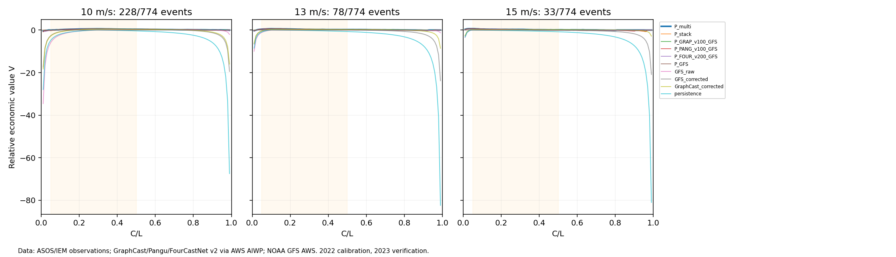
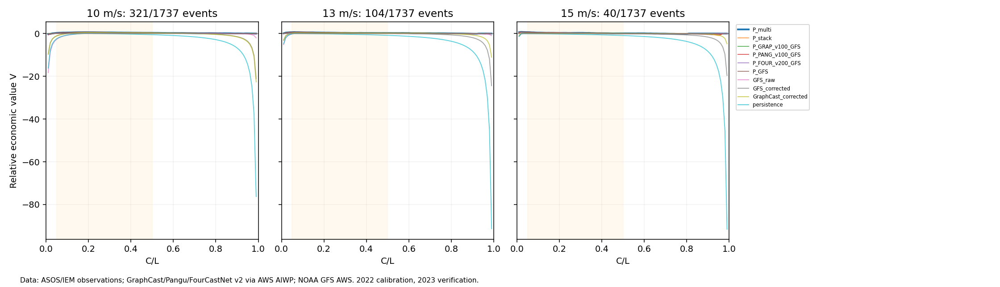
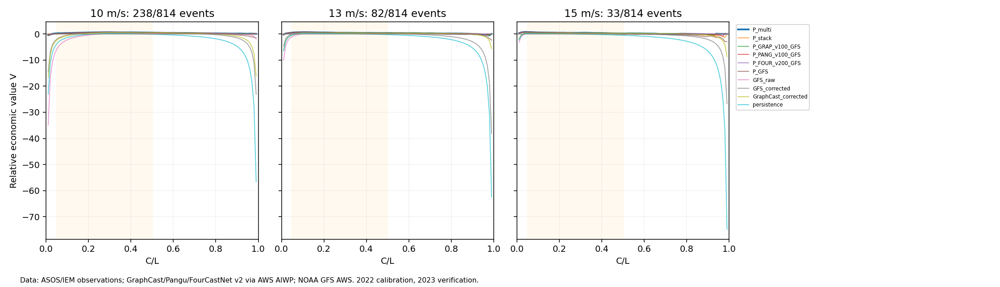
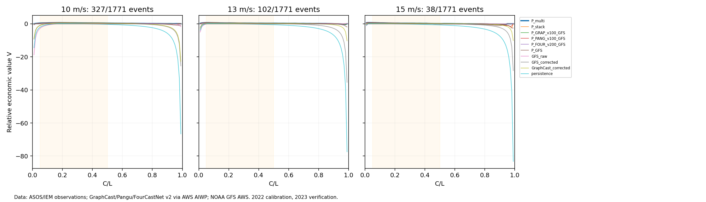
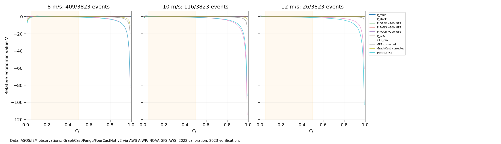
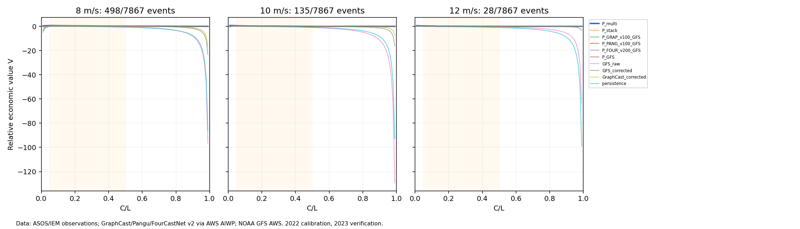
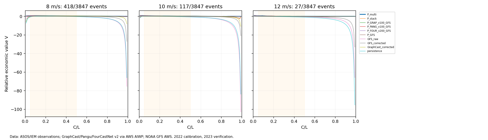
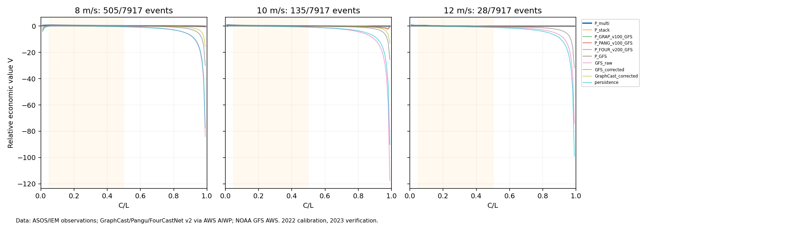
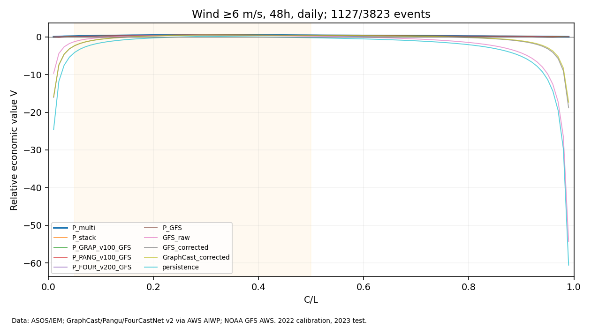
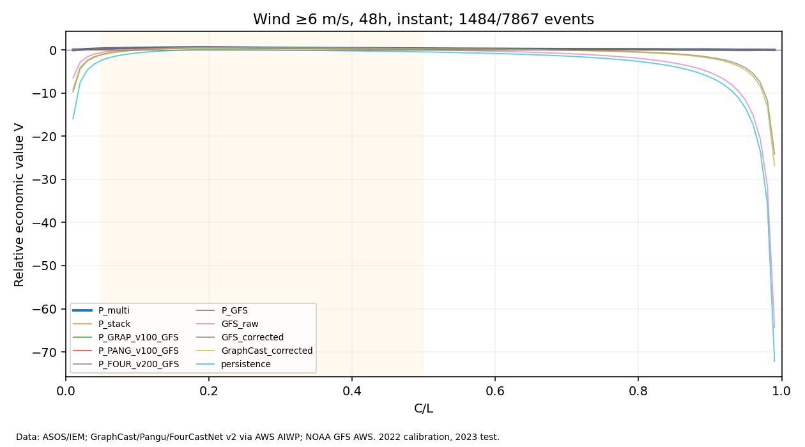

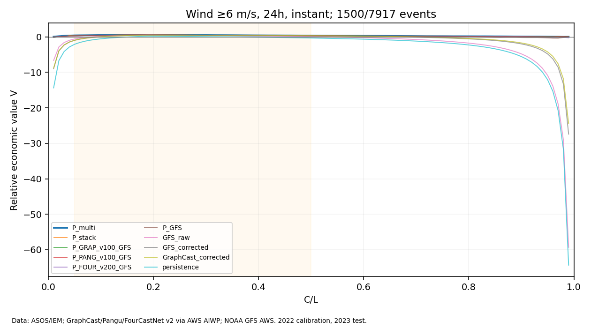

## 目录

- `results/`：结果表与说明
- `reviews/`：多模型审稿人审查后的裁决
- `figures/`：结果图
- `code/`：试验脚本（原样保存，路径已改为相对路径，运行前需按各脚本说明准备数据与环境）
