# 文献库全文检索 + 风工程数据抽取

**分组**：实验室（试验场）　**状态**：已转正　**时间**：2026-10-13 – 2026-10-16

## 阶段结论（测试性质，非正式结题）

10-14 已转正为平台工具 pages：验收五组全过线，二期非首页事实题 22/27 到页；三期盲测 10-14：到页 21/30（中文 9/10、中译英 8/10、书 4/7、扫描书 0/3），书籍偏弱经平台 0062 改进后 round3 书籍到页 4/10→7/10（达标）、round4 8/12 不变；台式机 I 盘已连通并清点：净新增约 1.25 万 PDF/42 万页，第一阶段已抽 28.9 万页有文字页（工作站 1.8 GB）；台式机 41.9 万页重抽版已交、0069 10-15 14:1x 放行入库；10-15 全部推进：剩余 10.5 万页 OCR 10-16 02:38 完成（105,336 页，已交 0069）、三库元数据与作品去重、djvu/pdg 书 31,365 页已交平台（472 页超星格式未解）、litwiki/knowledge 试用已回；入库等 0051 与 C 盘处理。10-13 结论：只做检索。两库 4,691 PDF/12.9 万页本地按页索引；非首页事实题前 5 精确到页约一半（英文 8/14、中文原文 5/5、中文问英文译问题后 3/5、书 4/6）， 论文级 1/27；平台已接入（三期，一期本周内），原型冻结作对照；` pages` 一期已上线（10-13 22:40 实测）；扫描件 OCR 79 份/5,422 页已交二期。廓线抽取搁置（单页文本 6/78 错、27/78 需限定，图页常定位错）；0 CU；另一台电脑上的书待 Liang Hu 给信息

## 原始任务

# 任务书：文献库全文检索 + 风工程数据抽取（实验室新想法，10-13 Liang Hu 批准开立）

## 要回答的问题
Liang Hu 多年积累的论文库（Zotero，3,163 个 PDF，17.7 GB，其中 2,422 个已有 Zotero 自带的全文文本缓存 `.zotero-ft-cache`）和书籍库（位置待 Liang Hu 告知）怎么用最值。10-13 判断：**不拿来微调大模型**（语料约千万–亿 token 级，对继续预训练太小；注入知识检索优于微调；微调后无法给出处；版权风险——依据审查 裁决第 4 条）。改为试两件事：
1. **全文检索**：全库切段建索引，接到 或做一个同用法的命令，问答时能引"哪篇、第几页"原文。
2. **数据抽取**：挑一种风工程数据（建议下击暴流风速竖向廓线，或高层建筑风压系数/阵风因子），从几十篇论文里抽成带来源与页码的表，抽样核原页，算准确率和人工核对工作量。

## 不需要本地大模型
检索只需要一个小的文本向量模型（CPU 可跑）或关键词检索；抽取默认走 Gemini 3.8 Flash 批量通道，每批抽 10% 由 Claude 复核（本线 10-13 试行规定）。本地 Qwen 只在遇到不宜外传的材料时才考虑。

## 判据（事先写定）
- 检索：准备 ≥30 个有标准答案的问题（答案页码已知），前 5 条结果里命中正确段落的比例；与现有 （只覆盖已建卡文献）对比。
- 抽取：逐值对原页核对的准确率；每篇平均人工核对时间；与文献已发表数据集（如有）对照。

## 边界
- C 盘只剩约 51 GB：索引与中间文件放 WSL 本地（706 GB 空），不往 本地盘 写大文件；试验产物（小文件、脚本、结果 md）写。
- Zotero 库只读，不改 zotero.sqlite、不动 storage。
- 不把书籍全文发往外部服务；论文送 Gemini 抽取只送需要的页。
- 总花费 ≤10 CU（如需 Colab）；不改平台 本体——若要接入，写方案交平台 Lead。
- 新用到的外部工具/模型写进。

## 交付
项目页判断表（环节 / 可行 / 质量 / 成本 / 问题）、检索命中率、抽取准确率与样表、一句结论：值得做成正式工具/数据集 / 只做检索 / 不值得。

## 项目报告

# 文献库全文检索 + 风工程数据抽取

## 目标
回答"Liang Hu 的论文库/书籍库怎么用最值"。不微调大模型；试 (1) 全库全文检索、可引页码；(2) 从论文中抽一类风工程数据成表。任务书。

## 当前状态
10-13 Liang Hu 批准开立（由 Strata 节点讨论引出）。10-13 18:20 最小试验已派 ideas（任务书副本）：A 全库按页建 BM25+小向量混合索引，≥30 题事先定判据（前 5 条命中正确论文+页 ±1），与 对比；B 30–40 篇下击暴流竖向廓线（z_max、U_max、廓线模型参数、r/D、页码图号）走 抽取，≥60 值核原页算准确率与核对工时。下击暴流选文参考风场线清单（windfield_step2，约 120 篇，只读）。已知：Zotero 3,163 PDF / 17.7 GB，2,422 个已有全文文本缓存；现有 只覆盖已建卡文献，未见全库全文索引。书籍：10-13 Lead 在 工作站 上找到两处——Zotero 内 87 本书 + 32 章节 + 60 篇学位论文；EndNote 博士文献库 （1,527 PDF / 6.7 GB，含 Kaimal & Finnigan、Naudascher 等书及中文文献），已纳入范围（补充，排在 之后进同一执行）；可能还有书在别处，待 Liang Hu 告知。

## 语料清单（10-13 ideas 盘点， +）
| PDF 附件 | 库内去重后候选 | 大小 | 有文本层 / 整件无文本 / 抽取失败 | 语言（前 5 页启发式：英/中/混/未知） | 类型 |
| --- | --- | --- | --- | --- | --- |
| 3,164 | 2,592 | 16.5 GiB | 3,061 / 83 / 20 | 2,959 / 2 / 95 / 108 | 书 73、书章 26、学位论文 50、期刊 2,870、其他 145（按附件；条目口径为 87/32/60） |
| 1,527 | 1,348 | 6.2 GiB | 1,440 / 76 / 11 | 1,402 / 0 / 35 / 90 | 1,517 未分类（.enl 元数据未解码；≥150 页长文档 56 个） |
| 4,691 | 约 3,845 候选作品簇（跨库同名簇 95，非精确） | 22.8 GiB | 已索引 128,708 页；整件无文本 159 件 / 10,553 页（不等于扫描件数） | 有文本层的中文文献极少：中文书多半是扫描件，待 OCR 抽样 | — |
| Literature 12,933 + Book 1,060 可读 PDF（另 132 件打不开）；字节去重后与两库仅重 53 件 → 净新增约 12,497 件 / 42.1 万页（现有两库的约 3 倍多）；.djvu 62 本约 3.0 万页；超星 .pdg 11 本约 3,163 页 | 去重净 15.9 GiB | 抽样估约 12.7 万页无文字层需 OCR（Book 中文名约 90% 是扫描件），工作站 10 线程估 80+ 小时 | 抽样中 124/英文或混合 406/未知 138（668 份） | 字节去重低估重复（同作品不同版本认不出）；PhDBackup 与 EndNote 博士库字节不同 |

## 已定决定
- 不做微调，检索优先（审查 裁决第 4 条）。
- 不需要本地大模型：检索用小向量模型/关键词，抽取走 Gemini 批量通道。

## 试过与结果
| 日期 | 做了什么 | 结果一句 |
| --- | --- | --- |
| 10-13 | 补充（ideas）：EndNote 库 + 库内书籍增量入索引，中文 CJK 三元索引 + 小术语表；新增 6 道书籍内页题 | 英文首页题扩库后不变（混合 27/34）。书籍 6 题只中 1 页：英文书题 1/3（B02 中，B05/B06 未中），中文问英文书 0/2，中文问中文书 B04 只中书未中页；原 34 道中文问英文论文 0–2/34。Lead 复核：失败主要是**跨语言**和**只靠关键词召回**（向量模型只在关键词前 60 页里重排、且只懂英文），以及两库同一本书重复占前 5 |
| 10-13 | 第二轮（ideas）：30 道非首页事实题（3 道题本身有误作废，有效 27），前 5 按标题+页去重；抽取 AI 逐页复核 78 值；8 篇校正图页送 Gemini 看图读数 | 检索（前 5 论文+页）：英文事实 8/14（找到论文 10–11/14）；中文原文 5/5（三元索引）；中文问英文 0/5，只译问题后 3/5；书籍 4/6（实体书 2–3/4）； 论文级 1/27。抽取：78 值中 45 同页文字支持、27 需限定工况/定义、6 错；8 篇中 5 篇目标图其实在别的页；图读 AI 与 Gemini 5 篇粗略一致，误差无人工真值未评估。Lead 抽核 5 道题标准答案（R01/R07/R13/R21/R27）均在原页 |
| 10-13 | 扫描件 OCR（ideas）：159 件无文字层 PDF 本机 Tesseract，去重后 79 份 / 5,422 页，22:00–22:35 完成，0 CU | 5,407 页有文本；20 页文本抽查 8 页有专名/数字错、8 页公式失真；Lead 对照 Wilcox PDF 第 40 页原图：正文基本正确、公式乱。可做关键词召回，不能直接引公式/数值。已交平台 0034 二期入库 |
| 10-14 | 平台验收（0034 一期 10-13 22:03 / 0038 二期 10-14 01:58，逐题文件） | 一期五组全过线：首页 29/34、英文事实 6/11（有效题口径，原型 5/11）、中文原文 5/5、书籍 5/6、中文问英文 3/5；二期 round2 有效 27 题 22/27（目标 20）、英文事实 9/11、34 道中文问英文首页题 31/34 到页、跨库重复已合并。弱项：第一轮 6 道书籍补题两期都只 2/6 到页。Lead 已核 SHA 前缀与 R13–R16 逐题 |
| 10-14 | 三期盲测（ideas，30 题冻结 SHA，题目不给平台）， pages 一次调用/题 | 到页 21/30、作品 25/30：中文原文 9/10、中文问英文 8/10、有文字层的书 4/7、扫描书 0/3（作品 2/3）。书籍内页普遍偏弱（与一二期书籍补题 2/6 一致）；发现元数据错挂：《热带气旋动力学引论》OCR 结果显示为 1949 年论文标题（Lead 已在原始输出核实）。聚合结果已交平台三期单列改进 |
| 10-14 | 台式机第一阶段（ideas）：12,497 个净新增 PDF 在台式机远端抽文本，经 SSH 传回 工作站，PDF 不落盘 | 成功 12,489 件 / 418,747 页，其中有文字 288,794 页、无文字 129,953 页（第二阶段 OCR），8 件分页异常（2,276 页）待诊断；工作站 实占 1.8 GB（小文件块开销），C 盘 52 GB。Lead 抽 2 页回原 PDF 重抽，内容一致 |
| 10-15 | 台式机第二阶段收尾（ideas）：OCR 停在 24,615 页（全是 Book/中文；10-14 20:46 因 C 盘<40 GB 自停）；导出打包清单；补 2 件异常 PDF | SQLite 418,861 页记录 / 12,491 件可入库（文字层 394,132 + OCR 24,615）；剩 105,338 页未 OCR（Book 其他目录约 2.7 万、Literature 约 6.9 万）、6 件损坏 PDF 2,162 页；20 页抽查：公式/数值/专名常错。已交平台入库 |
| 10-15 | 平台 0062 上线后复跑两套盲测（ideas， pages） | round3：到页 21→24/30，书籍 4/10→7/10（达三期目标），中文持平；round4（12 道书题）8/12 不变。剩余失败主要是整本书没被召回，书一召回基本就到页；聚合结果已交平台 |
| 10-15 | knowledge bot 试用 pages 复查 10 张知识卡出处 | 2 张命中原文页、2 张命中相关文献、6 张未检到。Lead 核 Zotero：未检到的 6 篇中 5 篇不在库里、1 篇有条目无 PDF（YY6ZFJJC）→ 检索本身没失手，缺口是"用户分不清没检到与库里没有"，已建议平台加提示。bot 反馈：准确英文题名 + 具体数值/方法提问最好用；宽泛中文主题或只给 DOI 会被相近文献占位 |
| 10-15 | LitWiki 试用 pages 复查 10 条已核页码的引文 | 首问 5/10 命中目标页，换问法后 7/10；失败都是"论文已知、要在其中找某页"时被同系列别篇或参考文献页占位。LitWiki 建议接入建卡流程作候选页定位，核引文仍须开原 PDF；已向平台建议加 限定作品内检索、精确题名加权、推算期刊页醒目标注 |
| 10-15 | 书目元数据第一轮（ideas，metadata/）：EndNote .enl 解出 1,373 条、安全关联附件 1,122/1,527；台式机 12,491 件题名全部低置信（7,092 来自文件名、5,399 来自首页启发式，socket 过期未读 PDF Info）；三库候选作品簇 15,009 | 30 条抽查可用率 23/30：EndNote 9/10、台式机 5/10、跨库簇 9/10。只能作候选关联，不能当正式书目；台式机与两库同 DOI/同指纹的只有 34 件（去重仍是保守下界）。第二轮：A Crossref 核 912 个 DOI 候选回填题名（已派）；B 等重抽单导出 pdf_meta.jsonl 后补 PDF Info 题名/作者再聚类 |
| 10-15 | .djvu/.pdg 转文本（ideas，台式机 ~/ftkb_djvu/，14:25 完成） | 无 sudo 改 `apt download` 解包 tesseract 4 + djvulibre 到用户目录（可行，其他单复用）。交付 djvu_pdg.sqlite：73 个文档 / 31,365 页（DjVu 61 本 28,391 页 + Melenk 恢复 282/283；超星 PDG 11 套 2,692/3,163 页），有文本 31,140（文字层 24,637 + OCR 6,728）；472 个失败页位（PDG 0x38 变换 398、附加图层 72，集中在《风工程导论》《钢桥》）等更完整解码器；10 页抽查文本正常。Lead 核 工作站 文件 sha256 与页数一致；已交平台 0069 追加 |
| 10-15 | 台式机 OCR 第三阶段（ideas，~/ftkb_ocr/，10:29 起后台 PID 63579，6 线程） | 复用 pkg 里解包的 Tesseract；200 页试跑 36 秒（约 5.5 页/秒，195 页有文本）→ 105,338 页外推约 5.3 小时，预计 10-15 下午至晚间完成；损坏 PDF 用 pypdf 修副本另行处理中。完成后 ocr_round2.sqlite 回 工作站、导 manifest，再交 0069 |
| 10-15 | 台式机文本重抽（ideas，~/ftkb_text/，10:47 起 6 进程，PyMuPDF blocks 按左右栏排序） | 目标 12,437 件 / 394,246 页，OCR 页原样带入；10:49 约 22 页/秒；**13:2x 已完成**（12,436 件 ok、1 件 error，394,243 文字层页 + 24,615 OCR 页），收尾交付与书目 B 已派；OCR 单因并行放慢到约 3 页/秒 → 约 10 小时（预计今晚）。台式机负载约 14（24 核），仍有余量。完成后交 50 页双栏对照、manifest、回 工作站 |
| 10-15 | 书目第二轮 A（ideas，Crossref 只送 DOI 字符串）：1,942 个独立 DOI 候选（台式机 912、EndNote 1,070） | 1,178 条来源记录与 Crossref 题名一致（≥0.82 相似度）→ 回填高置信题名/第一作者/年份到 *_v2.csv；258 条疑似误抓（DOI 能解析但题名不符）；22 条不存在；522 条 DOI 含 OCR 乱字（如"共/兲"）判"未核实"（勘误：首版误记为不存在）。**与 Zotero 同 DOI 的来源记录 1,065 条**（字节去重只认出 34 件）→ 跨库真实重复远多于此前估计，作品级合并要靠 DOI/题名。7 条题名一致但年份差>1 年待人工看 |
| 10-15 | 重抽收尾 + 书目第二轮 B（ideas） | v2 已回 工作站（895 MB，418,858 页，sha256 两端一致；1 件 PDF 只开得出 2 页列异常）；50 页双栏抽样中 17 页能确认左栏句子连续、其余需人工看。书目：台式机 12,491 件题名置信五级 138/1,256/989/8,540/1,568；522 个乱字 DOI 一个都没能安全修复；候选作品簇 15,159：只台式机 12,272、只 Zotero 1,538、EndNote+Zotero 1,065（EndNote 约 70% 与 Zotero 重合）、只 EndNote 278、台式机与 Zotero 重合仅 6 簇（Lead 复算，CSV 含 NUL 已让清）；30 条抽查 24/30（Crossref 10/10、PDF Info 6/10、EndNote 8/10）。已连同 v2 交平台 0069 |
| 10-16 | 台式机 OCR 第三阶段完成（ideas；10-15 23:3x 台式机 WSL 根分区 emergency 只读中断，Liang Hu 重启后 10-16 00:49 续跑，02:38 交付） | 105,336/105,338 页（有文本 103,456、空 1,880），2 页渲染超时、6 件损坏 PDF 未入；ocr_round2.sqlite 256 MB 两端 sha256 一致、integrity ok（Lead 复核）；20 页抽查可辨但中文字形/公式/表格错误常见。已交平台 0069 追加。**台式机语料至此交齐 ≈55.6 万页** |

## 未决与下一步
- **10-16 02:45 状态**：台式机三个来源（v2、djvu_pdg、ocr_round2）全部交平台 0069；等入库上线 → round5 盲测 30 题 + round3/round4 纵向对照。剩余未解：PDG 472 页（解码器）、6 件损坏 PDF、2 页超时。
- **10-15 09:05 Liang Hu："I 盘其他目录暂不管，别的全部推进"**。已派（写入范围互不重叠）：① ideas 台式机 WSL 就地 OCR 剩余 105,338 页（台式机 24 核/46 GB/盘 664 GB 空闲；无 sudo，改 micromamba+conda-forge 免 root 装 tesseract 等；首派因 socket 过期未开始，09:20 重建 socket（3 天）后重派；输出 ~/ftkb_ocr/ → 工作站 ocr_round2.sqlite）；② 书目元数据第一轮已交（候选级）；第二轮 A 已交（1,178 条高置信回填；与 Zotero 同 DOI 1,065 条）；B 已交（见试过与结果）；v2 + 书目表 10-15 14:05 交平台，**0069 14:1x 放行入库**（新约束：新增 ≤8 GB、C 盘 <85 GB 停；虚拟盘内部尚有 117 GB 空闲）；旧 page_text.sqlite 与旧 manifest 已删（14:20）；ocr_round2、djvu_pdg 交来后同工单追加；round5 台式机来源盲测 30 题已冻结（SHA；Book 10 / 论文 10 / 中文 5 / OCR 5），OCR 5 题 Lead 已目视原页核实，等 0069 上线跑分；③ .djvu/.pdg 单 14:25 已交付并交平台 0069；OCR 第三阶段 10:29 起在台式机全量运行，**23:3x 做到 102,850/105,338 页时台式机 WSL 根分区进入 emergency 只读（ext4 报错自动 remount-ro），进程退出**；已把 SQLite 备份到 工作站 ftkb_desktop/ocr_round2_partial/（102,850 页，integrity ok）；Liang Hu 重启后 10-16 00:49 续跑、02:38 完成并交付（见试过与结果）；工作站 上的临时备份 ocr_round2_partial 已删；重抽单 10:47 起也在台式机跑（约 5 小时）；ideas 自约回访 13:20、14:29；兜底回访 10-16 08:2x；④ 平台 0069 答复（10-15）：线上两库已按文本块排序无串行；台式机 page_text.sqlite 是 -layout 抽的须重抽，0069 只收重抽版 → 已派 ideas 在台式机用 PyMuPDF blocks 重抽交 page_text_v2.sqlite（加 extractor 列）；0069 预留 work_id 合并与标题/作者/年份显示、多来源 SQLite 增量追加（主键 sha256+物理页，后到来源只补空页/替换 OCR 页）。开工条件：C 盘 ≥100 GB + 重抽版交付；⑤ litwiki、knowledge 试用已回（见试过与结果 10-15 两行）：检索本身未失手，两处改进建议（库内无/无 PDF 提示；--key/--doi 作品内检索）已交平台排 0069 后；⑥ 已问平台增量索引与调用量。暂不动：I 盘其他目录；下击暴流抽取仍搁置。
- 10-14 14:20 第二阶段已派 ideas：本机 OCR 129,953 页（先 Book 中文/风工程/规范等），实测 6 线程约 1 页/秒（中文识别慢），全量约 1.5 天；10-14 20:46 因 C 盘低于 40 GB 按规矩自动停下，已识别 24,615 页（24,360 页有文字），剩约 10.5 万页；C 盘 22:24 剩 24 GB（增长来自 .hermes、/tmp 等，非实验室），已紧急报平台，C 盘恢复到 40 GB 以上前不重启；10-15 00:53 复核：A3 进程已全部不在、目录稳定 11 GB、C 盘回升到 21 GB。**按 10-14 Liang Hu 新规（工作站 不跑计算、不存计算数据），剩余约 10.5 万页 OCR 重启前要另定地点**（工作站 本机需报平台；书籍不能上 Colab；CRC 组空间约 95% 满），C 盘恢复后再定（10-15 02:32 C 盘 46 GB）；建议方案：在台式机 WSL 上就地 OCR（数据在那，不用传输、不占 工作站），需 Liang Hu 同意在台式机装 Tesseract；10-15 02:45 第二阶段阶段性成果（41.9 万页）已交平台，入库（等虚拟盘压缩、C 盘回到 100 GB 以上再派）；平台 0062 书籍改进 10-15 02:09 上线，复跑结果平台已接受（三期目标达到）；长书作品级召回改进并入 0069（书按章节/页组二级索引、术语向书籍加权、平台自建 ≥20 道整本未召回题），0069 等 C 盘回到 100 GB 以上开工，上线后实验室用 、 做纵向对照；剩余 10.5 万页 OCR 等 Liang Hu 是否同意在台式机装 Tesseract；第一阶段 41.9 万页已打包进 1,003 页逐字核对无误）；8 件异常中 2 件可补页码，FE-Handbook 等损坏；.djvu/.pdg 在 工作站 不装软件转不了，暂缓；工作站 新增合计 ≤4 GB；顺带诊断 8 件异常 PDF、评估 .djvu/.pdg。完成后 manifest 交平台，平台等 0051 与 C 盘处理后入库。
- **10-14 已转正**：检索做成平台工具 ` pages`（ 一期、0038 二期），所有 Lead/bot 可用。英文事实口径定为有效 11 题（我原写的 ≥8/14 是把原始 14 题原型值误标为有效题口径）。
- 三期盲测已交平台（10-14 10:15）：中文可用，书籍内页偏弱、OCR 书错挂书名，平台开 单列改进（长书书内找页+OCR 噪声补偿、错挂书名修正、跨库同作判定、中文翻译双路兜底）；上线后平台先用一二期题库回归，再通知实验室用同一套盲测题复跑交逐题结果；目标书籍到页明显高于 4/10，中文原文 ≥9/10、中文问英文 ≥8/10。原计划：实验室持有盲测题（ideas 出题跑分，10-15 前交平台 Lead），题目不给平台，并入平台约 10-20 的三期验收；重点看书籍内页是否普遍偏弱，若是平台三期单列改进。平台 10-14 已在 0034 登记一期转正。之后 原型可解冻。
- **结论（10-13 20:55）：只做检索。** 检索部分 status 待转正：形态是平台工具，不是科研项目，方案 已交平台 Lead，由平台排期；实验室提供原型与回归题库。
- **数据抽取部分搁置**：为什么不行——廓线大多在图上、每个值都要配对图号/径向位置/工况，单页文本抽取 6/78 错、27/78 要加限定，5/8 篇连图页都定位错；目前需要专家逐篇读图，自动化省不了多少工。缺什么：可靠的读图（带曲线归属）与人工真值。何时重启：有明确用途的数据集需求（例如某条线要下击暴流廓线对照库）且能接受"AI 初抽 + 专家逐篇核对"的工时；或多模态读图模型在 ≥10 篇人工真值上误差可接受。
- OCR 已完成并交平台 0034 二期（见上表）。10-13 22:40 实测 0034 一期已上线 ` pages`：中译英生效，但跨库同书重复占前 5——平台确认一期去重未生效（EndNote 标题是截断文件名），二期解析 EndNote 元数据 + DOI/文件哈希/首页指纹去重，OCR 页入库并标"OCR 文本，引用前核原页"；QuikSCAT 查询列为回归用例。等平台交一期验收逐题结果与二期验收结果。
- 10-14 已连通台式机 WSL（Tailscale SSH，用户 [用户]，用 IP 连；known_hosts 里主机名那条是过期记录，现主机密钥与 Tailscale 登记一致），清点完成（见语料表）；10-14 第一阶段已派 ideas：有文字层页按页抽文本到 PDF，工作站 新增 ≤4 GB；OCR/.pdg/.djvu 放第二阶段。**存储更正**：WSL 盘是 C 盘上的 vhdx（355 GB），WSL 显示的空闲是假的，真实上限是 C 盘剩余（10-14 47 GB）；已报平台。平台回复（10-14）：台式机文本入库排在 0051 之后，且等 C 盘问题解决（42 万页索引预计 4–6 GB）；结果标"来源：台式机"、显示 I:\ 原路径；实验室交 manifest 后平台开入库工单。C 盘回收需压缩虚拟盘、全平台停 10–30 分钟，已列入平台待 Liang Hu 决定清单第 11 项。此前：工作站 无 I 盘；desktop-re1s1os（Windows，Tailscale 在线）SSH 拒绝 工作站 密钥、SMB 未共享；台式机 报主机密钥变更，已停未绕过。已请 Liang Hu 加 工作站 公钥或开只读共享；能访问后先只做清点，不拷贝。
- 等 Liang Hu 告知另一台电脑上书和论文的位置、数量、是否扫描件；>5 GB 的拷贝目的地由 Liang Hu 定（倾向 WSL 本地盘）。
- 10-13 平台 Lead 决定接入：，分三期，一期本周内。实验室承诺： 与 脚本、题库在一期验收前不动（已告知 ideas）；回归题库与分数线已回平台（底线不低于原型：首页 ≥29/34；round2 分组 英文 ≥8/14、中文 5/5、书 ≥4/6、中译英 ≥3/5；目标 round2 合计 ≥20/27）。平台已把五份题库与分数线写进 0034（10-13）。等 0034 一期验收结果，验收通过后本页改 已转正 并链接 0034；兜底回访约 10-16 晚。

## 文献依据
- 审查裁决 （Ovadia：无监督微调不如检索；Balaguer：有监督微调 +6 pp）。

## Liang Hu 注
- 10-13："这个不需要本地大模型，对吧" —— 对。
- 10-16 02:4x OCR 第三阶段（台式机 12,491 件中的扫描页）完成： 105,336 页、1,713 件、2 条渲染超时页排除（FORTRAN90 手册），integrity ok，sha256 …；过程中台式机根盘只读故障、本地盘（9p）上的 SQLite 副本损坏（教训：Windows 盘不跑 SQLite 写入），见。交平台 0069 入库。

## 结果图

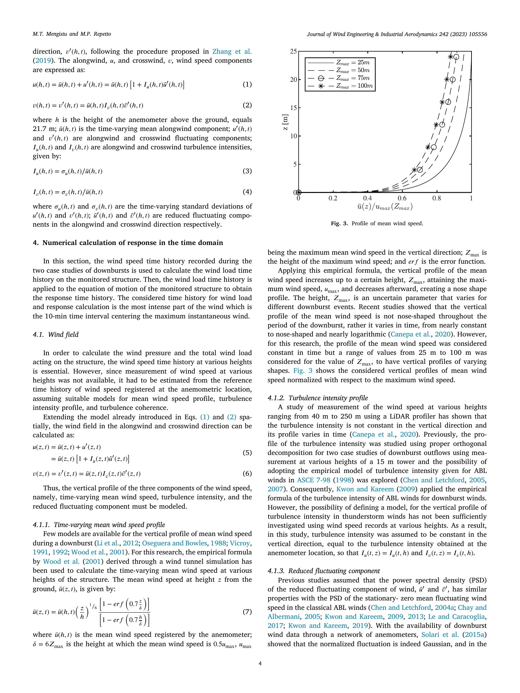
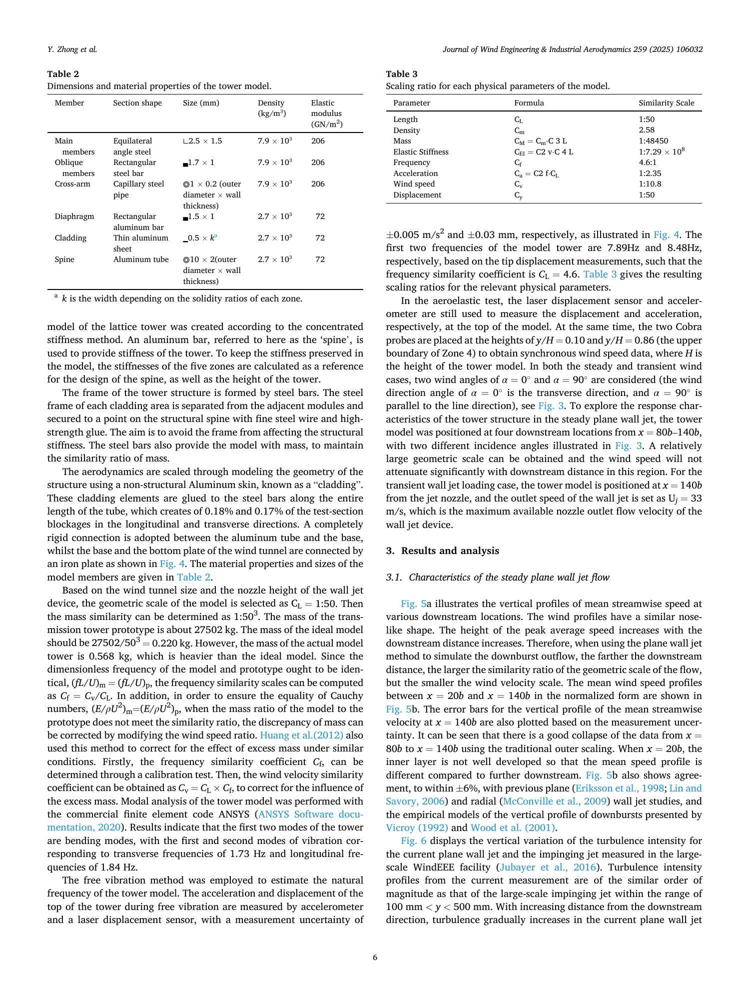
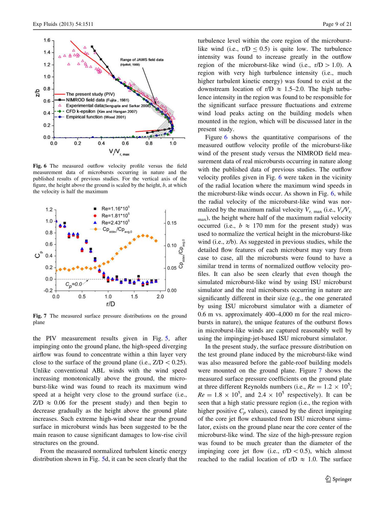
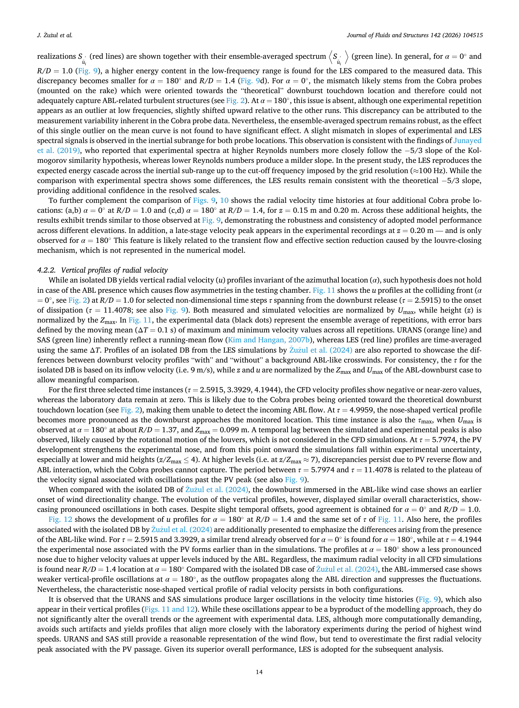
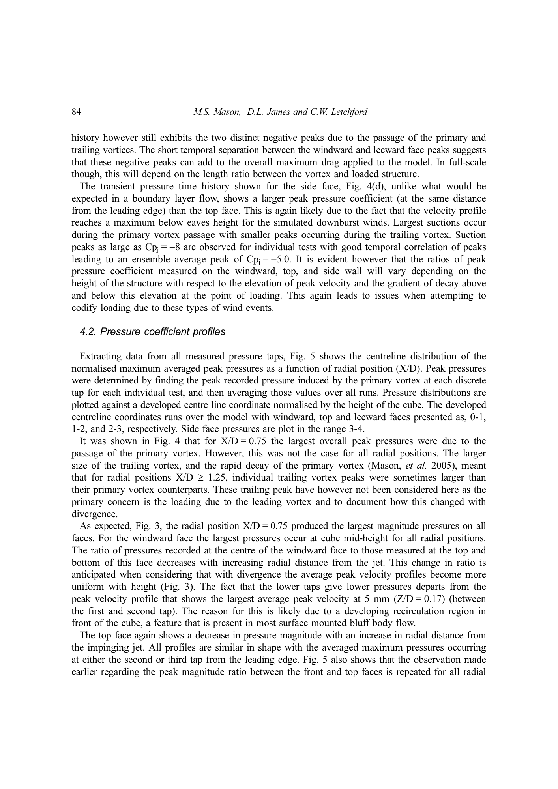

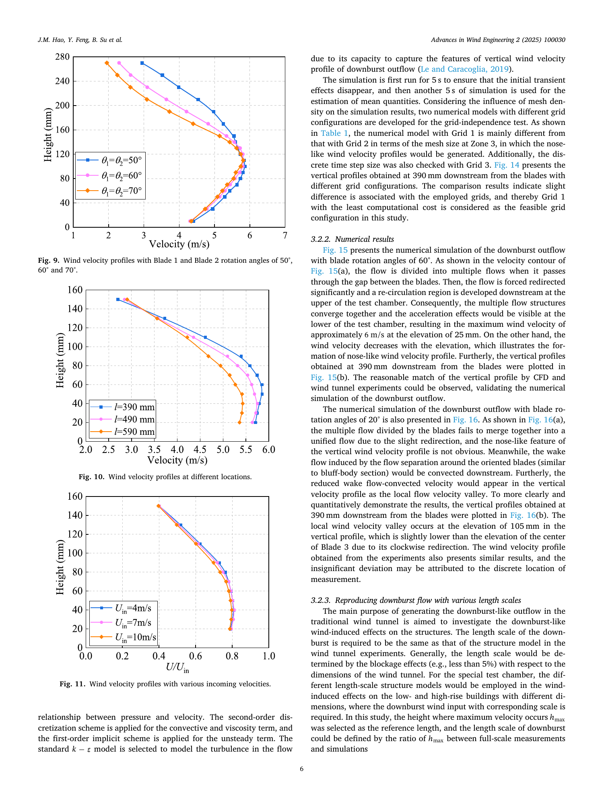
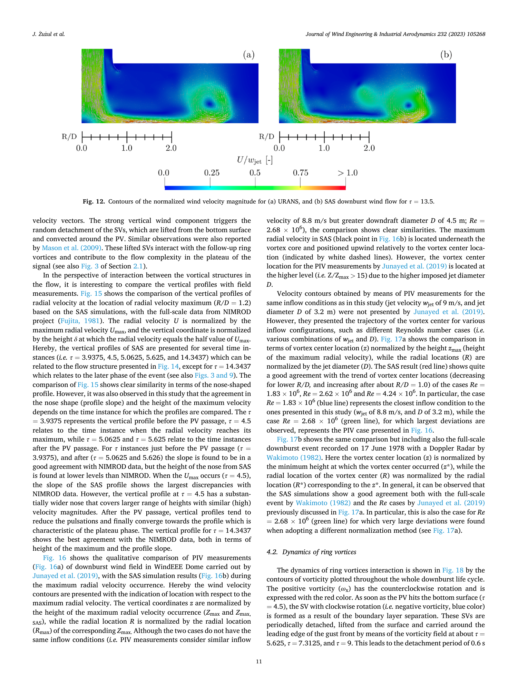

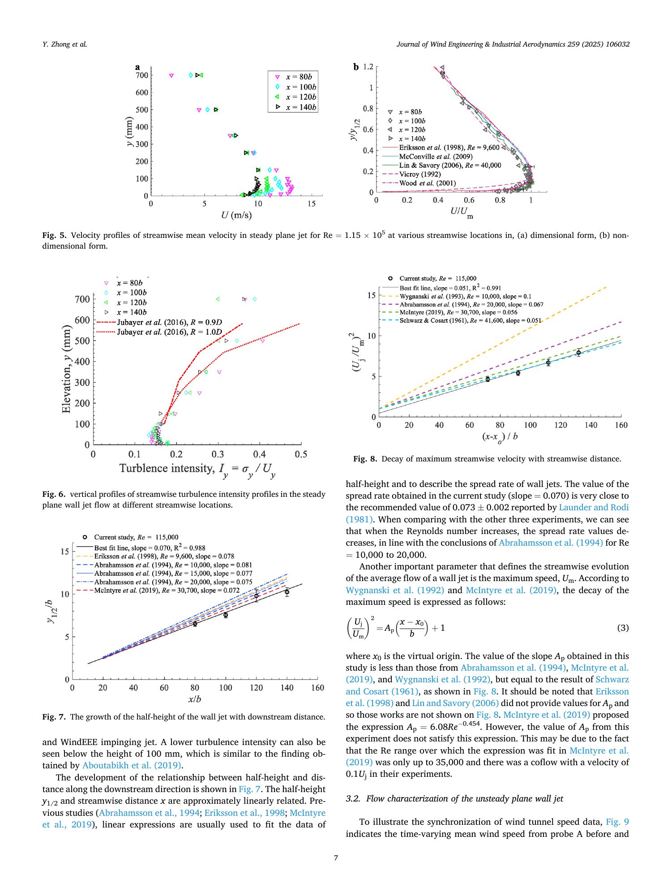

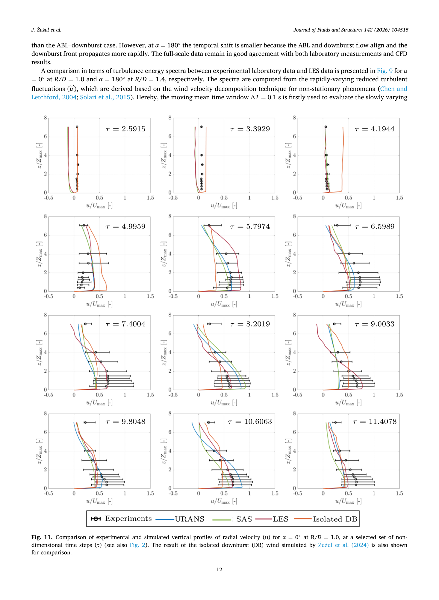
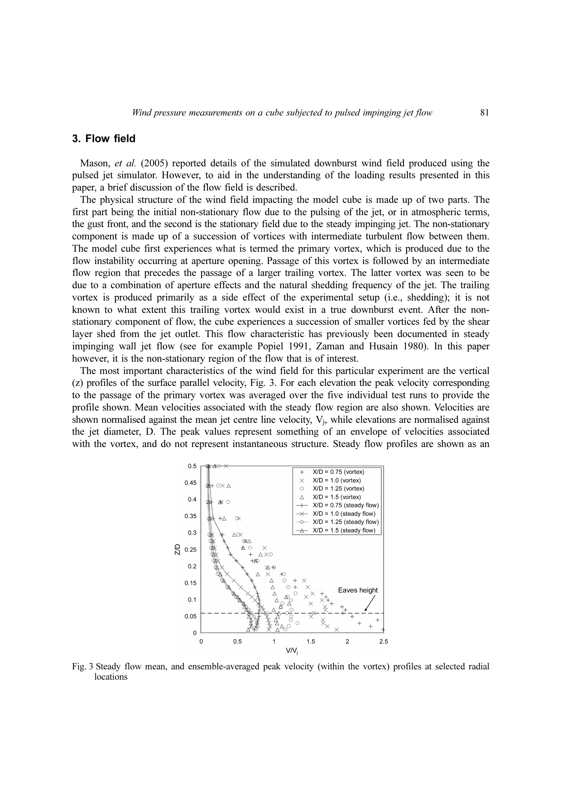
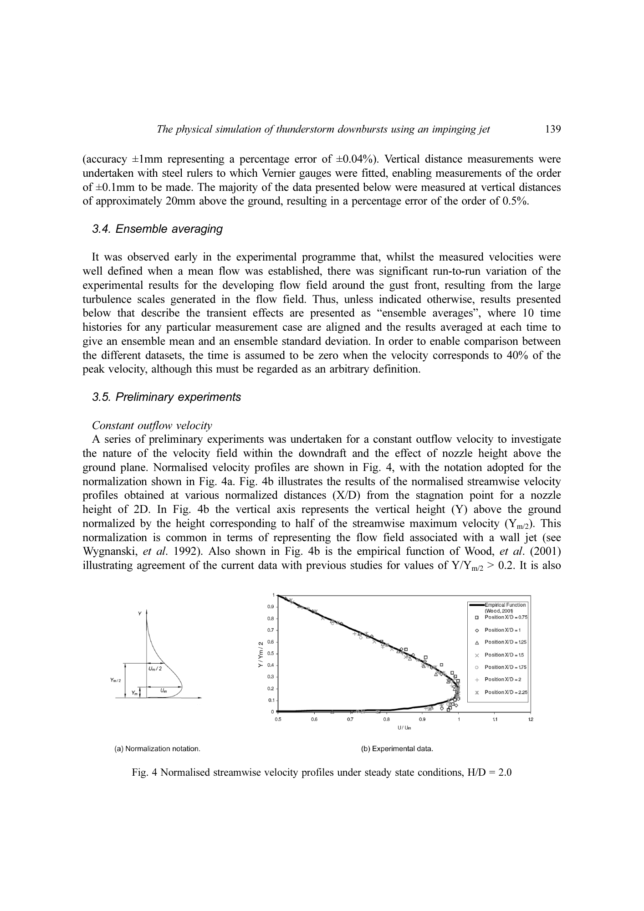
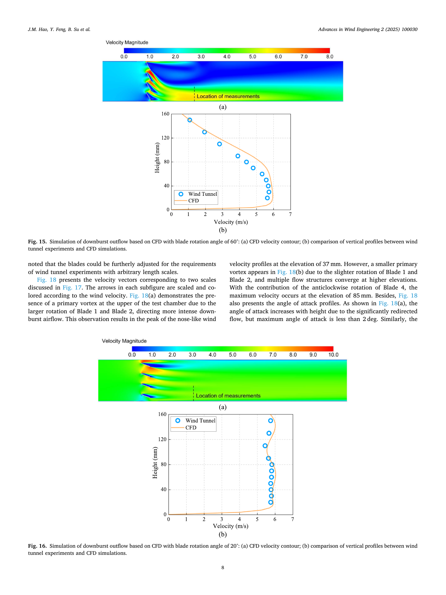
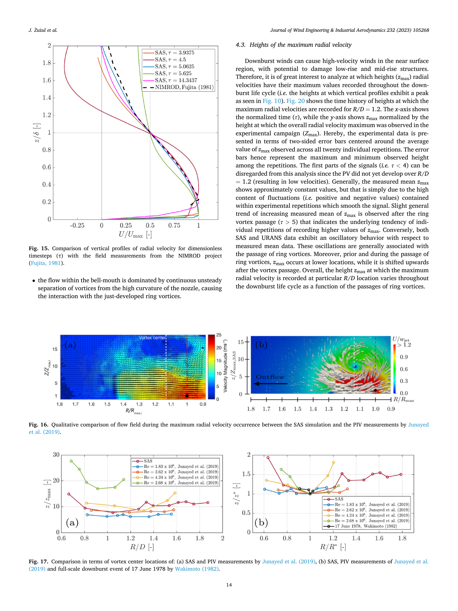

## 目录

- `results/`：结果表与说明
- `reviews/`：多模型审稿人审查后的裁决
- `figures/`：结果图
- `code/`：试验脚本（原样保存，路径已改为相对路径，运行前需按各脚本说明准备数据与环境）
