# 观测与模拟融合重建风场

**分组**：AI 气象 / 气候大模型与风工程　**状态**：搁置　**时间**：2026-10-14 – 2026-10-15

## 阶段结论（测试性质，非正式结题）

ASOS 站网上融合只比克里金好 0–4%；协议 v1.2 留用；雷暴近地风速当前公开数据不可做

## 原始任务

# 任务书：H 良态风站点留一重建（克里金 vs 背景场+残差 vs 学习方法）· 2026-10-14；按既定授权做，中途不必求批。

## 目标
回答一个问题：在良态（非对流）大风日，用稀疏地面站重建连续 10 m 风场时，"模式背景场 + 残差克里金"或学习方法，能不能比最好的纯插值（克里金/IDW）明显更准？只为判断值不值得继续，不追漂亮。

## 数据（全部公开，只读）
- 观测：ASOS/AWOS 小时 METAR 风速风向（经 Iowa Environmental Mesonet 接口，NCEI DSI 6405 源）。可复用 的取数写法。
- 背景场：ERA5（ARCO-ERA5 公开 Zarr，10 m u/v）；HRRR（AWS 公开桶，用 **f01–f03 预报**，不用 f00 分析——f00 已同化这些站，留一会被污染）。可选再加 URMA/RTMA 作"业务产品参照"，但它本身吃了这些站，只列为参照、不参与判据。
- 地形/下垫面协变量（可选）：站点高程、NLCD 或 ESA WorldCover 粗糙度类别。
- 区域：德州中东部，覆盖 Dallas–Austin–San Antonio–Houston 四城（与事件线德州四城对齐），约 28–34°N、94–100°W，目标 ≥60 个站。
- 日期：2020–2021 冷季的良态大风日 10–20 天（锋后/天气尺度大风）。筛选：区域内站点小时风速有相当比例 ≥8 m/s；当天区域内无雷暴（METAR 无 TS/CB、Storm Events 无 Thunderstorm Wind），写清筛选规则和选中日期。

## 方法（至少这些，可加）
1. 纯插值：IDW、普通克里金（变差函数每小时或每天拟合，写清做法）。
2. 背景场直接插到站点：ERA5、HRRR（未修正）。
3. 背景场 + 残差普通克里金：ERA5、HRRR 各一。
4. 学习方法：梯度提升树或高斯过程，特征可含背景场、高程、粗糙度、经纬度；再加"学习方法 + 残差克里金"。训练只用留出站以外的站（或按天分组），严禁用留出站的数据。

## 检验
- 逐站留一（LOO）：每次去掉一站，用其余站重建，预测该站该小时 10 m 风速（主变量）；风向和 u/v 作副指标。
- 指标：RMSE、偏差、MAE；逐站和总体；按天自助法给 95% 区间。另报每站每天最大小时风速的误差（峰值子集）。
- **判据（事先写定，不因结果改）**：最好的"背景场+残差"或学习方法，比最好的纯插值（IDW/OK 中较好者）总体 RMSE 低 ≥20%，且在 ≥2/3 的站上更好 → 判"值得继续"；10–20% 或只有其一 → "有条件"；<10% → "插值够用"。
- 另报站距效应：按留出站到最近站距离分组（<25、25–50、>50 km）。

## 边界
- 工作站 本地 CPU 即可，数据总量控制在 2 GB 以内，用前；若确需 Colab，≤20 CU、用完 stop、同一轮只你一个执行方。不上超算。
- 文章没写的参数（变差函数模型、IDW 幂次、HRRR 预报时效等）先查后假设，凡是假设写明"假设"和理由，列进结果文件的参数来源表。
- 新用到的外部数据/代码写进；结果图注明数据来源。
- 只在 下写。

## 交付
（方法对比表、逐站留一误差、判据结论一句、参数来源表、已知局限）、一张对比图、全部脚本。回报只写结论和数字。

## 项目报告

# H 观测–模拟融合重建风场

## 目标
用试验和实测修正/重建模拟风场（稀疏观测 → 连续风场）。第一步：文献现状 + 良态风站点留一对比（克里金 / 背景场+残差克里金 / 学习方法），判断融合方法比强插值基线好多少、值不值得继续。后续展开台风、温带气旋、雷暴；重建风场以后供 I（风灾损失–风速数据库）当独立风速来源。

## 当前状态
**10-14 收口（搁置）**。最终产出《站点风速重建协议 v1.2》（已交 I）：ASOS 站网上背景+残差比克里金只好 3–6%（雷暴约 0），站距约 80 km、飓风强风站有条件；飓风事件最大风用 Holland+残差可去峰值低估；按事件类型加性校正可去峰值低估（雷暴为粗估）。雷暴：站点插值峰值低估 3–5 m/s；单雷达低空径向分量 H6/H7 都"说不清"，按止损写为"当前公开数据条件下不可做"。
**为什么搁置**：四类事件站点重建与峰值校正已完成，产出已交 I；雷暴路线两次小试无正面信号。
**重启条件**：I 用协议后发现系统问题；有可在雷暴中验证低空雷达风的近场实测；TDWR Level II Nyquist 可靠可读且有站点在 <300 m 波束下；DAT 风速单位与定义经官方确认。

## 算力与存储边界（10-15 更新：Liang Hu 10-14 加严）
- **工作站 不跑计算、不存计算数据**：重启时求解器、批量留一、雷达解码、大下载一律在 CRC/TACC 或 Colab 跑和存；工作站 只放脚本、单项 <200 MB 的小结果、图和报告；确需在 工作站 临时放 >1 GB 先报上级。新大数据优先 TACC（CRC 组空间约 95%）；CRC 默认单节点。
- 本节点已有计算数据已由根 Lead 搬到 TACC，以后复核从 TACC 取，不拉回 工作站。H1–H7 任务书里的"工作站 本地 0 CU"作废。
- Colab 不设单试验上限；预计 >100 CU 先停报上级（50648743）；用完必须 colab stop，同一轮只派一个执行方。
- 超算走 ComputeOps 资源申请 + 登记，单作业 ≤50 SU，预检与提交分两条命令。

## 层级规矩（根 Lead 10-14 定， 迁移后 5 层上限）
- 本节点（二级）下不开三级子项目；要细分就在本节点内用任务，或报上级开同级二级节点。
- 往下只剩两跳：Lead → bot → 工具；任务书里不让工具 bot 再委托别人。
- 子树列表不按父节点分组，以界面项目树为准。

## 已定决定
- 2026-10-14 第一步设计与判据 → 
- 2026-10-14 **收口**：协议 v1.2 为最终产出，雷暴风速当前公开数据条件下不可做 → 
- 2026-10-14 H7 最后一试与止损 → 
- 2026-10-14 H6 雷暴雷达：说不清 → 
- 2026-10-14 H5 判定、协议升 v1.2 → 
- 2026-10-14 协议 v1 审查裁决、出 v1.1 → 
- 2026-10-14 雷暴定稿、站点留一阶段收口、协议 v1 送审 → 
- 2026-10-14 温带气旋定稿、H4 雷暴小试 → 
- 2026-10-14 飓风阶段定稿、进入温带气旋 → 
- 2026-10-14 良态风阶段收口、下一阶段登陆飓风 → 
- 2026-10-14 r1 判"插值够用"，第二轮改问稀疏站网 → 

## 已知前提（本线数据）
- 插值基线强：实验室 TPU 试验严格内插 ML 0/5；Han 2026 纯 Kriging MAE 0.36–0.37 优于 LBM–LES 0.46（数字孪生风洞卡，p. 39 表 6，见）。
- 生成式同化（GenDA）只在单街区稳态 RANS 切片、理想节点观测上验证，数据未公开。

## 试过与结果
| 日期 | 做了什么 | 结果一句 |
| --- | --- | --- |
| 2026-10-14 | Grok 快查 + Lead 核原文 | 已核真实站点证据：KiloDA（山西复杂地形，1,340 站整块扣留 238 站）比克里金 RMSE 低 15.4%、89.5% 站更好；Kiessling 2021（瑞典）比泛克里金好约 5%；理想孪生实验的 49% 不作真实证据；S2G 数值未核 |
| 2026-10-14 | r1 良态风逐站留一（ideas；137 站、31,898 站时） | OK 1.613、IDW 1.634；ERA5+残差 OK 1.553（−3.8%，81/137）；GBT+残差 1.524（−5.5%，87/137）；>50 km 档 OK 2.142 vs GBT+残差 1.625；峰值时刻普遍低估约 1.5 m/s → 插值够用 |
| 2026-10-14 | H7 雷暴雷达最后小试（Chicago 两例，KLOT 低波束 + 108 个 DAT 点；ideas） | 检验 A 合格站事件 0（站上空波束 385–736 m）；DAT 单位未核，假设 mph 时雷达−DAT 中位 16.0 vs 邻站−DAT 9.7 m/s → 说不清，触发止损 |
| 2026-10-14 | H6 雷暴雷达近地风可行性（达拉斯两天，KFWS 最低仰角；ideas） | 18 站事件：持续风峰值偏差插值 −3.59 → 雷达 | −3.28、RMSE 4.71 → 5.18；波束 258–1646 m AGL；两天 DAT 雷暴点 0 个；TDWR 未用上 → 说不清 | |
| 2026-10-14 | H5 峰值低估校正（四类已有留一峰值，按事件留一；ideas） | 按类型加性校正：良态 RMSE −12%、温带 −22%、雷暴持续风 −25%/阵风 −30%，合并偏差 ±0.5 内→有效；各事件残余偏差雷暴达 ±2–3 m/s（粗估）；飓风 Holland+残差无需校正；跨类通用参数无效 |
| 2026-10-14 | H4 雷暴（达拉斯 4 个可评日、44 个 1 分钟站；ideas） | 峰值持续风 IDW 4.78 → ERA5+残差 4.79（−0.2%）插值够用；峰值偏差 −3.2 m/s，阵风 −5.1；ERA5 单用 −8.8；样本很小 |
| 2026-10-14 | H2 补 Francine（B 复用对齐） | Francine 主判据 −22.8%（25/44）有条件、强风 10 站 −52.8% 值得；十事件+Francine 合计 −3.8% 插值够用，独立强风合计 −10.8% 有条件 → 飓风定稿不变 |
| 2026-10-14 | H3 温带气旋（中南部平原，严格合规 4 事件 359 站为主数；ideas） | 峰值 RMSE OK 拟合 2.30 → ERA5+残差 2.22（−3.2%，207/359）→ 插值够用；参照 5 事件 −3.2%、2 事件 −5.5%，均插值够用；ks_20180306 有 1 条 VCTS 不合规；tx_20191126"有条件"只因胜站恰达 2/3（降幅 3.8%）；样本少、结论偏弱；ERA5 单用峰值低估 3.2 m/s；各法峰值低估 1.2–1.4 m/s |
| 2026-10-14 | H2b 强风副判据（独立 9 事件、≥12 m/s 273 站） | 克里金 3.89 → Holland+残差 3.50（−10.0%，154/273）→ 有条件；仅 Zeta 过双门槛 → 飓风阶段定稿 |
| 2026-10-14 | H2 清洗版（十事件，陆地池；ideas） | 峰值 RMSE OK 2.79 → ERA5+残差 2.70（−3.2%，379/745）→ 插值够用；未清洗版的 −15% 来自离岸/沿海站；Holland+残差把峰值偏差从 −1.18 降到约 0（RMSE 持平）；1–3 RMW −11%，<1 RMW 更差 |
| 2026-10-14 | r2-clean（清洗站表、残差也逐小时拟合；ideas） | r1 全站 −2.6%（78/134）；40 km −6.2%、54 km −9.4%（插值够用）、82 km −12.5%（124/134，有条件）；GBT 仍不如 ERA5+残差 → 良态风定稿 |
| 2026-10-14 | H2 十事件（B 节点 v1 同批；ideas） | 峰值 RMSE 合计 OK 3.21 → ERA5+残差 2.73（−15.0%，413/794 站）→ 有条件；6 事件有条件、4 事件插值够用；冻结 Holland 单用多不如 ERA5（Ida 偏高 7.3 m/s）；强风站副判据预览（未清洗，9 新事件 304 站）−19.8%、61% 站 → 有条件 |
| 2026-10-14 | H2 首版：Beryl 2024 + Nicholas 2021 站点留一（ideas） | 201 站事件峰值持续风：OK 3.17 → Holland+残差 OK 2.46（−22.4%）、ERA5+残差 2.53（−20.3%），但只 105/201 站更好 → 有条件；峰值偏差 −1.25 → −0.42；强风站（≥12 m/s，49 站）−35%、1–3 RMW −36%（未事先登记，作线索）；未做站点清洗 |
| 2026-10-14 | r2 抽稀站网（50/25/10%，各 20 次；ideas） | ERA5+残差 OK vs 最好纯插值：41 km −5.9%（90/136）、53 km −8.8%（107/136）、82 km −13.4%（126/136）；82 km 档 ERA5 直插已胜插值；GBT 各档不如 ERA5+残差；峰值时刻偏差 −1.7～−2.2 m/s → 有条件 |
| 2026-10-14 | 审稿人 E/F 核 S2G、HRRR、RTMA；Lead 亲核 S2G 预印本 | S2G 的 25–32% 是整幅格点对 RTMA（真值不独立）；留出站对实测只有"中心化 RMSE 降低"（正式版 8.5%，单源未亲核）；HRRR f00 同化地面风；RTMA 无全网留一 |
| 2026-10-14 | r1 补充（WorldCover 1 km 下垫面分组） | 建成区主类 16 站：ERA+残差 1.530 vs OK 1.523（无改善，9/16）；非建成区 121 站：1.556 vs 1.625（−4.2%，72/121）。ERA5 主口径 −3.75%（95% 区间 2.53–4.82%） |

## 参数来源表
| 参数 | 取值 | 来源或"假设" | 查过哪些地方 |
| --- | --- | --- | --- |
| 判据 | 融合/学习比最好纯插值 RMSE 低 ≥20% 且 ≥2/3 站更好 | 设计（Lead 补充 2，事先写定） | — |
| HRRR 背景时效 | f01，不作判据主组 | f00 同化地面风（Benjamin 2016、Dowell 2022，经审稿人 F 摘句）；f01 不能保证目标站独立 | 审查 |
| ERA5 陆地 10 m 风是否同化地面站 | 不直接同化 | Hersbach et al. 2020（QJ 146，10.1002/qj.3803）观测黑名单，审稿人 D、A、E 一致；Lead 未亲读原页 | 审查 |
| B 节点 Holland 链（H2 复用） | CLIMADA 6.1.0 H08 + 方向海陆粗糙度；2 min 与 5 s 时距换算、500 m 参考高度 | **假设**：B 开跑前预注册；凡引用 Holland 链误差（含给 I 的建议）带此限定 | B 节点 REUSE_NOTES.md |
| 站点清洗 | 剔除海上平台、坐标与他站相同者；<2 km 站对保留一个 | 设计（审查 必须改） | — |

## 未决与下一步
- **H5 峰值低估校正已完成**：按事件类型加性校正有效，写进协议 v1.2 第 4 节，经上级交 I；原定：用四类已有留一峰值，试加性/线性/分位数映射校正，按事件留一交叉验证；判据：峰值偏差 ≤0.5 m/s 且 RMSE 不变差（+2% 内）为有效。任务书。
- 协议：审查 已裁（3/3 有保留支持），v1 不交，按裁决出 v1.1经上级交 I。
- **H6 雷暴雷达近地风最小可行性检查**（上级 10-14，已派 ideas；问事件线 Lead 复用其 WSR-88D/TDWR 流程）：达拉斯 2024-06-01、2025-07-09；检验 A 站点峰值 vs H4 插值，检验 B DAT 损伤点 vs 37 mph 基线；判据开算前登记。任务书。
- **背景：雷暴"雷达+站点"足迹重建（规模超出小试，H6 结论后由上级决定是否写转正提案）**。需要数据：WSR-88D Level II 最低仰角（0.5°）径向速度与反射率、TDWR（达拉斯/休斯敦等机场有）、ASOS 1 分钟风；可能的做法是雷达径向速度降到近地（波束高度订正）+ 站点残差融合。预计工作量：数据下载与去混叠、波束高度与近地换算、逐例检验，单例数天、数事件数周，超出试验场。可接的线：事件线（已有逐例 WSR-88D/TDWR 判读与证据包，Dallas 2024-06-01、2025-07-09）；CM1 线（雷暴模拟）。H5 做完后若 I 确实卡在雷暴风速上，由上级写转正提案问 Liang Hu。
- B 节点复用须知（10-14）：只用 正式结果；H2 脚本只导入 模型函数，未从 v1 根目录结果取数（Lead 查脚本确认，ideas 复核中）；H2 事件集与 B 有差异（多 Ida、Idalia，缺 Francine）——补 4 已完成（Francine 补跑、第 494 行勘误、差异写明，ideas 复核未从 v1 根目录取值）；飓风结论保留幸存者偏差（近风眼站易断报，样本偏外围弱风站）。
- Grok 报告 → 写 Deep Research（--gemini）任务书，含 GitHub 仓库检索要求 → 结论 
- ideas r1 结果 → 按判据判；"值得继续"再设计第二步（台风/温带气旋/雷暴之一，或加入密网 Mesonet 作独立检验）。
- 事件 Lead 10-14 已回：未做多站重建，不重复；可只读借用 下 S1_ROWS.csv、ASOS_STATION_YEAR_COMPLETENESS_R2b.csv、ASOS_WIND_SENSOR_NOTE.md（阵风口径）；无数值 QC 规则。雷暴阶段候选：Dallas 2024-06-01（例 6）、2025-07-09（例 8），证据包 S3_2020_TX4_20261010/，更多见 S2_GROUPS.csv（26 组）；均判"模糊"，只当有观测的雷暴大风个例，不当下击暴流真值。
- WRF Lead 10-14 已回：未做过站点融合/重建，不重复；无德州数据与 QC 规则。提醒（无文献依据，基于其线数据）：HRRR f01–f03 仍源自吸收过该站的分析，留一偏乐观；METAR 平均风/阵风与时区口径要统一；按下垫面分组报代表性误差。已补进 r1（ERA5 组为判据主组，HRRR 组标"上游已用"）。

## 文献依据
- Zheng et al. 2026, arXiv 2609.11230v1（KiloDA），PDF 正文 Fig. 5 段：真实观测扣留区 −15.4% vs Kriging（Lead 核原文；无 wiki 卡片，待 litwiki 建卡）。
- Kiessling et al. 2021, Proc. R. Soc. A, 10.1098/rspa.2021.0236，表 1：E 0.370 vs 0.388（Lead 核 PMC 全文；无 wiki 卡片）。
- （GenDA 证据边界）。

## Liang Hu 注

## 结果图

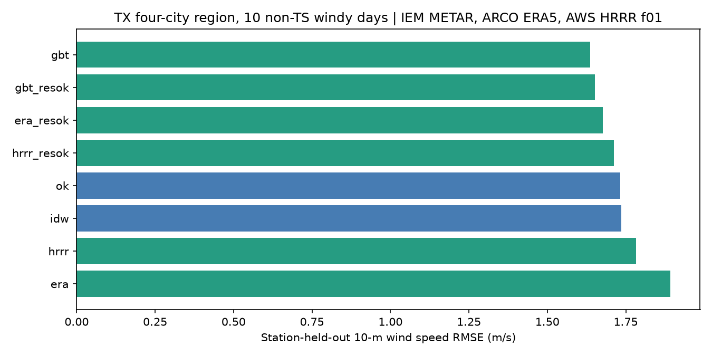
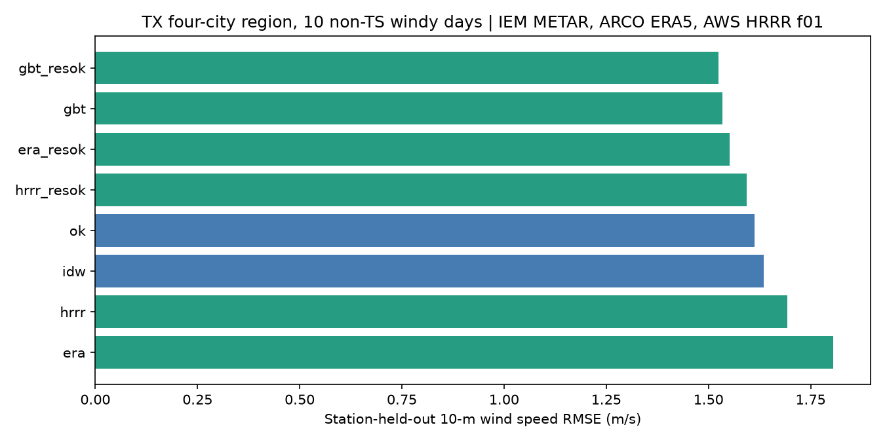
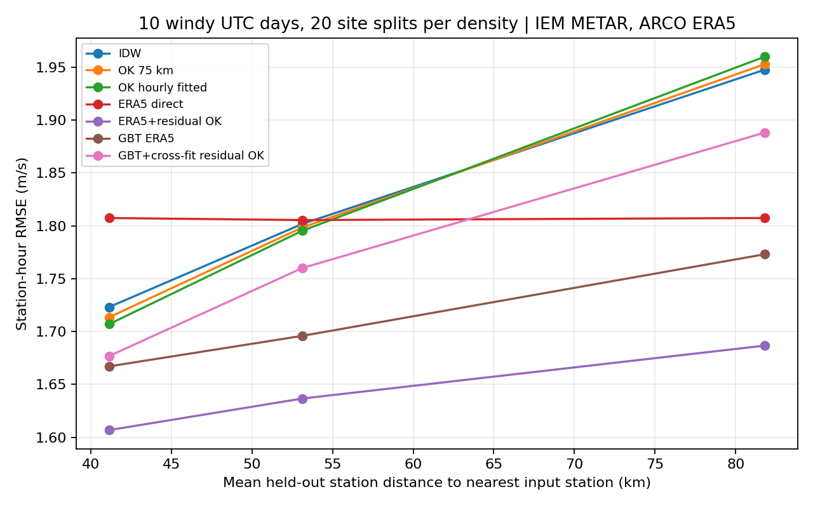
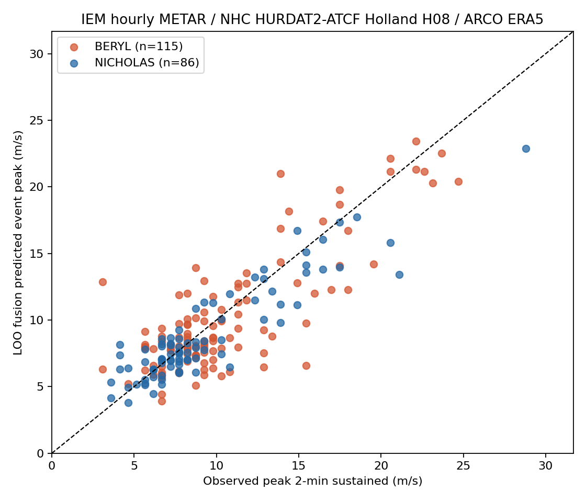
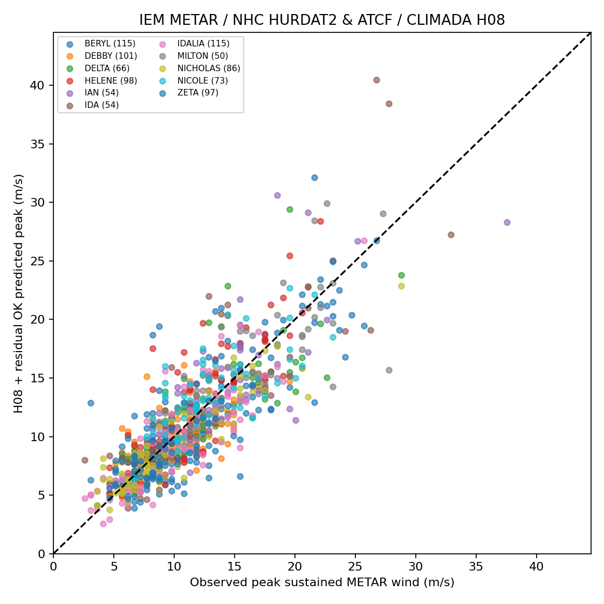
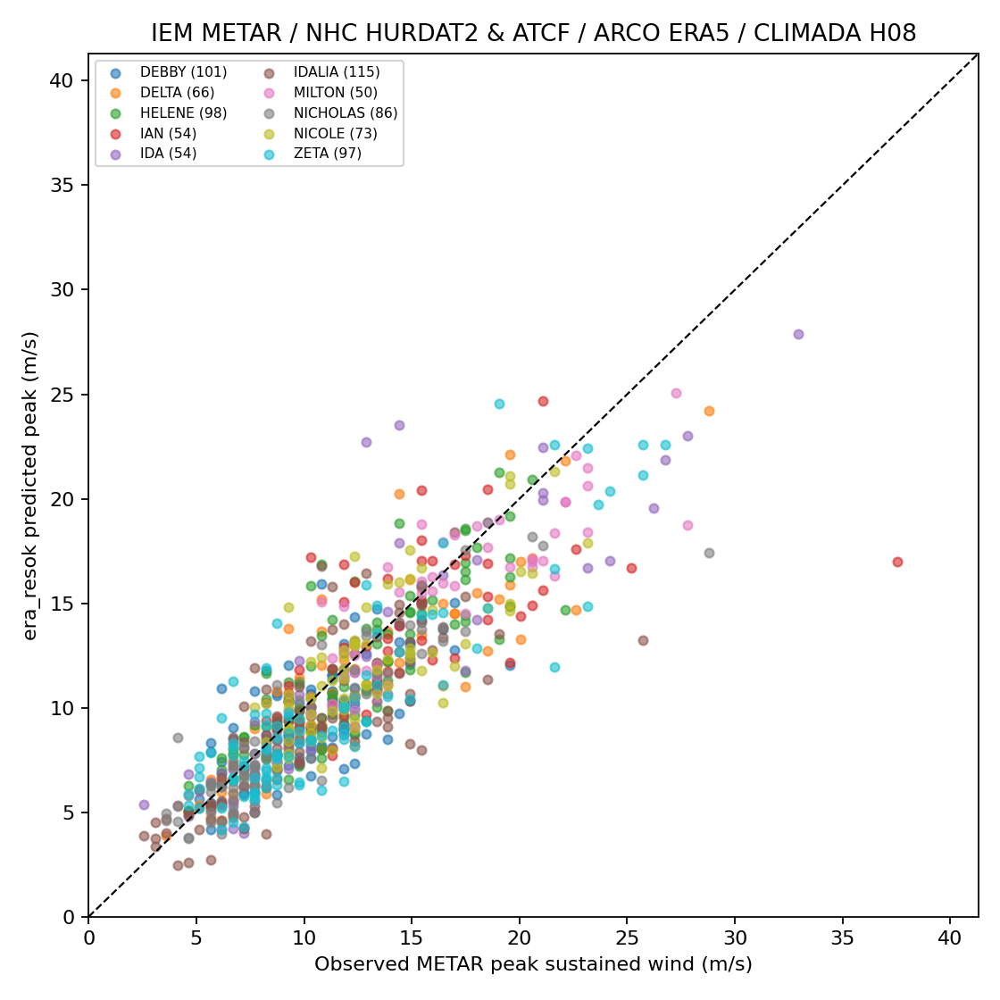
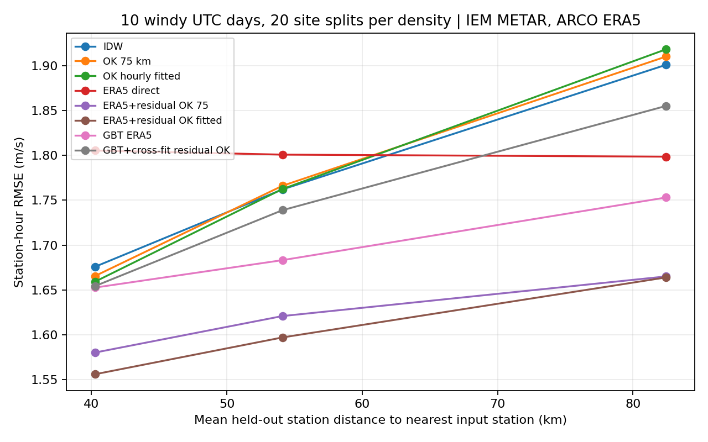

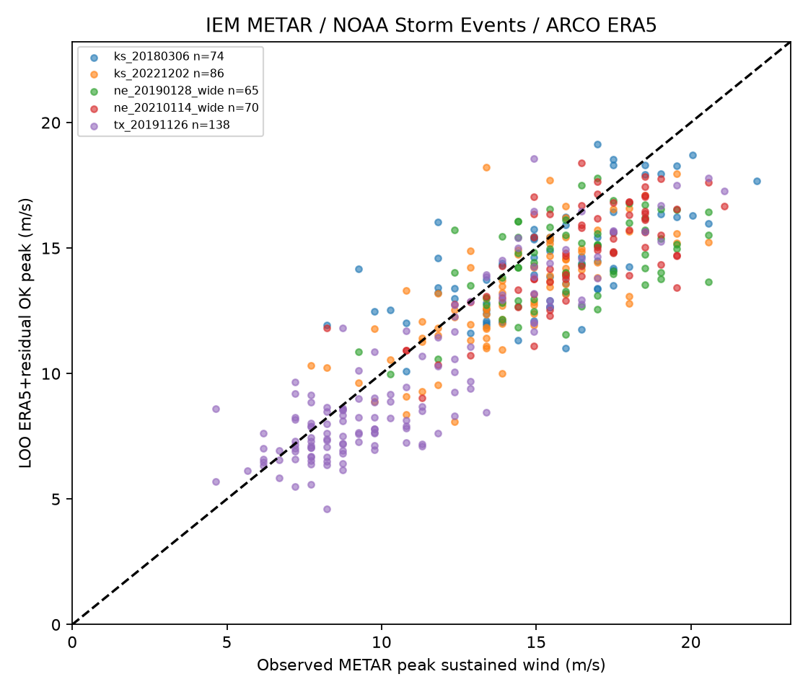
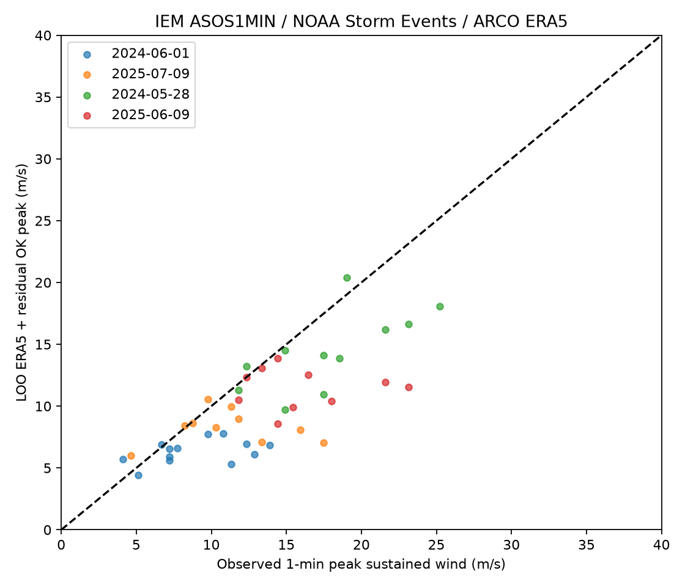

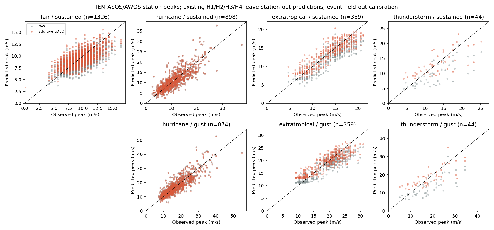
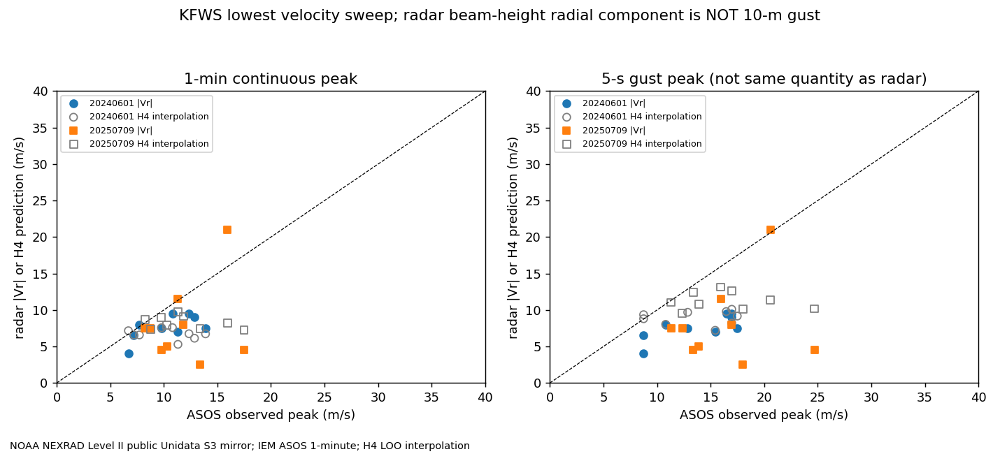
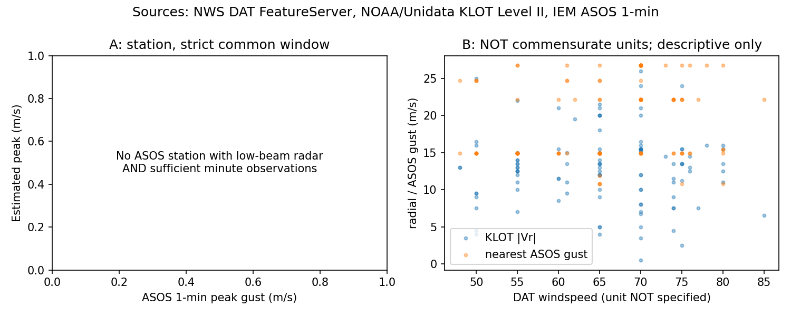

## 目录

- `results/`：结果表与说明
- `reviews/`：多模型审稿人审查后的裁决
- `figures/`：结果图
- `code/`：试验脚本（原样保存，路径已改为相对路径，运行前需按各脚本说明准备数据与环境）
