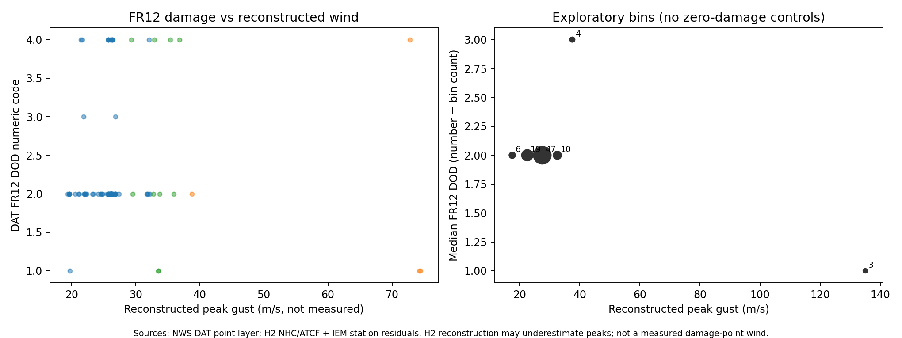
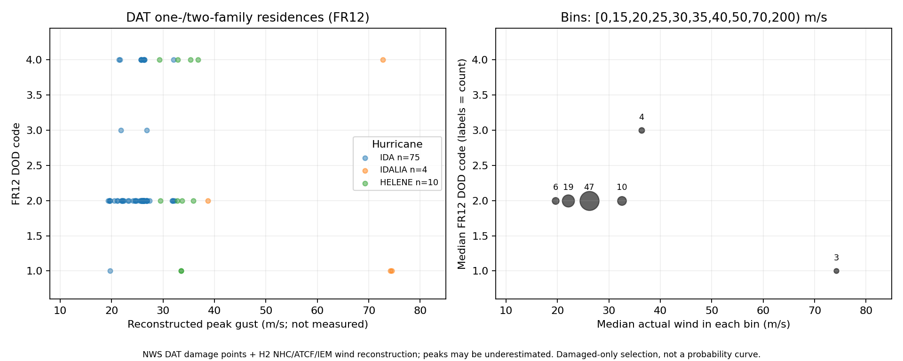
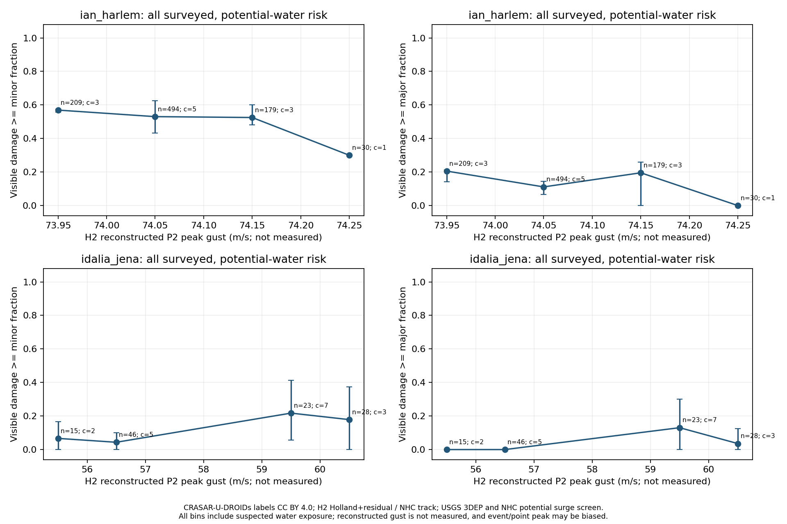
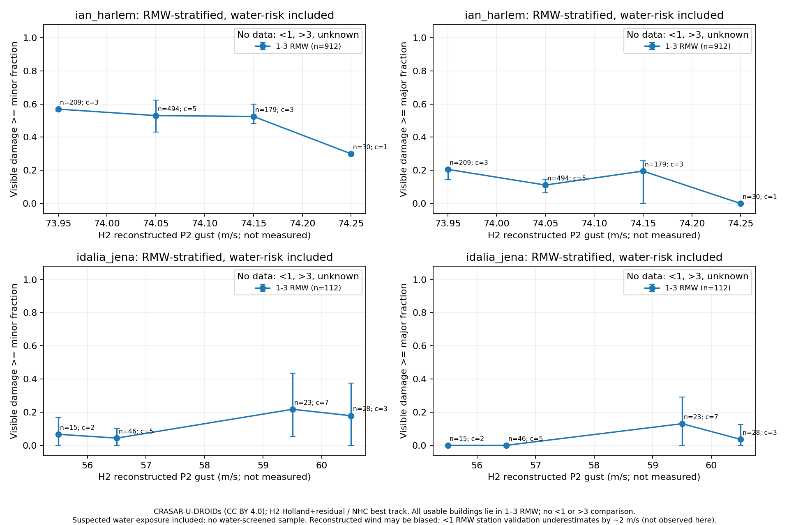
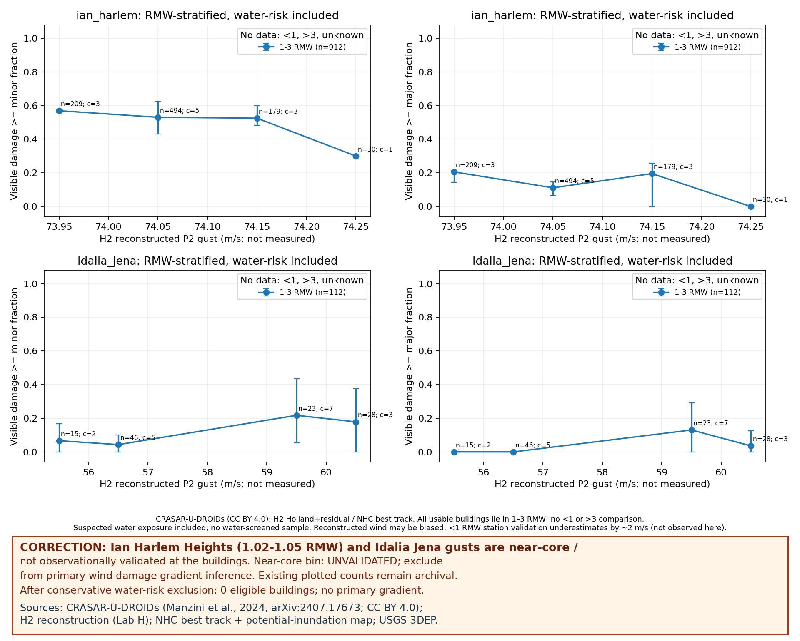
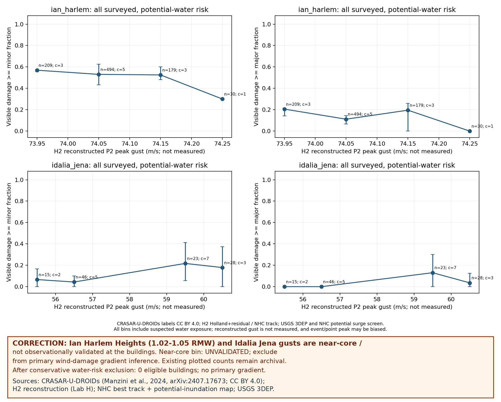

# 风灾损失与风速数据库

**分组**：AI 气象 / 气候大模型与风工程　**状态**：搁置　**时间**：2026-10-14 – 2026-10-15

## 阶段结论（测试性质，非正式结题）

大模型抽取可用；缺独立风速（雷暴）和跨风速带的带分母逐栋数据（飓风）

## 原始任务

# 任务书 · 风灾损失–风速数据库 第一步：Storm Events 叙述批量抽取与准确率（10-14）

节点：I 风灾损失–风速数据库，父节点 数据、CFD 模型与观测（50648743）。执行：ideas。

## 目标
判断“用大模型从 NOAA Storm Events 叙述批量抽结构化损失–风速记录”值不值得继续：各字段抽得准不准，以及有多少条的风速**不是**按损伤反推的（按损伤反推的风速拿去验证损失模型是循环论证，必须分开）。

## 数据
- NOAA NCEI Storm Events 批量 CSV（官方源，直接下载）：https://www.ncei.noaa.gov/pub/data/swdi/stormevents/csvfiles/ 的 `StormEvents_details-ftp_v1.0_d<年>_c*.csv.gz`，取 2018–2023 年。下载放 WSL 本地目录（不要放 本地盘），只把抽样子集 CSV（几百行）和结果写回。
- 只读借用事件线：（Storm Events 546 行，含 noaa_magnitude_type：EG 450、MG 94）。雷暴风样本里优先放 30–50 条与这批 event_id 重合的德州四城事件，便于以后和事件线、H 节点对齐。
- 灾后调查报告（NWS DAT、StEER/DesignSafe、NIST）本轮只做可获得性快查：有没有公开可批量下载的入口、格式、许可，一段话写进结果；拿不到就只做 Storm Events。

## 样本（约 300 条，分 3 批，每批 ≤100）
- 雷暴（Thunderstorm Wind）约 120；热带气旋（Hurricane/Typhoon、Tropical Storm）约 90；温带气旋/天气尺度大风（High Wind，取 10–4 月、排除明显的下坡风/沙尘可酌情）约 90。
- 只取 EVENT_NARRATIVE 非空且提到损伤（或 DAMAGE_PROPERTY>0）的记录；分层随机，固定随机种子，写清抽样脚本。

## 字段表（Lead 定，可补充但不删）
event_id；hazard（雷暴/热带气旋/温带）；date_time_local；location（州、县/城镇、经纬度若有）；structure_type（如独栋住宅、活动房、商业建筑、谷仓、电杆/线路、树木、车辆、标识牌；可多值）；damage_description（原文摘句）；damage_severity（无/轻/中/重/毁坏，按叙述）；wind_speed_value 与单位（kt/mph，统一转 m/s 另列）；wind_speed_kind（阵风/持续）；**wind_speed_source**（见下）；wind_speed_source_quote（支持该判定的原文摘句）；instrument_or_site（如 ASOS 站名、mesonet）；EF/损伤等级若提及。
Storm Events 结构化列（MAGNITUDE、MAGNITUDE_TYPE、SOURCE、DAMAGE_PROPERTY）作为对照列一并保留，模型只读叙述，事后再与结构化列比。

## 风速来源判定规则（先定再出题）
- 官方定义（NCEI《Storm Data Bulk Data Format》，Lead 已核）：magnitude 为风速（节）；magnitude_type：EG = Wind Estimated Gust，ES = Estimated Sustained Wind，MS = Measured Sustained Wind，MG = Measured Wind Gust。**“估计”并不说明估计依据**，所以 E 类还要看叙述。
- 你要补查：NWS Directive 10-1605（Storm Data Preparation）里关于雷暴风/大风“估计风速”如何得出（是否允许按损伤估计）的原文与页码，写进参数来源表。
- 分类：`measuredradar`（叙述明说由雷达速度估计）；`damage_inferredobserver_estimate`（观测者目测估计、未提损伤依据）；`estimated_unspecified`（E 类且叙述没说依据）；`none`（无风速）。
- “非损伤推断风速占比”报两档：严格 = measured + radar；宽松 = 再加 observer_estimate。estimated_unspecified 单列，不并入任何一方。

## 做法
1. 写字段表与判定规则 → 出题（每条一个 JSON 输出模板）→ ` ≤100 题；有审查在跑时不开批量；不用 --force；被让路暂停就等它续跑。
2. 金标准：每个灾种 20 条（共 60）由你按规则逐条人工标注（不看 Gemini 输出），作准确率基准；另每批随机 10% 由 Claude 复核，记一致率，某类一致率 <90% 写明并停止该类。Lead 会抽查金标准。
3. 准确率按 字段 × 灾种 计；数值字段按“完全一致/单位换算后一致”计；结构类型按集合匹配（报精确与部分匹配）。

## 交付（写在）
- （字段表 + 判定规则 + 参数来源表：每个定义的出处与页码）；、批量题目与答案 jsonl、金标准、脚本
- ：字段准确率表（字段 × 灾种）、wind_speed_source 混淆矩阵、非损伤推断风速占比（两档，按灾种）、模型抽取与结构化列 MAGNITUDE_TYPE 的一致性、每类典型失败例子（各 2–3 条原文）、DAT/StEER 可获得性一段
- 一句结论建议（值得继续/搁置）和第二步建议。

## 边界
0 CU（本机批量即可；确需 Colab 不设单试验上限，预计 >100 CU 先停下报本节点 Lead，用完必须 colab stop、同一轮只派一个执行方（10-14 18:3x 口径更正））；不上超算；文章/文档没写的参数先查后假设，假设要标明；其他线数据只读；只在 下写；不保存任何 token。外部数据写清来源，Lead 负责补 PUBLIC_CITATIONS。

## 项目报告

# I 风灾损失–风速数据库

## 目标
用大模型把 NOAA Storm Events 叙述（以后加灾后调查报告）批量抽成结构化“损失–风速”记录，判断这条路值不值得做。Liang Hu 10-14：韧性/性能指标要用于设计，必须先经过真实损失数据验证；目前困难，只做起步。

## 当前状态
**搁置（10-14 22:4x）**，决策。
- **为什么不行**：大模型抽取可用（来源 66/70，能分开按损伤反推的风速），但缺数据——雷暴站网测不到损伤核心风（邻站阵风比 DAT 损伤估风中位低 37 mph，H4 重建无效）；飓风 DAT 只有受损点、无趋势；带分母的 CRASAR 片区小、风速跨度 0.3 m/s 且全在风暴潮区，排水损后 0 栋可用。
- **缺什么**：跨宽风速带、排除水损、含未受损建筑的内陆逐栋损伤数据；雷暴的独立风速来源。
- **什么情况下重启**：(1) 大范围灾后航拍 + 建筑损伤分类、系统抽样内陆调查，或保险/FEMA 地址级数据（需数据协议，Liang Hu 定）；(2) H6 证明雷达近地风可作雷暴独立风速；(3) 有具体用户需要设计风速 vs 实际损伤验证并愿投入人工逐栋核查。重启复用 脚本与 （中间数据在 TACC 归档），计算放 CRC/TACC/Colab，不在 工作站 本机跑。

## 层级规矩（根 Lead 10-14 定， 迁移后 5 层上限）
- 本节点下不开三级子项目；要细分就在本节点内用任务，或报上级开同级二级节点。
- 往下只剩两跳：本节点 → bot → 工具；任务书里不让工具 bot 再委托别人。
- 子树列表不按父节点分组，以界面项目树为准。

## 边界
- Colab（10-14 18:3x 母项目 Lead 按 Liang Hu 原话“现阶段多用 Colab、不限 CU”更正，原 ≤20 CU 作废）：不设单试验上限；单试验预计 >100 CU 先停下报上级节点 50648743；用完必须 colab stop，不许空转；同一轮只派一个执行方。
- 计算地点（Liang Hu 10-14 加严，全线）：工作站 不跑计算、不存计算数据。重启时下载、批量抽取的缓存、点位重建复算、影像/栅格处理一律在 CRC/TACC 或 Colab 跑和存；工作站 只放脚本、单项 <200 MB 的小结果、图和报告，确需临时放 >1 GB 先报上级节点。本节点原 工作站 上的 >1 MB 中间数据已由根 Lead 搬到 TACC，复核从 TACC 取，不拉回 工作站。新大数据优先 TACC（CRC 组空间约 95%）；CRC 默认单节点。
- 超算单作业 ≤50 SU（资源申请 + 登记，预检与提交分两条命令）；批量杂活 单批 ≤100、不用 --force、10% 复核；其他线数据只读；只在 下写。

## 已定决定
- 2026-10-14 搁置 → 
- 2026-10-14 r3 后：DAT×重建这条子路线不再加码，先核带分母的公开损伤数据再定搁置 → 
- 2026-10-14 r2 全量后：雷暴暂缓、先做飓风试点 → 
- 2026-10-14 r1 后继续，第二步转向“同地同时配对可行性” → 
- 2026-10-14 开工设计（字段表、风速来源六分类、样本分层）→ 

## 试过与结果
| 日期 | 做了什么 | 结果一句 |
| --- | --- | --- |
| 2026-10-14 | r1b 修评分（单位换算、站点语义档） | 只变热带风速值 17→18、热带站点语义 15/20；r1 结论不变 |
| 2026-10-14 | r5 补充：按离风眼远近档分层；DAT 单位改“推定 mph” | 两片 1,024 栋全部落在 1–3 RMW 档，<1 与 >3 档 0 栋，无法分档比较；搁置判断不变 |
| 2026-10-14 | r5 CRASAR 小片区（Ian Harlem Heights 912 栋、Idalia Jena 112 栋）× 质心点位 H2 重建阵风 | 单片区阵风跨度 Ian 仅 0.3 m/s（< H2 误差 3–4.5 m/s）；保守排水损后 0 栋，放宽后 48 栋、4 簇、无重损；含水损版本也无单调梯度 → 搁置 |
| 2026-10-14 | r4 带分母公开数据核查 | 找到 CRASAR-U-DROIDs（无人机影像逐栋多边形 + 无/轻/重/毁，CC BY 4.0，Lead 已核数据卡），与 H2 的 Ian/Ida/Idalia 重合；Idalia Steinhatchee 一片 608 栋（无损 473）；xBD 非商用、NSI/OpenFEMA 无逐栋损伤；Idalia 72–74 m/s（阵风；对应持续风 55.8–57.1 m/s，1.10–1.20 RMW）高于 NHC TCR 登陆强度 100 kt（PDF 第 5 页），已更正为**外推失真**（见搁置决策 10-14 23:0x 更正节） |
| 2026-10-14 | r3c 近站组人工核查（Helene 5 组 78 点、达拉斯 3 点） | Helene 近站点几乎全是树木损伤，DAT 时间成批相同（疑为调查录入时刻），一组最多 48 点共用一次观测，SBO 组最近模型输入站 82.6 km 超出协议验证范围；无一可称同地同刻真值组 |
| 2026-10-14 | r3 飓风试点：Ida/Idalia/Helene 416 个 DAT 点 × 点位复算 H2 Holland+残差 P2 | 416/416 可重建、字段齐；FR12 89 点 DOD 与重建阵风无单调趋势（Ida Spearman +0.08，DOD2 占 60/75）；原因主要是 DAT 只有受损点、缺分母，混非风机理；Idalia 72–74 m/s 待核 |
| 2026-10-14 | r2-C 补充：H4 达拉斯 5 日、H2 Idalia/Helene、足迹尺度 | 达拉斯只有 2025-03-04 出候选：≤10 km 3 点/3 组，25 km 52 点/9 组，其中 49 点距站 10–25 km，远超下击暴流尺度（微 <4 km、宏 ≤10 km：NOAA JetStream；Romanic 等 2022 WACE 37:100474 期刊第 1 页）；Idalia ≤10 km 5 点/3 组，Helene 78 点/5 组；H2 grid 只给站点位置值，DAT 点位重建须另算 |
| 2026-10-14 | r2-C 全量：DAT 2019–2024 18,434 点 × IEM 窗口最大阵风 | 雷暴 ≤10 km 667 独立站-时组（≤25 km 1,972），热带 35（86）；雷暴 DAT 损伤估风比邻站窗口最大阵风中位高 37 mph（10–58，97% 为正；单位 mph 为假设）→ 站网测不到损伤核心风 |
| 2026-10-14 | r2-B 富集来源正例困难金标准 70 条 | 来源六分类 66/70（94%）；实测 精度 34/34、召回 34/37；损伤推断 精度 16/17、召回 16/16；未说明依据 精度 14/17；只适用富集正例，不外推出现率；多站多值已改为逐值数组，逐值金标准未建 |
| 2026-10-14 | r2-C 配对小试：DAT 点 × IEM ASOS 实测阵风（Ian、Ida、达拉斯 2 日、休斯顿 1 日） | 飓风 131 点 ≤5/10/25 km 候选 10/47/107，雷暴 112 点 2/71/112；但独立站-时组很少（雷暴 3 日约 20 组，Ida 28 组、Ian 4 组）；5 km 几乎凑不出；DAT 自带风速是损伤估计不算独立 |
| 2026-10-14 | r1：Storm Events 300 条（雷暴 120/热带 90/High Wind 90）Gemini 3.8 Flash 抽取 + 60 金标准 + 每批 10% 复核；补充批 40 条 TX4（2010–2017） | 全部 ok；三批复核闸门均 ≥90%；严格独立风速占比 雷暴 2.5%、热带 31%（有速度者 48%）、High Wind 53%；EG→MG 二分一致 203/210；补充批结构类型 3/4 未过闸；评分有单位换算错待修 |
| 2026-10-14 | r1b：修评分（mph/kt/m/s 统一换算，±0.5 m/s；加站点语义互含档），不重跑模型 | 热带风速值 17→18/20；站点语义 雷暴 20/热带 15/High Wind 19（精确档 20/12/18 不变）；其余字段不变；雷暴 20/20 多为空值题，不当正例能力 |
| 2026-10-14 | 核 NCEI 官方格式文档 | magnitude_type 四类定义已核；E 类不说明估计依据，须看叙述 |

## 参数来源表
| 参数 | 取值/定义 | 查过哪些地方 |
| --- | --- | --- |
| Idalia 登陆强度 | 100 kt（1 min 持续风）；实测最大阵风 74 kt（Perry）；登陆 RMW 10 n mi | NHC TCR 原文 |
| magnitude 单位 | 风速，节（kt） | NCEI 格式 PDF |
| magnitude_type | EG 估计阵风；ES 估计持续风；MS 实测持续风；MG 实测阵风 | NCEI 格式 PDF |
| 估计风速的依据（是否可按损伤估计） | 允许按损伤估计风速 | NWSI 10-1605 |
| DAT windspeed 单位 | mph（由数据内部一致性推定，官方未写明） | DAT 图层元数据、DAT 数据自检；NWS 字段字典未找到 |
| 叙述给风速区间 | 记上下限，落在区间内判对 | — |
| 德州四城子集类型分布 | EG 450、MG 94、ES 1、MS 1（共 546） | 本线数据 |

## 未决与下一步
- 10-14 22:3x 上级补充：飓风损伤–风速趋势按离风眼远近档（<1 / 1–3 / >3 RMW）分开看（<1 RMW 两法都低估约 2 m/s），已并入第五步；雷暴“雷达+站点”由 H 做最小可行性检查，结果出来再定是否重启
- 10-14 22:1x：第五步已派 ideas：CRASAR 小片区去重、排水损/遮挡，建筑质心点位重建 P2 阵风，按建筑簇做损伤概率分箱；优先离岸片区（Steinhatchee、Cocodrie 均为风暴潮重灾区）
- 10-14 21:5x：第四步（0 CU）派 ideas 核带“未受损建筑”分母的公开飓风损伤数据（xBD、NSI、OpenFEMA、StEER、NIST）能否对上 H2 事件；有则第四步用，无则搁置
- 姊妹节点 H 在做 H6「雷暴雷达近地风最小可行性检查（达拉斯两天）」：若可行，就是 I 雷暴路线的重启条件（雷达近地风作独立风速来源），出结果后接
- 10-14 21:3x：第三步飓风试点已派 ideas（DAT/StEER 损伤点 × H2 Holland+残差重建 × 邻站实测，2–3 个事件，按建筑类型看损伤–风速趋势）
- 10-14 21:09：results_r2.md 已交（A/B/C 初版）；配对补充（窗口最大阵风、2019–2024 全量独立站-时组数、DAT 损伤估风 vs 实测差、H4 达拉斯日与 H2 飓风、足迹尺度列）尚在 ideas 队列 → 出来后判值不值得继续
- 10-14 20:3x 上级补充：DAT 自带风速一律按损伤推断、只作损伤描述；配对风速只用 ASOS 实测与 H 重建；雷暴日优先 H4 达拉斯 5 日（2024-05-28、06-01、2025-03-04、06-09、07-09，复用 h4/ 1 分钟数据），飓风优先 H2 陆地站多的事件；配对表加“距离 vs 足迹尺度/RMW”说明 → 已并入 
- 10-14 20:2x：r2 补派——站点取窗口最大阵风、DAT 2019–2024 全量估独立站-时组数（真实 N）、DAT 损伤估风 vs 邻站实测差分布；困难金标准 70 条批量在跑
- 10-14 17:31 进度：主样本 300 条全部抽完，批 3 复核过闸（结构/严重度/摘句/来源各 9/10）；批 4（40 条）在跑。草稿 analysis.json 初步信号（未定稿）：雷暴 120 条中 117 条为 EG，按叙述能确认实测的仅 3 条，116 条“估计但没说依据”；温带 90 条实测 48；热带 90 条叙述有风速 54、实测 26。金标准：雷暴各字段近满分但因叙述基本无风速而偏易；热带结构类型 65%、站点 60%、来源 75% 偏低
- 10-14 16:51 进度：批 2 100/100 完成，10% 复核各字段 ≥9/10（结构类型、阵风/持续各 9/10），全字段联合 8/10，过闸；批 3 16:5x 开跑；之后批 4、results_r1.md
- 10-14 16:19 进度：批 1 100/100 完成，10% 复核 9/10 全字段一致（唯一差异为损伤等级 moderate vs severe，该字段 90%，未触发停止线；复核 10 条恰好全是无叙述风速的雷暴，来源字段证据弱，以金标准为准）；批 2 16:18 开跑
- 10-14 15:19 进度：批 1 已出 31/100，Gemini 池 5 小时剩余 26%，按平台让路规则暂停，预计 15:53 自动续跑（未用 --force）；批 4（40 条 TX4 2010–2017）已备好；ideas 自约 15:47 回访。批次顺序：批 1 → 10% 复核闸门 → 批 2 → 批 3 → 批 4 → results_r1.md
- 10-14 14:50 裁决：审查暂停只指实验室自己的；S1 重合与 2018–2023 冲突（S1 全在 2010–2017）→ 加补充批 4（40 条 TX4 雷暴，单列）；雷暴风速多在 MAGNITUDE 列，分开报叙述/结构化列覆盖率
- 主样本已就绪：300 条（雷暴 120/热带 90/温带 90，种子 20261014），金标准 60 条已手标（Lead 抽查 3 条合理）；DAT 有公开 ArcGIS 图层与导出，StEER 在 DesignSafe/Fulcrum、无统一 API、许可逐项目核
- ideas 第一步结果 → Lead 抽查金标准、核失败例子 → 判值不值得继续
- 10-14 H3 温带气旋正式版（ 第 108–110 行；此前“2 事件 151 站 −5.5%”为作废先行版，误把 METAR 的 TSNO 当雷暴，不再引用）：严格合规 4 事件 359 站，峰值 RMSE 克里金 2.30 → ERA5+残差 2.22（−3.2%），插值够用 → I 的温带大风：普通克里金为基线，峰值低估单独处理。
- 10-14 H4 雷暴（达拉斯 4 日、44 个 1 分钟站，样本很小）：融合 0 收益；峰值持续风低估约 3.2 m/s、阵风约 5 m/s，ERA5 单用低估约 8.8 m/s → 站点重建对雷暴大风基本无能为力。结合 I 第一步（雷暴 120 条中可确认实测仅 3 条），雷暴事件目前没有可用的独立风速来源。
- H 四类成果整理为《站点风速重建协议 v1》，审查 后正式交 I
- 10-14 H 协议升 **v1.2**（替换 v1.1；第 4 节峰值校正依据，按事件留一，第 4 节未单独送审）：按事件类型加性校正——良态持续 +0.82（P2 口径，勿与 P1 −1.6～−2.0 混用）、温带持续 +1.46、温带阵风 +1.38、雷暴持续 +3.25、雷暴阵风 +5.08；飓风 Holland+残差不校正（克里金时程取最大则 +1.21）。限定：必须分类型、不能跨类通用；雷暴单事件残余偏差仍可达 ±2–3 m/s，校正量只来自 4 个达拉斯事件，是粗估；校正值标“重建、非实测、已校正（v1.2）”，原始重建值另留一列；只在有站点处检验，无站损失点与窗口外峰值未验证。对 I 的影响：r3 飓风用 Holland+残差，按 v1.2 不校正，r3 结论不变；若日后用校正值影响判定，先请上级送审第 4 节
- 10-14 H《站点风速重建协议 v1.1》正式交付（已被 v1.2 替换）（3/3 有保留支持）——**以此为准，取代下面各条 H 阶段数字**：重建值记录须附方法、背景场、峰值定义 P1/P2 与窗口、持续/阵风与时距、离站距离、事件类型、飓风 RMW 档、子集样本 RMSE/偏差；峰值普遍低估（良态 1.6–2.0、温带 1.3–1.5、飓风插值强风站 2.6/近核 2.0、雷暴持续 3.3/阵风 5.1 m/s），直接建损失–风速关系会使风速轴偏低；飓风最大风用 Holland+残差（强风站 3.45/−0.66 vs 克里金 3.87/−2.59），<1 RMW 都低估约 2 m/s；远离站点、大面积断站未验证；H5 峰值校正在做。已写入第二步任务书补充节：重建配对与实测配对分开计数，不进严格独立档，雷暴不用重建
- 10-14 H 飓风阶段定稿给 I 的飓风风速建议：(1) 只要事件最大持续风 → B 节点 Holland 风场 + 站点残差克里金（峰值偏差 −1.18 → 约 0 m/s；强风站 ≥12 m/s 的 273 站 RMSE 3.89 → 3.50，−10.0%，正好压在“有条件”下限；Lead 核 results_h2b.md 第 39 行：只有 154/273 站更好）；(2) 要逐小时时程或非峰值时刻风速 → 普通克里金（Holland+残差逐小时差约 20%）；(3) 陆地站附近插值与融合整体相当（−3.2%），离岸/海岸平台无法评估；(4) 阵风峰值 Holland+残差 RMSE 3.67 → 3.47，阵风换算系数属假设（见 B 节点参数来源表）。字段照旧：reconstruction_method、nearest_station_km、averaging（持续/阵风）、wind_speed_source=reconstructed（非实测）。温带气旋（H3）在跑，雷暴未验证
- 10-14 H 方法建议（审查 裁决后收窄）：只限良态风的持续风（ASOS 约 2 min 平均）——离最近站 <50 km 用普通克里金，更远用 ERA5+残差克里金；阵风、峰值、雷暴/热带气旋/温带气旋均未验证，峰值时刻普遍低估约 2 m/s。不能写成“插值满足 I 的需求”。数字：清洗版定稿（ 第 11–12 行）：82 km 档 ERA5+残差克里金比最好纯插值低 12.47%、124/134 站更好，判“有条件”；54 km 档低 9.36%，判“插值够用”；密站网只低 2.6%；r1 的“>50 km −17%/−24%”主要来自海上平台站 BQX，剔除后只 −8.9%，不再引用。ERA5 不直接同化陆地 10 m 风（Hersbach 2020，据 H 裁决），对陆上目标站基本独立。I 用时字段标 wind_speed_source=reconstructed（非实测），另记 reconstruction_method、nearest_station_km、averaging（持续/阵风）
- 10-14 H 提醒（ 第 31 行）：重建风速在站点当日最强小时系统低估约 1.5 m/s（最优 GBT+残差 OK 偏差 −1.52 m/s，1,349 站日），离最近站 >50 km 误差更大 → 以后用重建风速当独立来源时，字段加 reconstruction_method、nearest_station_km，并按峰值偏低处理（第二步再定是否做偏差修正）；H 的德州站点表与 Storm Events 2020–2021 详情文件在，可只读复用（已被上一条审查后口径取代，数字以上一条为准）
- 与 H：H 的重建风场以后作本节点“独立风速来源”；样本里德州四城事件优先，便于对齐

## 文献依据
- 暂无卡片；第一步回来后按需委托 litwiki 建 NWSI 10-1605、损伤–风速循环论证相关文献卡。无文献依据，基于本线数据。

## Liang Hu 注

## 结果图

## 目录

- `results/`：结果表与说明
- `reviews/`：多模型审稿人审查后的裁决
- `figures/`：结果图
- `code/`：试验脚本（原样保存，路径已改为相对路径，运行前需按各脚本说明准备数据与环境）
