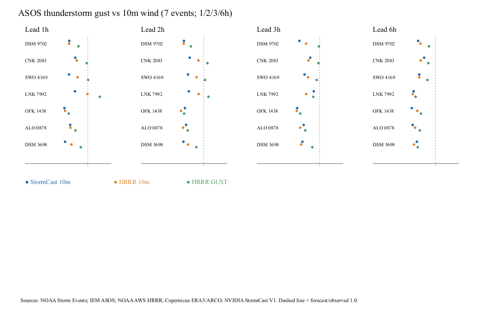
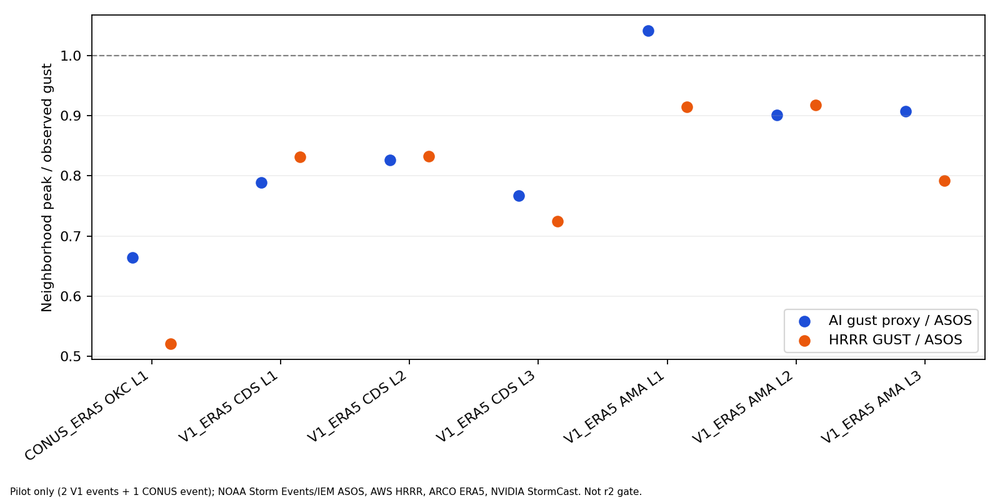
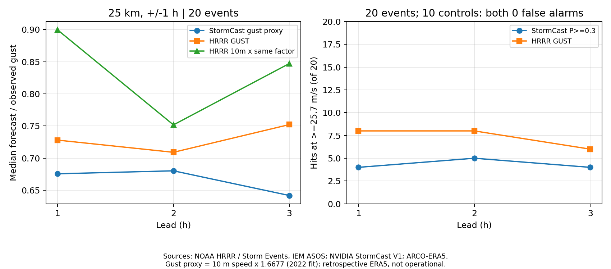

# 对流尺度AI与雷暴短临

**分组**：AI 气象 / 气候大模型与风工程　**状态**：搁置　**时间**：2026-10-14 – 2026-10-16

## 阶段结论（测试性质，非正式结题）

10-16 审查 ：StormCast V1/CONUS + 常数系数阵风代理按冻结门槛未达扩样标准，暂停该配置；不等于 AI 不如 HRRR（差异不显著、口径敏感）；重启需重新预注册（盲样本、阵风诊断、概率型判据）；约 212 CU；10-16 第三轮预注册经审查 冻结（定稿），S0 已冻结（V1 120 + CONUS 80 个事件，200 个对照），S1 修正后通过（中位比 1.00、r=0.98），合计约 6.4 CU；S2（约 144 CU）待母项目放行

## 原始任务

# 任务书：对流尺度 AI 模型第一步——能否在 Colab 跑、能否报出雷暴地面强风

## 目标
回答两件事：(1) 公开的约 3 km 对流尺度 AI 模型里，哪些能在我们的 Colab A100 上真正跑起来；(2) 跑得起来的那个，在 5–10 个下击暴流/强雷暴事件上，0–6 h 起报的地面强风能报出几成，和 HRRR 业务预报比差多少。最终目标是上规模后报（几十到几百个事件），所以脚本要写成"事件清单 → 取初值 → 推理 → 对 ASOS"的批处理。

## 交付物（写到）
1. ：候选模型表——StormCast（earth2studio 内有）、WoFSCast、FuXi-Nowcast、CorrDiff-HRRR 等（你查到的都列）：分辨率、区域、提前量、输出变量（10 m 风/阵风/气压层或模式层廓线）、训练年份、初值需求、权重与代码是否公开、许可证（原文摘句）、Colab A100 实测能否跑、单次推理耗时与显存。
2. ：5–10 个事件（地点、时间、ASOS 站、实测峰值风及来源、最近探空站），必须在模型训练年份之外、在模型区域内；优先用 SPC/Storm Events 里 ASOS 测到 ≥50 kt 的雷暴大风。说明怎么挑的。
3. + 图 + 原始日志 + 脚本：按下面判据给每事件、每提前量（1/2/3/6 h 起报）的结果表。
4. ：同批事件，AI 模型（若输出廓线）与 HRRR 在探空站最近格点的廓线 vs 实测 RAOB，比 MUCAPE、DCAPE、0–6 km 风切。
5. 一句结论：值得继续 / 不值得，以及扩到几十上百个事件需要多少 GPU 时间。

## 判据（已写定，不得事后改）
- 每事件取 ASOS 实测峰值所在站；模型取以该站为中心 ±25 km、观测峰值时刻 ±1 h 内 10 m 风（有阵风变量也报）最大值；另报 ±10 km/±0.5 h 作敏感性。
- 基线：同提前量 HRRR 业务预报（10 m 风与 GUST 字段）；起报时刻 HRRR 分析的持续性。
- 指标：峰值比（模型/观测）、峰值时间与位置偏差、≥25.7 m/s 是否报出。
- 值得继续：1–6 h 提前量上 AI 峰值比不低于 HRRR 的 90%，且 ≥2/3 事件优于持续性；单事件单次起报推理 ≤10 GPU 分钟。

## 边界
- Colab A100，现阶段不限 CU；预计超过 100 CU 先停下回报。用完必须 `colab stop`，回报时给 `colab ls` 无残留证据。不上超算。
- 数据只用公开来源（AWS HRRR、AIWP、Iowa Mesonet ASOS、SPC、NOAA Storm Events、UWyo/IGRA 探空），大文件不落 工作站。
- 模型权重许可证逐个核，非商业条款写明；新用到的数据/代码/模型补进，图表角注写数据来源。
- 文章没给的参数先查后假设，假设标明。
- 某个模型跑不起来就写清卡在哪，换下一个，不要停下来问；全部跑不起来也算结果。
- 不需要再请示

## 项目报告

# 对流尺度 AI 与短临（L / M / L2）

## 目标
判断约 3 km 的对流尺度 AI 模型（StormCast、WoFSCast 等）能否直接给出雷暴与地面阵风，并能否批量做几十到几百个事件的预报/后报——这是雷暴方向唯一能上规模的路线（Liang Hu 10-14）。第一步交付：公开模型能否在 Colab A100 跑的核实表；5–10 个有站点实测的下击暴流/强雷暴事件 0–6 h 起报 vs ASOS 与 HRRR 的检验表；同批事件 AI/HRRR 探空 vs 实测探空（L2 的前置门槛）。

## 当前状态
10-16 **搁置**（5/6 有效，裁决）。搁置的是"StormCast V1/CONUS + 10 m 风×1.6677 阵风代理 + 事后 ERA5 条件"这一配置的扩样：按冻结门槛两代都未达扩样标准（V1 20 事件、CONUS 12 事件 53/54 组）。**不是**"对流尺度 AI 不如 HRRR"：命中差异不显著（McNemar p 0.22–1.0），判据 1 换集合最大口径即全过，任一成员 ≥25.7 m/s 计数 AI 不少于 HRRR GUST（V1 9/11/9 vs 8/8/6），V1 含已见 7 例，阵风只用了常数系数。为什么不继续：现有设计已经回答不了"值不值得上规模"，再扩样只是在不显著的差距上花钱（CONUS 约 700 CU/百事件）。重启条件（任一出现即重新立题、重新预注册判据，不直接恢复扩样）：① 盲样本 + 雷暴风核实 + 有对流无强风对照 + 预注册集合聚合与概率型判据 + 样本量估算；② 混合层风廓线阵风诊断代替常数系数；③ 出现原生阵风输出或训练期外可检的公开对流尺度模型；④ 改为不要求站点峰值的批量用途（改目标，须 Liang Hu 定）。第二轮共约 212 CU。M 已收口；L2 未启动。

## 第二轮判据（10-14 冻结，事后不得放宽）
见 "判据"一节：1–3 h 每档 AI 阵风估计峰值比中位 ≥ HRRR GUST 的 0.9 倍；≥25.7 m/s 判别（集合 P≥0.3 记报出）在事件+无事件样本上命中率不低于 HRRR GUST、误报率不高于其 1.5 倍；GFS 真预报条件相对 ERA5 下降不超过 20%。阵风系数 1.6677 固定（2022 拟合）。宽窄窗并列、窗边比例、两个 HRRR 基线；持续性只作附录。

## 第一步的判据（开跑前写定）
- 检验对象：每事件取 ASOS 实测峰值风所在站点；模型取以该站为中心 ±25 km、观测峰值时刻 ±1 h 内的 10 m 风（有阵风变量就同时报阵风）最大值。基线：同提前量的 HRRR 业务预报（10 m 风与 GUST）、起报时刻 HRRR 分析的持续性。
- 指标：峰值比（模型峰值/观测峰值）、峰值时间与位置偏差、≥25.7 m/s（50 kt）是否报出。
- "值得继续"：在 1–6 h 提前量上，AI 模型峰值比不低于 HRRR 的 90%，且在至少 2/3 事件上优于持续性；并且单事件单次起报推理 ≤10 GPU 分钟（上规模的前提）。达不到写清差在哪，不放宽判据。
- 事件必须在所用权重的训练期之外：StormCast V1（训练 2018-07—2021-12，权重 Apache-2.0）用 2022 年后事件；StormCast-CONUS（训练到 2025-09-30，权重 OpenMDW-1.1）用 2025-10 后事件。

## 怎样走向上规模
第一步脚本按"事件清单 → 自动取 HRRR 初值 → 推理 → 自动对 ASOS"写成批处理；过闸后扩到 SPC/Storm Events 里几十到几百个有 ASOS 实测的雷暴大风事件做后报统计；M 的 AIWP 统计给出环境可预报提前量，决定 L2 能否做"预报"还是只做"后报"。L2 的 CM1 集合在超算跑，规模化交 CM1 线或转正式项目。

## 边界
- 层级（根 Lead 10-14，5 层上限）：本节点是二级节点，不再开三级子项目；需要细分时在本节点内用任务，或报上级节点 Lead（雷暴与对流尺度）开同级二级节点。
- 往下只剩两跳：本节点 → bot（ideas）→ 工具；任务书不得让工具 bot（gpu-gemini、审稿人、litwiki 等）再委托别人。
- 子树列表不按父节点分组，层级以界面项目树为准。
- 算力与数据：Colab 优先，不设单试验上限（母项目 10-14 按 Liang Hu 原话"现阶段多用 Colab、不限 CU"对齐，原"单试验 ≤20 CU"作废）；单试验预计超过 100 CU 先停下报上级；用完必须 colab stop，不让会话空转；同一轮只派一个执行方。L 第二轮照旧：整轮 ≤200 CU，累计 120 CU 报上级一次，到 200 CU 停下报上级。超算单作业 ≤50 SU，走资源申请与；L2 的 CM1 集合由 CM1 线跑，我们只交 input_sounding 格式廓线。
- 计算与存储地点（Liang Hu 10-14 加严）：工作站 不跑计算、不存计算数据（10-15 01:59 C 盘余 46 GB）。求解器、推理、训练、批量算例、大下载一律在 Colab 或 CRC/TACC 跑和存；工作站 只放脚本、单项 <200 MB 的小结果、图和报告，拉回的检查点保持小文件，大中间件留在 Colab/集群；确需在 工作站 临时放 >1 GB 先报上级。CRC 组空间约 95%，新的大数据优先放 TACC /work 或 /scratch；CRC 默认单节点。任务书一律写明在哪算、结果放哪。

## 已定决定
- 2026-10-14 文献审查 裁决：StormCast 两版权重分开；FuXi-Nowcast 改为反例（强阵风阈值不如持续性）；补 HRRRCast 候选（公开版 6 km、GUST 为后处理诊断、气压层到 200 hPa、GFS 边界），撤回"只有 StormCast 可用"；Cook 10% 收窄口径；撤回 Collins 外推；新意按窄口径写 → 
- 2026-10-14 开立，第一步全在 Colab/工作站，CM1 部分先问 CM1 线 → 

## 试过与结果
| 日期 | 做了什么 | 结果一句 |
| --- | --- | --- |
| 10-16 | 第二轮 CONUS 段（B 46.2 + B2 少量 + B3 78.1 CU，估算）：12 个 2026 事件 + 6 对照，53/54 组（缺 1 对照 3 h 组 1 成员） | **按冻结判据不通过**。宽窗 AI/观测 1/2/3 h 0.67/0.74/0.68，HRRR GUST 0.79/0.82/0.81，HRRR10×系数 0.84/0.94/0.86；AI/HRRR GUST 0.85/0.90/0.84 → 判据 1 只 2 h 过；命中 AI 1/1/0 vs HRRR GUST 4/2/3（/12）→ 判据 2 不过；误报两者 0。缺的对照组只影响误报，不改结论 |
| 10-15 | 第二轮段 A：V1+ERA5 条件全样本 20 事件 + 10 无事件对照 × 1/2/3 h × 10 成员（本会话约 25.7 CU，费率估算） | **按冻结判据不通过**。宽窗峰值比 AI/HRRR GUST/HRRR10×系数：1 h 0.68/0.73/0.90，2 h 0.68/0.71/0.75，3 h 0.64/0.75/0.85 → 判据 1（AI ≥0.9×HRRR GUST）1 h 0.93 过、2 h 0.96 过、3 h 0.85 不过；判据 2 命中 AI 4/5/4 vs HRRR GUST 8/8/6（/20）不过；对照误报两者 0/10。连同系数放大的 HRRR 10 m 风也多数比 AI 好。窄窗两者都只到 0.4–0.5。窗边 AI 成员 133–143/300 |
| 10-15 | 第二轮闸门段：V1 在第一步 7 事件上跑通阵风管线（本会话约 11.7 CU，费率×时长估算） | 管线与用时过闸：单组 173–312 s、成员中位 22 s（预估 55 s），约 0.3–0.6 CU/组。科学结果（已见样本，非盲测）：宽窗 AI/观测 1–3 h 0.51/0.59/0.62，HRRR GUST 0.75/0.73/0.77；AI 命中 0/3、0/3、0/2（HRRR GUST 的命中数）。合并 10 事件：AI/HRRR GUST 中位 1 h 0.84、2 h 0.88、3 h 1.01；≥25.7 命中 AI 3/2/2、HRRR GUST 6/6/4。窄窗两者 7 例全不中 |
| 10-14 | 第二轮第②段 V1/ERA5（旧口径 ≤20 CU，计入本轮；账户余额降 18.03 CU 为上界） | 153 行检查点；完整 10 成员组 13 个：事件 3（AMA、CDS、CID）×1/2/3 h，对照 4 组（CDS 3 档、CID L1）；对照 9/10 有邻站 METAR <40 kt 交叉，CNK 无邻站。中间汇总（不作裁决）：AI/观测中位 1 h 0.79、2 h 0.83、3 h 0.77，HRRR GUST 0.91/0.92/0.79；≥25.7 命中 AI 3/3、2/3、2/3，HRRR GUST 3/3、3/3、2/3；对照误报两者 0。算力：本段约 7 个新组用 ≤18 CU，按此速度 ≥20+≥10 全量约需 200 CU 以上，单组用时须在闸门段实测核对 |
| 10-14 | 第二轮第①段 HRRRCast GPU 兼容性（约 1.1 CU） | 权重再次校验通过；隔离 Python 3.10 + TensorFlow 2.15.1 能识别 A100，但加载 .keras 时内核持续卡住，事件推理未跑通。Decision：HRRRCast 暂缓（公开版 6 km、训练期覆盖 2023、环境不通），只有 V1 段过关后才再试，届时用 2024-04 后事件 |
| 10-14 | 第二轮部分执行（先导） | V1 两例（AMA 65 kt、CDS 62 kt）×1/2/3 h×10 成员：阵风代理（AI 10 m 风×1.6677，2022 年拟合）宽窗 AI/观测 0.77–1.04，与 HRRR GUST 0.72–0.92 相当，P(≥25.7) AMA 1.0、CDS 0.3–0.7；CONUS 在 A100 80GB 可跑（前向 97 s/2 步，20.6 GB），OKC 2026 一例 L1 AI/观测 0.66、P=0；CONUS 气压字段只到 p20hl（约 440 hPa）；GFS 条件单成员烟测通过；HRRRCast 权重校验通过但训练期 2021-03—2024-03 覆盖 2023 事件，前处理未通、未推理。第一会话被平台回收（pruned，已报平台）。三条判据全部未评估 |
| 10-14 | HRRRCast 可用性核实 | 有公开权重（约 203 MB）；但公开版是 6 km、气压层只到 200 hPa、GUST 为后处理诊断（因子 1.4）、权重无单独许可、训练期未核；未在 Colab 实跑 |
| 10-14 | 第一步观测与基线补充：IEM ASOS 1 分钟档逐例核峰值；WoFSCast 仓库核权重 | 6/7 例 1 分钟档与报告峰值同分钟同值；OFK 同分钟缺测（窗内最大 53 kt，METAR PK WND 记 56 kt），单列待复核；同源比对不能证明无站内质控删峰。≥25.7 m/s 命中：AI 0/28、HRRR GUST 8/28、HRRR 10 m 1/28。WoFSCast 仓库无权重、无 release，配置指向内部路径 → 暂不可用。第一轮不过的判定不变 |
| 10-14 | M：AWS AIWP（Pangu、GraphCast Operational）40 个 2023–24 ASOS ≥50 kt 雷暴大风日，提前 12–120 h，对 13 层 ERA5，基线日变化对齐持续性，逐参数判据 | DCAPE、0–1 km 风切全部五档过；0–6 km 风切 Pangu 五档过、GraphCast 到 72 h；MUCAPE/MLCAPE 两模型五档都不过（中位误差常低于持续性，但逐事件只赢 14–25/40，不到 2/3）。验证时刻取最近 00/12 UTC，偏离风峰可达 6 h；只验环境不验阵风 |
| 10-14 | 第一步：StormCast V1（训练 2018-07—2021-12，中部美国 512×640）在 7 个 2023–24 ASOS 雷暴大风事件×1/2/3/6 h 起报 | 按预设门槛不过：AI/HRRR10 峰值比中位 1 h 0.85、2 h 0.61（3 h 1.11、6 h 1.01）；AI 0/28 报出 ≥25.7 m/s；6/7 事件优于持续性；单组 ≤88 s，100 事件×4 起报约 6 GPU 小时。口径问题：AI 与 HRRR10 都是 10 m 平均风，对 ASOS 阵风只有 0.3–0.5，HRRR GUST 0.75；单成员；条件场用事后 ERA5。探空：模式层只 14 层到约 440 hPa，CAPE 不可用于 L2。WoFSCast 无公开权重/初值，FuXi-Nowcast 无权重，CorrDiff 权重受限 |
| 10-14 | Deep Research 核对（298d34） | 两份报告一致：对流尺度 AI 模型都没有对地面雷暴强风做过站点检验（检索缺席）；实际可用只有 StormCast；DR 把 HRRR 强风偏差错挂到 Fovell 2022，实为 Collins 2024 WAF PDF p10（阵风 −11.32 m/s，冷季下坡风）；ASOS 质控误删约 10% 对流峰值（Zotero DZF9GFUU PDF p1）；无"AI 探空→CM1"先例。送审 |
| 10-14 | Grok 文献快查 + 核对 StormCast 模型卡、FuXi-Nowcast 摘要 | StormCast 现行权重训练 2018-07–2025-09、全 CONUS 3 km、OpenMDW-1.1 可商用、有 10 m 风无阵风 → 检验事件须在 2025-10 后；FuXi-Nowcast 有阵风但只限华东、未见权重；未找到"AI 探空→CM1"先例 |

## 参数来源表
| 参数 | 取值 | 来源或"假设" | 查过哪些地方 |
| --- | --- | --- | --- |
| 检验邻域 ±25 km/±1 h | 25 km、1 h | 假设：约 8 个 3 km 格点、覆盖对流位置误差；敏感性：另报 ±10 km/±0.5 h | 待文献快查 |
| 强风阈值 | 25.7 m/s（50 kt） | NWS severe wind 标准 | — |

## 未决与下一步
- 10-16 01:52 第三轮预注册已冻结：
 - 定稿，SHA256 在。
 - 依据审查 的裁决和决策记录。
 - 已派 wx 执行 S0+S1（Colab，≤12 CU）。
 - 10-16 02:10 wx 交回预筛（约 1.7 CU）：暂定 V1 295 条、CONUS 127 条（尚未做格网边界核对和对照配对，不算冻结样本）；S1 未开始。02:20 补派 ：S0 收尾后接做 S1，两单合计 ≤12 CU。
 - 10-16 02:28 交回：S0 两单按 A100 单价估约 3.4 CU，超过分段估计 3 CU，wx 停机；样本未冻结，S1 未开始（格网核对已确认暂定候选都在网格内）。我记为偏离 D1：分段 CU 只是预算估计，S0 上调到 ≤5，S0+S1 合计仍 ≤12。02:36 派 一次做完 S0 冻结和 S1。
 - 10-16 03:26 交回，停在记账问题上：CPU 会话按 A100 单价 6.85 CU/h 记账，估到约 9.8 CU 停机。合格事件预备数为 V1 301、CONUS 132，临时抽样 120/80；对照配对尚未完成。我记为偏离 D2：CPU 会话改按实测单价记账。03:36 派 完成对照配对、样本冻结和 S1。
 - 10-16 04:56 核实： 在 CPU 会话后台配对对照，22/200，暂无缺对照；CPU 实测约 0.08 CU/h，D2 记账得到证实。wx 预约 07:45 回访后接着冻结样本、做 S1。已留言要求 S1(a) 用 HRRR wrfnat 的全部原生层。
 - 10-16 10:49 S0 冻结：events_r3.csv（…）、controls_r3.csv（…），V1 120 个、CONUS 80 个事件，200 个对照全部配上（合格池 V1 301、CONUS 132；改用 35 dBZ 时增加 0 个）。11:13 S1 首次结果：(a) 1.113 / r=0.915，(b) 1.00，(c) 不过（AI 的 Z1hl−地形为 −26～39 m）。Lead 复核发现 θv 的气压单位用错（Pa 当 hPa），首次结果作废，记为 D3；高度改为锚定 HRRR 最低层，记为 D4。11:32 派 wx 重跑 S1。累计约 4.3 CU。
 - 10-16 11:38 S1 修正版**全部通过**：(a) 公式/业务 fg10m 中位比 0.99999、r=0.982（10 个事件，4370 个格点×时次）；(b) 只用 StormCast 的 14 层时，峰值中位比 1.000；(c) 锚定后两个事件 860 列 NaN=0、PBL 顶全部找到。AI 的 Z1hl 有漂移（−26～39 m），按 D4 锚定；层高不单调的列按 D5 处理。合计约 6.4 CU。已报上级，**S2（V1 120+120，约 144 CU）等母项目放行**。
 - (原计划) S1 过闸后报上级。**S2 等母项目放行，不直接开。**
- 10-16 上级「AI 气象」同意方向，放行 S0+S1（约 9 CU，以审查后定稿为前提）。已派 litwiki 建卡（Benjamin 2020 阵风诊断原文、雷达对流阈值），定稿审查 （`--count 3`）已发出，重点问 V1 80+80 的功效是否够、事件多于 80 时是否提到 100 以上。两者都回来后裁决、冻结草案、放行 S0+S1。
 - litwiki 已交回（10-16），我抽查了 Benjamin 2020 PDF 第 14 页和第 16 页原文，属实。定稿时要改两处：
 1. 混合层顶判据改为 θv(hl1，约 8 m) + 0.5 K（Benjamin 2020 PDF 第 14 页 / 报告第 10 页），只在 PBL 内取最大（PDF 第 16 页 / 报告第 12 页）。这样就不再需要 q2m 的假设。
 2. 雷达阈值 40 dBZ 仍按“假设”处理：文献只有 MRMS 合成反射率 >40 dBZ 的依据（Liu 2021，技术说明第 2 页），另以 Roberts & Rutledge 2003 的 >35 dBZ（PDF 第 1 页 / 期刊第 562 页）做敏感性分析。
 卡片位置：、`H9ENWPG3_*`、`NR_liu_2021_*`。S1 闸门过了报上级；**S2 不直接开**，由上级转母项目放行。
- 10-16 第三轮预注册草案已写好，**只做了设计、没有花算力**：。L 仍为搁置，放不放行由上级「AI 气象」定。草案要点：
 - 盲样本：V1 用 2022、2024、2025-01–09 的事件，CONUS 用全国 2025-10 以后的事件；对照为“有对流、无强风”，与事件 1:1 配对。
 - 阵风改用 HRRR 混合层诊断（Collins 2024 式 (1)，期刊第 708 页），需要重跑并保存 hl1–hl20 各层。
 - 主时效定为 2 h；主判据三条：Brier 不劣、命中/误报不劣（界限 0.15）、峰值比 ≥0.9。
 - 样本量：V1 80 个事件 + 80 个对照，CONUS ≥50 个。
 - 分段：S0 抽样冻结 + S1 试点 + S2 V1 盲测，约 105 CU；全部五段约 570 CU；S2 及以后每段都要先经上级放行。
 - 定稿前：Benjamin 2020 原文和雷达阈值交 litwiki 建卡；定稿按冻结协议送审 `
- 10-15 12:50 B 会话 11:25 守护停机（46.19 CU，230 行、20 组完整）；B2 新会话启动即报 OptionalDependencyError 退出，无新增结果（已报平台）。12:58 派 wx 开 B3：照原 B 装齐可选依赖后从 230 行续满 54 组，整轮剩约 81 CU（累计约 134），到限停下报。
- 10-15 母项目批：CONUS 段 B 跑满 54 组，整轮上限 215 CU，取代"到 200 停"；同一段 B 续跑，不重算、不另开同名会话；超 215 停下报上级。已告知 ideas。出结果：不过则搁置前送 6 人，通过直接报上级。上规模成本（CONUS 约 700 CU、V1 约 140 CU）只记录，不据此放行。
- 10-15 10:42 按段 B 实际耗时重算（上级要求）：B 会话已跑约 6.0 h、约 41 CU（6.85 CU/h 估），完成 17/54 组。每组（1 事件×1 提前量×10 成员）墙钟：1 h 约 14 分、2 h 约 20.5 分、3 h 约 27 分（自回归步数越多越慢），平均约 20.5 分 ≈ 2.3 CU/组——比 05:20 用的 13 分/组慢约 1.6 倍（那 2 组只是 1 h）。第二轮累计约 83 + 41 ≈ 124 CU，已过 120（已报上级）。剩 37 组约 87 CU，整轮预计约 210 CU，会碰 200 上限：到 200 CU 停下，用已完成的约 49/54 组按冻结判据出判定并写明样本数（事件优先，缺口落在对照）。05:20 那句"预计约 175、不会碰 200"按实测改正。
 - 上规模的直接证据：CONUS 单卡 A100 每组约 20 分钟，100 事件×3 提前量 = 300 组 ≈ 100 GPU 小时 ≈ 700 CU；V1 每组 3–5 分钟，同规模约 20 GPU 小时 ≈ 140 CU。
- 10-15 05:20 第二轮算账核对（上级 Lead 要求）：
 - 分段（单位 CU；"上界"=共享账户余额下降，含同期其他会话；"估"=本会话时长×约 6.85 CU/h）：先导段 ≤26.8（上界）；第①段 HRRRCast 约 1.1（估）；第②段 V1 ≤18.0（上界）；闸门段约 11.7（估）；段 A 约 25.7（估）；段 B 至 05:10 约 3.3（估）。合计约 86.6。
 - 口径：项目页旧数"上界约 58"是段 A 之前的累计（≤46 + 11.7）；回报里"约 84/87"= 58 + 段 A 25.7（+ 段 B 3.3）。没有重复计入或漏计，两数时间点不同。其中先导段与第②段是上界，实际偏低。
 - 段 B 预估：约 13 分钟/组、约 1.65 CU/组（前 2 组含安装与权重加载，实际每组应略低），54 组约 89 CU；到 05:10 已计 3.3，剩约 86，加一次续开会话的安装加载约 2–3 CU。整轮预计约 175 CU，会过 120（届时报上级），不会碰 200。我 05:10 说"大概率碰 200 上限"算错了，撤回。
 - 10:40 回访按段 B 实际每组耗时再重算一次写在这里。
- 10-15 05:10 CONUS 段（第二轮段 B）在跑：约 27 分钟完成 2/54 组，CONUS 每组远慢于 V1。上级 Lead 批：到单会话 50 CU 直接续开新会话（从检查点续），整轮 ≤200 CU，过 120 CU 报一次；到 200 CU 未完就用已完成组按冻结判据出判定并写明样本数；报每组 GPU 分钟与 CU，并估算 100 事件×3 提前量的成本。
- 10-15 ：r2 下 >100 KB 文件（含 gate_7events 检查点）被根 Lead 清理时搬到 TACC lab_archive（清单），TACC 恢复后由根 Lead 校验拉回；续跑只从 Colab /content 恢复，判定若只差这批文件则注明"工作站 检查点在 TACC，未比对"。 原因即此，已告知平台。
- 第二轮累计 Colab（上界，含共享账户其他会话）：先导段 ≤26.8 + 第①段约 1.1 + 第②段 ≤18.0 ≈ ≤46 CU；120 CU 时报上级。闸门段 已过（10-15 00:26）；累计上界约 46 + 11.7 ≈ 58 CU。已放段 A（V1 补齐到 ≥20 事件 + ≥10 对照，≤50 CU）与段 B（CONUS 2026 事件 + ≥6 对照，≤50 CU）；GFS 段等判据 1、2 有模型通过再派。
- ideas 第二轮（任务书，排在 M 之后）：阵风换算、10 成员集合、≥20 事件 + ≥10 无事件对照、GFS 真预报条件、StormCast-CONUS 在 2025-10 后事件上试跑并核垂直层数；判据已写定。 10-14 18:20 预检：估算约 163 CU 超 100 CU 闸门停下（候选 666 条）；Lead 曾放行 200 CU，10-14 上级 Lead 更正为每段 ≤20 CU（200 CU 待母项目批）；去掉 6 h、成员成批推理，顺序 HRRRCast → V1 ERA5 → GFS 条件 → CONUS 2026 事件。
- 上级 Lead 10-14 补两条判读（已转 ideas，不改判据）：报最大值落在窗边（≥0.9×半径）的比例，窄窗与宽窗并列——第一轮约 20/28 组 AI 宽窗最大值在 20–25 km，多半是背景风；持续性基线太弱，"6/7 优于持续性"不作技巧证据，结论以 HRRR GUST 与"HRRR 10 m×同一阵风系数"两个基线为准。 第一轮复核：宽窗最大值落在窗边（≥22.5 km）AI 18/28、HRRR10 13/28、HRRR GUST 14/28；窄窗（10 km/±0.5 h）三者 ≥25.7 m/s 都是 0/28。
- L2 探空：StormCast V1 只到约 440 hPa，不能直接给 CM1；候选改用 HRRR 气压层产品或 CONUS 版（看第二轮核层数）。
- 10-14 探空补充：CM1 取列规则已写成可测试脚本 （合成测试 2/2 过），七例 RAOB 与 ASOS 峰值时差 0.25–4.35 h（3 例 >3 h）；真正的 CM1 对流前列还没取：要逐例雷达首个 ≥35 dBZ 时刻、HRRR 反射率与陆地掩膜，原始廓线也没存，现有 soundings.md 只作参考，不能当 L2 交接。Decision：L2 取列与 input_sounding 等第二轮判出"值得继续"后再做（用 HRRR/HRRRCast 原生层 + NEXRAD/MRMS），现在不派。
- M 已完成（见上表）：AI 全球模型能提前 3–5 天报准风切和 DCAPE，CAPE 在 0.5–5 天都不稳定。对 L2 的含义：后报用 HRRR/ERA5 分析抽探空；做预报时 CAPE 是短板，只能靠对流尺度模型的短提前量（第二轮 HRRRCast 有 CAPE 与 20 层）。M 不再追加。
- Grok 快查已核（见上表）；Deep Research 已核，审查 已裁决；HRRRCast 已加进第二轮；GitHub 仓库表由 ideas 在 models.md 里给。
- 10-14 CM1 线回复：不重复（他们只从 HRRR f00 取列）；取列规则可借，已转 ideas；2022 年后有实测峰值的只有 NIP 2022-06-03、ALTU 2023-07-03（都在 StormCast 现行训练期内，不作检验事件）；L2 小集合（10–20 成员）由 CM1 线跑，我们按 input_sounding 格式交廓线，排期在 CRC /groups 空间恢复、其子项目 C/B 开跑之后。

## 文献依据
- PDF p3：97 探空驱动 CM1 下击暴流集合（L2 先例）
- 近域先例（未建卡）：CGsNet Xiao 等 2023 GMD 10.5194/gmd-16-3611-2023；Lagerquist 等 2017 WAF 10.1175/WAF-D-17-0038.1；FuXi-Nowcast arXiv 2512.08974v2（阵风站点检验，13.9/17.2 m/s 不如持续性）；HRRRCast arXiv 2507.05658；Cook 2023 Meteorology 10.3390/meteorology2020017；Collins 等 2024 WAF（Zotero PU6IMCA9）PDF 第 10 页
-；KYSQSJZT（Bolgiani 2020）
- 父项目 AI 气象判断表 1b 行：StormCast arXiv 2408.10958、WoFSCast 10.1029/2024GL112383、FuXi-Nowcast arXiv 2512.08974、Das 2024 10.1038/s41612-024-00834-8（尚未建卡）

## Liang Hu 注
- 10-14：能到 3 km 尺度、捕捉到有利条件后，可考虑用 CM1 降尺度；降水更难预报，也是后续可考虑的灾害（P，暂不开）。最终目标是上规模的预报和后报；现阶段多用 Colab，不限 CU。

## 结果图

## 目录

- `results/`：结果表与说明
- `reviews/`：多模型审稿人审查后的裁决
- `figures/`：结果图
- `code/`：试验脚本（原样保存，路径已改为相对路径，运行前需按各脚本说明准备数据与环境）
