# 自建/本地模型对我们研究的用途

**状态**：搁置　**时间**：2026-10-13 – 2026-10-13

## 结论

不做自己的语言大模型（继续预训练/全量微调），LoRA 暂不做。评测 200 题摘要初筛：本地 Qwen3-32B 82.0%、Claude Sonnet 80.5%、Gemini 3.8 Flash 85.5%（置信区间重叠）；50 题 PDF 单值抽取：本地 92%、前沿 96%。建议成批筛选/抽取交 Gemini 3.8 Flash 批量通道或 Colab 本地 Qwen3-32B，Claude 只做复核；约 6.8 CU。物理场代理部分另留档搁置

## 原始任务

# Liang Hu 任务书 · 实验室第三个子项目：自建/本地模型对我们研究的用途（10-13）

背景：Strata+Qwen 子项目证明 Colab A100 能跑百亿级模型，但"通用聊天大模型本地化"对我们价值很低。Liang Hu 想知道对风工程研究真正有用的是哪一类。三类各给"对我们有没有用、凭什么、最小试验是什么"：
1. 领域微调的语言模型（风工程文献/规范/报告上微调小 LLM 或 LoRA）。预判价值低（ + Claude/Gemini 已覆盖）；核实有无反例。
2. 物理场基础模型/代理模型（神经算子、Transformer/扩散代理；天气基础模型 GraphCast、Aurora、ArchesWeather、WeatherMesh；CFD 代理如 Transolver）。重点：用已有 CFD/LBM/WRF/CM1 数据训练城市风场或建筑风压快速代理能否做、数据够不够；直接调现成天气基础模型给 WRF/CM1 线做初始场、集合或快速筛事件是否可行。
3. 专用小模型（风压时程/风洞数据异常检测、事件分类、超算日志判错等）。
交付：项目页表（类别 / 具体用途 / 已有数据够不够 / 最小试验 / 预计成本 / 推荐度）；挑一个最值得的最小试验立即派 ideas 或 gpu-gemini（Colab A100，≤10 CU），其余列候选。涉及数字孪生风洞、PETW 各线的先问对方 Lead 是否已在做；其他线数据只读。最终给 Liang Hu 一句话：哪一类值得投入、第一步是什么。

## 项目报告

# 自建/本地模型对我们研究的用途

## 目标（10-13 10:38 Liang Hu 重新定向）
回答 Liang Hu 原本的问题：**自建/本地语言大模型（LLM）**对我们研究有什么用。四问：(1) 本地开源 LLM 能否接走批量杂活（文献筛选、PDF 抽数、知识库打标签、Storm Events 文字判雷暴风、超算日志判错）；(2) 在我们资料上微调（LoRA/全量）值不值得，与"前沿模型 + 检索"正面比；(3) 别人的领域 LLM（OceanGPT、ClimateGPT、GeoGPT 等）怎么做、成本、评测、风工程/土木有没有、我们做有没有论文价值；(4) 在我们真实任务上和 Claude/Gemini/Codex/Grok 差在哪。任务书。

## 当前状态
10-13 13:32 结论已出，状态改"搁置"（问题已答完；运维建议转平台，不是研究项目）。子项目「AI 气象大模型预报用途」 另行推进。
**一句话**：不做自己的语言大模型（继续预训练/全量微调）；第一步是把批量杂活从 Claude 挪出去——文献摘要初筛与 PDF 单值初抽交给 Gemini 3.8 Flash 批量通道（质量最好、已在订阅内）或 Colab 上的 Qwen3-32B（数据不宜外传或要离线时），能用关键词规则的先用规则，Claude 只做判断与复核。
**重启条件**：出现大量格式固定、有标注的窄任务（如组内配置生成）且本地模型与前沿模型差距明显时，再做 LoRA 对照；出现不宜外传的大批量文本时启用本地通道。

## 判断表（语言大模型；两轮评测后，10-13 13:32）
| 问题 | 我们的具体用途 | 已有数据 | 最小试验 | 成本 | 推荐度 |
| --- | --- | --- | --- | --- | --- |
| 1 本地开源 LLM 接批量杂活 | 文献摘要初筛、PDF 单值抽取 | 知识库卡片、Zotero PDF、NOAA 公开数据 | **已做两轮**（第二轮 350 题冻结后盲跑） | 第二轮约 1.97 CU；约 5.6 CU/千题（含冷启动摊销） | **摘要初筛：可用**——Qwen3-32B 准确率 82%、召回 98%、精确率 58%，与 Claude Sonnet（80.5%/100%/56%）相当，Gemini 3.8 Flash 最好（85.5%/98%/64%），均远好于关键词（67.5%）；仍须人看被排除的边界样本。**PDF 单值抽取：可作初抽**——本地 92% vs Claude/Gemini 96%，须核原页。**Storm Events 判雷暴风：用规则**（构造后规则 100%，未测真模糊样本）。日志判错未测。 |
| 2 在我们资料上微调（LoRA） | 固定格式窄任务 | 需另建标注集 | 未做——本地已与前沿模型相当，差距不足以证明值得 | — | 低（重启条件见上） |
| 3 做"自己的领域大模型"（继续预训练） | "风工程 GPT" | 无足量语料 | 不做 | 数百–数千 A100·h 起 | 低（文献依据见审查 裁决；土木有 CivilGPT 先例，风工程未见） |
| 4 与前沿模型差距 | 同 1 | 同 1 | 同 1 | — | 筛选：本地 32B ≈ Claude Sonnet < Gemini 3.8 Flash；抽数：本地低约 4 个百分点（50 题差 2 题）；Codex/Grok 未测 |
**省多少用量（估算，本线数据）**：Claude 经命令行每次批量调用约 3.9 万 token（多为框架开销），列表价约 0.05–0.06 美元/题；本地 Colab 约 5.6 CU/千题（含冷启动摊销）。若每月 1 万条筛选/抽数类杂活，约 1 万次 Claude 调用可整体移出（Gemini 订阅通道或本地）。占平台 Claude 总用量的比例取决于这类杂活实际有多少——平台未统计，无法给百分比。

## 已定决定
- 
- 综述审查裁决 
- 物理场代理部分：（已留档）

## 试过与结果（语言大模型）
| 日期 | 做了什么 | 结果一句 |
| --- | --- | --- |
| 10-13 01:15 | Strata + Qwen3.8-Flash-Next（Colab A100，见） | 94 GB 级模型 32K 跑通，输出 35–59 tok/s，每个新会话约 40 min/4 CU 准备；单条交互慢，批量吞吐未测 |
| 10-13 11:10 | 审查 （3/3 有保留支持）已裁：恢复 LLaMat/NL2FOAM 受限正面对比、补 CivilGPT 与 PMC12657656、撤回 MCP 统一数值、评级按任务拆分 | |
| 10-13 12:18 | 第一轮 100 题评测（Colab A100 40 GB，约 55 min ≈4.85 CU；Gemini CLI 认证失败未比） | A 筛选：8B 40/40 但关键词规则也 40/40（题太易）；B PDF 抽数：Qwen3-30B 24/25 = Claude 24/25；C Storm Events：本地最好 12/20 < Claude 15/20；D 只测比值无意义。本地 100 题 3–4 min（含加载）；Claude CLI 每题约 2–4 万 token（含系统开销）。偏离：开跑前未先交评测集，部分题修正后重测 |
| 10-13 13:17 | 第二轮 350 题（冻结哈希后盲跑；A100 80 GB，约 17 min ≈1.97 CU） | A2：本地 32B 82%≈Claude 80.5%，Gemini 85.5%，关键词 67.5%；B2：本地 92% vs 前沿 96%；C2：关键词 100%（题仍偏易） | 、 |
| 10-13 10:45 | 综述：--max 已回（16 min，3.4 万字）并由 Lead 核对；默认档已回（19 min，2.4 万字）并核对；两份送审 | Max 有张冠李戴（OpenFOAMGPT/NL2FOAM）与未核比较（LLaMat vs GPT-4o），已剔除 | |
| 10-13 10:50 | GitHub 仓库表（Lead 直查 API） | 推理/微调/PDF 解析框架成熟活跃（vLLM 9.4 万★、LlamaFactory 7.5 万★、unsloth 7.8 万★，Apache/MIT）；领域 LLM 仓库星少、多停更 |

## 未决与下一步
- 已答完。平台 Lead 认可建议并转 Liang Hu 定全平台做法（建议实验室线 + LitWiki 先试一周、抽 10% 复核）；本子项目内已先按此执行（ 默认，本地模型仅用于不宜外传数据）。根 Lead 10-13 定线内试行（10-13 至 10-20，抽 10% Claude 复核，一致率 <90% 退回），已转。如 Liang Hu 要真模糊 Storm Events 样本或日志判错的评测，可补一轮（≤10 CU）。
- 数字孪生风洞后续两项（v8 复做、W3 交叉预测）属于已留档的代理部分；对方通知到时转根 Lead 另行安排，本子项目不再承接。

## 文献依据
- 待综述后补。已有：VNP48R7H（NL2FOAM，Qwen2.5-7B LoRA）、FV7BN78P、5ZE3U2A8；FoamGPT（ML4PS 2025 Table 1）。

---

## 附带成果：物理场代理（已留档，搁置）
**状态：搁置（10-13 10:38 Liang Hu 定，不再投入；若要做另开子项目）。**
一句话结论：在我们现有数据上，学习模型没有胜过合适的经典基线——TPU 13 种矩形高层逐栋留一，严格内部 5 栋 ML 0/5 胜几何插值；Silsoe LBM 入流→迎风 Cp(t)，CNN 与线性传递函数持平；文献先例（DeepUFNet、ScaleSplit-NO）与此不冲突（任务与比较对象不同）。附带发现：Liang Hu 3–5 月旧项目 graph-deeponet-wind（UrbanTALES，留出 R² 约 0.79，未见非学习基线）；Silsoe 来流可预测性随距离单调下降（衰减长度粗估约 30 m）。
重启条件：有"已有测点/低保真信息"的重建或校正需求、或要给 graph-deeponet-wind 补非学习基线时，另开子项目。
审查：、。

### 当前状态
10-13 06:40：判断表已按审查 裁决修订（3/3 有保留支持）；最小试验已派 ideas（：TPU 孤立高层库整栋楼留出，ML vs 插值/Kriging，≤10 CU）。Deep Research 因 Gemini API 月度花费上限（429）未启动，已报平台（平台确认是 Liang Hu 账户计费上限，已恢复并补跑），先例改用知识库卡片 + 联网快查。各线数据询问在途：lbm 、cfd 、wrf 、cm1 、windtunnel （已回）、events。

### 判断表（DR 补跑 + 审查 裁决后，10-13）
| 类别 | 对我们的具体用途 | 已有数据够不够 | 最小试验 | 预计成本 | 推荐度 |
| --- | --- | --- | --- | --- | --- |
| 1 领域微调 LLM / LoRA | 规范问答、CFD 配置生成 | 需整理训练/评估集 | 不做 | 0 | 低：没有证据显示本地微调比前沿模型 + 检索 + 纠错流水线更好（FoamGPT ML4PS 2025 Table 1：Qwen3-8B 0→26.36%、GPT-4.1-mini 35.45→39.09%，关闭纠错；FV7BN78P、5ZE3U2A8 卡） |
| 2a 风压代理：孤立矩形高层、mean/rms Cp、几何内插 | Cp 快速估算 | 公开 TPU 库够 | **已做**：逐栋留一，严格内部 5 栋 ML 0/5 获胜 | ≈0.06 CU | 低（只限此场景：固定 GBM/MLP、本协议；峰值、干扰、非矩形未测） |
| 2a′-轻 库边界外推、稀疏测点重建、多保真校正 | 少测/少跑 LES | TPU 公开；多保真缺成对 LF/HF（待 CFD/LBM 回复） | 候选：TPU 边界几何系统外推；或稀疏测点重建 | 1–3 CU | 附条件候选（LBM 入流→风压已试：线性 FIR ≥ CNN，此变体不支持）：有先例（NF6S3H9N 单楼跨风向；DeepUFNet 稀疏测点→SR 4/3.75；TPU T111），本组数据/算力适配未核 |
| 2a′-重 城市风场代理 | 城市风场快速估计 | Liang Hu 旧项目 graph-deeponet-wind 已在 UrbanTALES 512 例上做过 2D 行人风速代理（留出 R² 约 0.79，未比非学习基线）；3D 不做 | 实验室不重复；候选：给旧项目最优模型补一个非学习基线对照 | 远超 10 CU | 算力受限暂缓（ScaleSplit-NO 完整训练 9.7–25.5 h，审稿人 A 核） |
| 2b 现成 AI 天气模型接 WRF/CM1 | 驱动 WRF 的廉价集合、环境筛选 | 公开 ERA5/GFS | 不排 | — | 低-中（0.25° 全球模型环境参量有技巧但平滑，Feldmann 2024；Pangu 一天提前量，Hua 2025 GRL；我们以后报为主；WRF 线回复：扰动 0.01 K 即致强风面积差约 5 倍，AI 初值/集合给不了这部分信息，不建议） |
| 3 专用小模型 | 雷暴/非雷暴风分类、风压通道异常检测、作业日志判错 | ASOS 1 分钟公开；风洞线无实测，但 CFD 线有 CAARC 风洞实测 351 通道 500 Hz | 候选：ASOS 1D-CNN vs 规则基线 | 1–2 CU | 中，附条件：看事件线有无分类瓶颈（2T26I5GW p.12，ASOS 内部 5 折 acc 86.7%，卡片待审） |

### DR 先例与 TPU 试验：不冲突（审查 已确认）
- DR 里最像"冲突"的两条已核实存在：DeepUFNet（arXiv 2508.03183 v2 摘要：SR=1.5 训练，SR=4、3.75 测试泛化"满意"）、ScaleSplit-NO（Qin et al. arXiv 2609.38977：Montreal 城市风场一步 NMSE 比基线低 65.8%）。
- 不冲突的原因是**任务和比较对象不同**，不是先例不可信：
 1. 任务：DeepUFNet 是给定目标柱上的稀疏测点时程去重建/推进全场；ScaleSplit-NO 是同一城区的流场时间推进。TPU 试验是**没有任何测点、只给几何参数**去预测一栋新楼的 Cp。
 2. 基线：先例比的是其他网络（U-Net 等）；TPU 试验比的是几何插值/Kriging。没有已核先例在"整栋新几何 + 与插值同条件比较"下胜过插值。
 3. 规律一致：城市 FNO 自己报告跨显著不同城市形态有局限（arXiv 2501.05499）；TPU 上 ML 也只在库边界外推（T111）占优。
- 由此推出：值得试的是"有测点/有低保真信息时的重建与校正"和"边界外推"，不是"纯几何内插"。

### 已定决定
- 
- 审查裁决 、

### 试过与结果
| 日期 | 做了什么 | 结果一句 |
| --- | --- | --- |
| 10-13 | 读 6 张必读卡 + + 联网快查 | 2a 文献：同库随机留出 R² 高，外推 rms 差；无"整栋未见楼"严格留出先例 |
| 10-13 | （08:25 补跑，11 min） | 报告无 DOI；核对后：DeepUFNet 跨边长比外推未能核实、ScaleSplit-NO 名称查无、雷暴风分类被漏检；未发现与 TPU 结论冲突的已核实先例。核对与修订提案送审，已裁（DeepUFNet、ScaleSplit-NO 改为已核实，2a′ 拆轻/重） | |
| 10-13 | 审查 裁决 | 3/3 有保留支持；改 7 处口径，TPU 协议补充为逐栋留一、点级回归、去峰值、预定判据 |
| 10-13 | CM1 Lead 回复 | 未做 ML。可借：Moore 102 例探空 + 47 例逐分钟近地场（800×800，5 通道，约 34 GB，本地）与每例统计量/判读标签，另 52 例在跑。首选代理：探空 → 出流统计量（峰值风、面积、持续时间、是否成型），样本 47→约 99 |
| 10-13 | **发现 Liang Hu 3–5 月的旧项目** CRC （CM1 Lead 提示，Lead 只读核） | UrbanTALES 公开 LES 城市风场 512 例（1 m），建筑高度图 → 行人高度风速场 640×640；auto_v2–v6 共约 250+ 次训练、40 种架构、AI 驱动超参搜索；最好留出（47 例）中位 R² 约 0.78–0.79，比 200 轮 U-Net 基线 0.72 高约 0.07；**只和网络基线比，未见非学习基线**；5-12 后无更新，知识库无记录；本机线索：Liang Hu 的 OpenClaw 工作区 与 （见 第 29、36 行） |
| 10-13 | CFD Lead 回复 | 未做 ML；样本少（一事件、单风向），只宜作验证集。可借：D420 近地风情景/廓线、CAARC/Silsoe/Case011Up Cp、**CAARC 风洞实测 3 工况（351 通道、500 Hz、120 s）**——可作第 3 类风压通道异常检测的真实数据；推荐代理：粗网格风场→近地廓线（需 CM1 多事件）、几何+来流→Cp（TFCA 风洞档案，Zenodo 63 个 ABL 压力文件）。实验室不需要 CRC 上两个 D420 全场根（各约 70 GB），不影响其清理 |
| 10-13 | WRF Lead 回复 | 未做 ML；只有 2 个事件（Akron 约 8 条轨迹、Wister 待出），不足以训练代理；0.01 K 扰动使强风面积差约 5 倍（风暴内部离散，全球模型给不了）→ 不建议 AI 生成初值/集合；建议的"0.25° 环境筛选"对后报用 ERA5 即可，AI 模型只在预报情形有增量 |
| 10-13 | LBM 逐站距离分析 | 单站输入距迎风面 27→7 m，FIR 相关 0.35→0.67、RMSE 0.265→0.203，单调；1h 排架中心列（24 m）0.42 与距离插值 0.41 吻合 → 支持"距离造成相关降低"；全 20 点排架作输入反而只有 0.32（输入多反而差）；CNN 各站均未过判据；x=−33 m 探针无脉动（入口边界）已排除 |
| 10-13 | LBM 补做：只用真正上游探针 | x≤−10 m：FIR RMSE 0.215、相关 0.62，CNN 0.212（好 1.3%，9/11 点）；x≤−15 m：FIR 0.228、相关 0.57，CNN 0.229。学习模型仍不明显胜线性传递函数；真正上游 7–12 m 沿程探针相关约 0.6；数字孪生风洞线认为 1h 排架约 0.3 更可能是探针布置不同而非距离骤降；逐站距离分析已派 |
| 10-13 | 第二个试验重做（覆盖 0–6 s 时滞，两套输入） | 【更正】"上游沿程探针"输入混入立方体内/屋顶上方/驻点区探针（任务书错误，数字孪生风洞线复核发现），FIR 0.207/相关 0.66、CNN 0.220 不能当来流预测力；有效的只有 1h 排架组；1h 排架输入：FIR 0.269 vs CNN 0.271。学习模型不胜线性传递函数；准定常 RMSE 最差但极值误差最小（min/max Cp 0.14/0.54 vs FIR 0.38/0.63） |
| 10-13 | 数字孪生风洞 Lead 回复 | 未做 ML；数据只有 Silsoe 立方体单算例（v7，642 s，40 测点 + 约 70 探针，本地 CSV 约 120 MB）；只迎风面经验证；首选代理：入流时程→表面 Cp(t)，与准定常比 |
| 10-13 | 第二个最小试验首轮：LBM 入流→迎风面 Cp(t) | TCN 比线性 FIR RMSE 低 8%（11/11 点），但三法相关≈0；Lead 核查：输入窗口 ≤1.3 s 未覆盖约 4 s 输送时滞（设计漏洞），首轮作废，已派重做（覆盖 0–6 s，两套输入） |
| 10-13 09:05 | GitHub 仓库检索（Liang Hu 新规第二步；ideas 名额满，Lead 用 GitHub API 直查） | 2a′ 有成熟通用库（neuraloperator 3954★、Transolver 422★，MIT）；2b 有 Apache-2.0 统一推理框架（earth2studio、ai-models）；雷暴风 1D-CNN 无开源实现需自建；DeepUFNet、FoamGPT 无许可证 |
| 10-13 | TPU 首轮（旧协议） | 5 楼（α=1/4）×5 风向，留出 T213_4：GBM 比 B0 RMSE 低 mean 17%/rms 5%，比 GP 低 rms 仅 1.5%；随机风向留出 GBM 反而输给插值；0.01 CU |
| 10-13 07:18 | TPU 协议补充版 | 13 种几何 × 2 暴露 × 5 风向逐栋留一：mean 最佳 ML 比最佳插值差 2.1%，rms 好 0.4%，各只赢 3/13 栋——未过预定判据（≥20% 且 ≥2/3）；只有边界楼 T111（1:1:1，外推）ML 明显更好 |
| 10-13 08:13 | TPU 全风向复核 | 13 几何 × 2 暴露 × 全部官网风向逐栋留一：最佳 ML 比较佳基线 RMSE 高 13%（mean）/27%（rms），只赢 2/13；严格内部 5 栋全由插值获胜；T111 外推 ML 仍约减半误差（mean 0.12 vs 0.23）。约 0.06 CU，会话已 stop |
| 10-13 | 风洞 Lead 回复 | 未做 ML、无实测数据；可借 YM2019 数字化 132 曲线/15,517 点 CSV、合成数据+故障注入生成器+规则质检器、148 孔表与管路传递函数；建议逐通道异常检测，原型可交回该线待 UF 实测到位试跑 |

### 未决与下一步
- TPU 结果：内插场景 ML 与插值相当，此场景不值得投入；**不是"风压代理没用"**。值得看的是外推（库边界/新几何类型）与多保真（2a′），以及雷暴风分类（3）。全风向复核已确认（10-13 08:13）；等事件线 回来再定第二个试验（≤10 CU）。
- 给 Liang Hu 的一句话（根 Lead 10-13 口径）：内插场景不值得投入；值得看的是外推和多保真（2a′），以及雷暴风分类（3）。
- 等审查 裁决；等六线回复补"已有数据"列；DR 额度恢复后补跑一次。
 - (2) 入流修正后（空场 r1 → v8 建筑算例，对方预计本周内）在新数据上复做，含逐站距离分析，报衰减长度（v7 粗估约 30 m≈5H）与积分尺度 Lu 之比
 - (3) W3 同步实验：用成员 A′ 的来流预测成员 B 的迎风 11 点 Cp(t)（同一入流不同初场；对方给小 CSV 路径，原始 CRC 只读），与 W3 迎风差能底值一起读
 - (补，已完成) 加 z12：排架中心列 FIR 相关 0.417→0.382（变差），x=−10/−15/−20 变化 ≤0.011；CNN 均未明显胜 FIR，对方已撤回该需求（z12 系转述多写，要的就是 z1/3/6，v4b 已满足），结果留档不交付
 - 输入集一律剔除 P_x-33.05 三点（固定边界值，std≈0）；混杂项：离楼近与离入口注入区远分不开。
- 候选（未派）：CM1 探空→出流统计量（等约 99 例）；graph-deeponet-wind 补非学习基线；2b GraphCast/Pangu 单事件环境比对；3 ASOS 雷暴风分类；U3DWind 公开 LBM-LES 五城数据集做城市风场代理（卡片）。

### 文献依据
- 2a：QN6Z9F4B（PDF p.10 Fig.9）、9CBNZGZB（pp.15–17）、NF6S3H9N（pp.1–3 Table 1），均在；Taira et al. 2025。
- 2b：Feldmann et al. 2024 arXiv 2406.09474（联网，未入库，待 litwiki 补卡）；、。
- 3：2T26I5GW（pp.6–8）。
- 1：VNP48R7H。
- 任务书列的 6 张来源卡片
- 根 Lead 预查命中：；（KAN 高层干扰效应代理，TPU 库）；（ML 增强矩形柱气动数据库）；、

## 候选新想法（Liang Hu 10-13 对话中提出，未立项）
- AI 气象大模型用于短临/短期预报：给龙卷、雷暴、台风提供背景环境场；风电（轮毂高度风、功率预报）可能更直接受益；对 CFD 的参考价值（入流/边界条件、生成式湍流场、方法借鉴）。相关卡：（全球 220 m GLES，物理模式，非 AI）、（城市微气候生成式模型，Liu 等 arXiv 2610.10430）、（台风近地风廓线物理约束网络，arXiv 2610.11405）、（WeatherMesh）。10-13 Liang Hu 批准，已开子项目，页；10-13 14:00 子项目搁置（三事件回算：对流背景场只到 12–24 h 且不稳定，CAPE 是瓶颈）。

## Liang Hu 注

## 留档补记（10-13 根 Lead）：事件线对"雷暴风分类小模型"的答复
- 事件线判定靠 Storm Events + Cook v2 Class/XClass 弱标签 + 逐例雷达；瓶颈不在"是不是雷暴风"，而在雷暴风内部机制区分（孤立下击暴流 / 阵风锋 / MCS·超级单体）和近地足迹（德州四城 17 组逐例重建全"模糊"）。单站 ASOS 分类器对普查帮助有限；可能的小用处是在 ASOS 1 分钟记录里找 Storm Events 漏报的候选。事件线没在做、也不打算做。
- 可只读借用的标签：Cook v2 原档（Mendeley 10.17632/88jp3swkn6.2，CC BY 4.0）；德州四城子集 （约 110 MB）与；机制标签太少，不足以训练。
- 判断：第 3 类"雷暴风分类"推荐度从"中"降为"低"（除非改成"漏报候选筛查"这一窄用途）。随物理场代理部分一并留档搁置；重启条件：有人需要大规模漏报筛查，或出现足够的机制级标签。

## 结果图

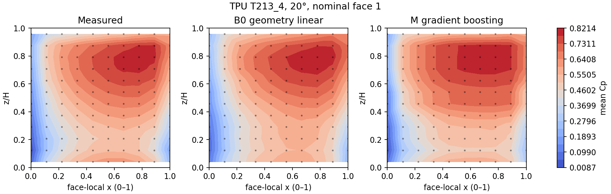
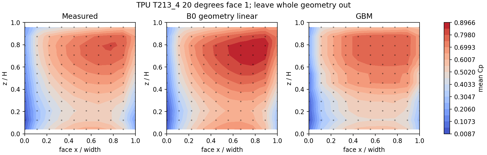
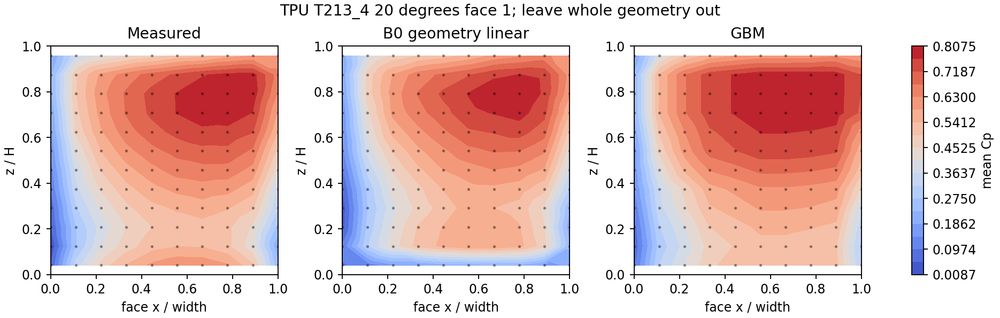

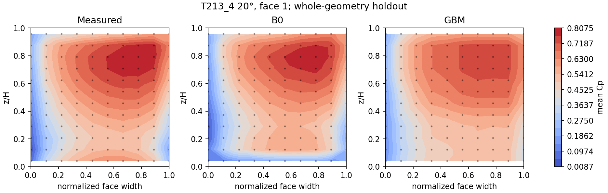
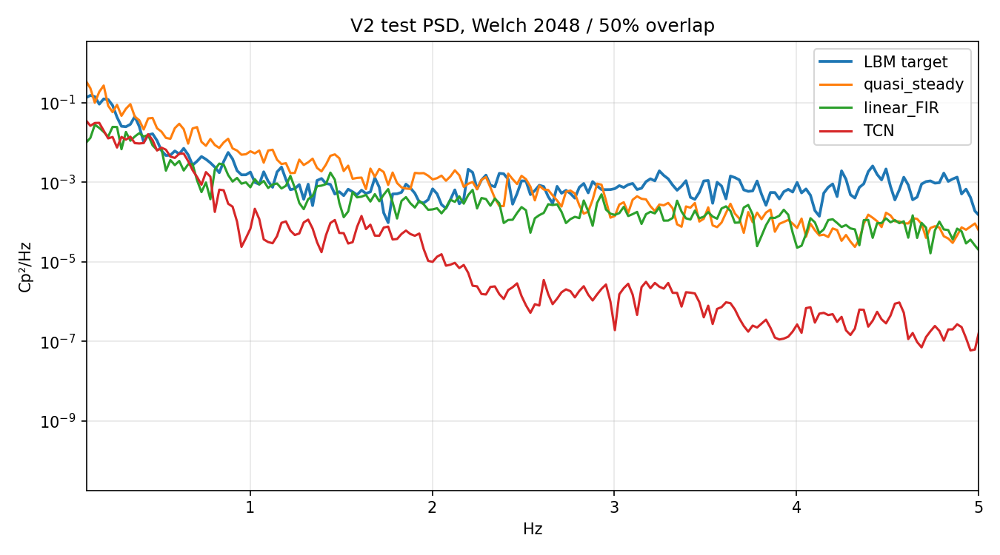
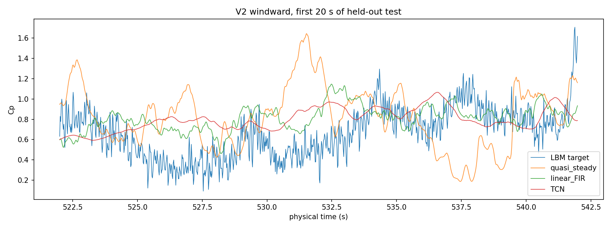
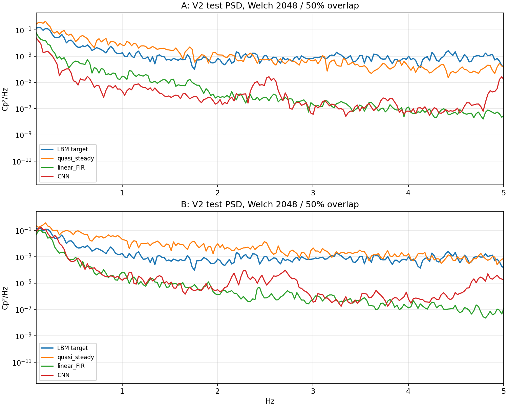
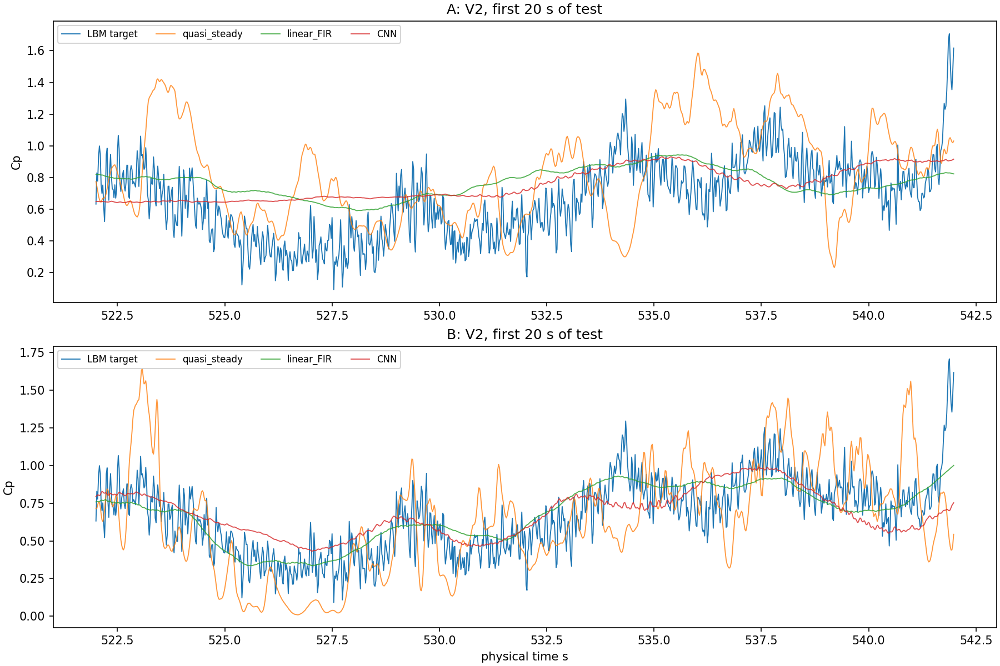
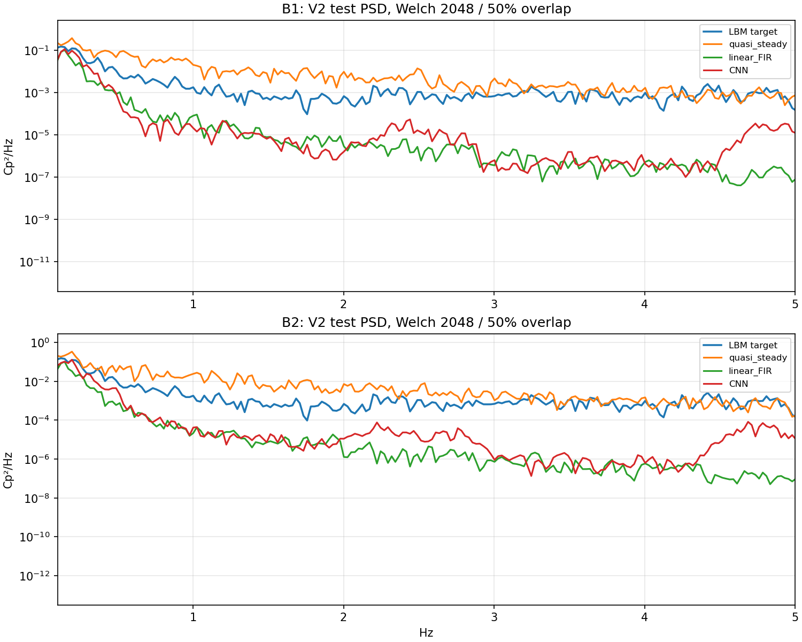
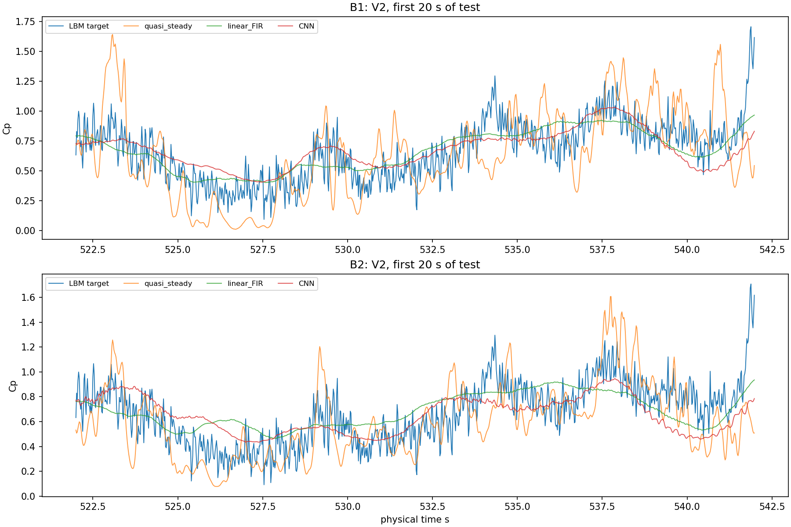
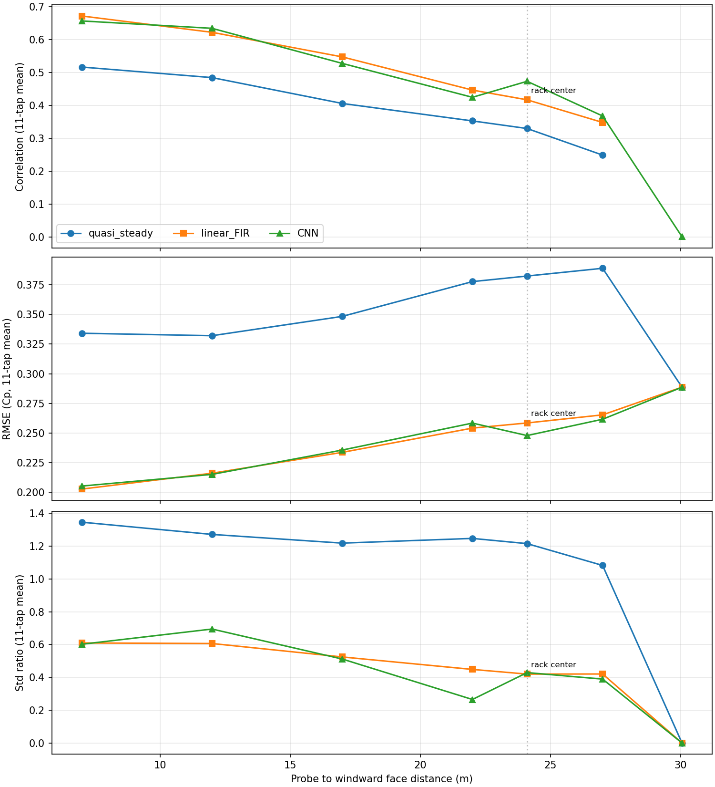
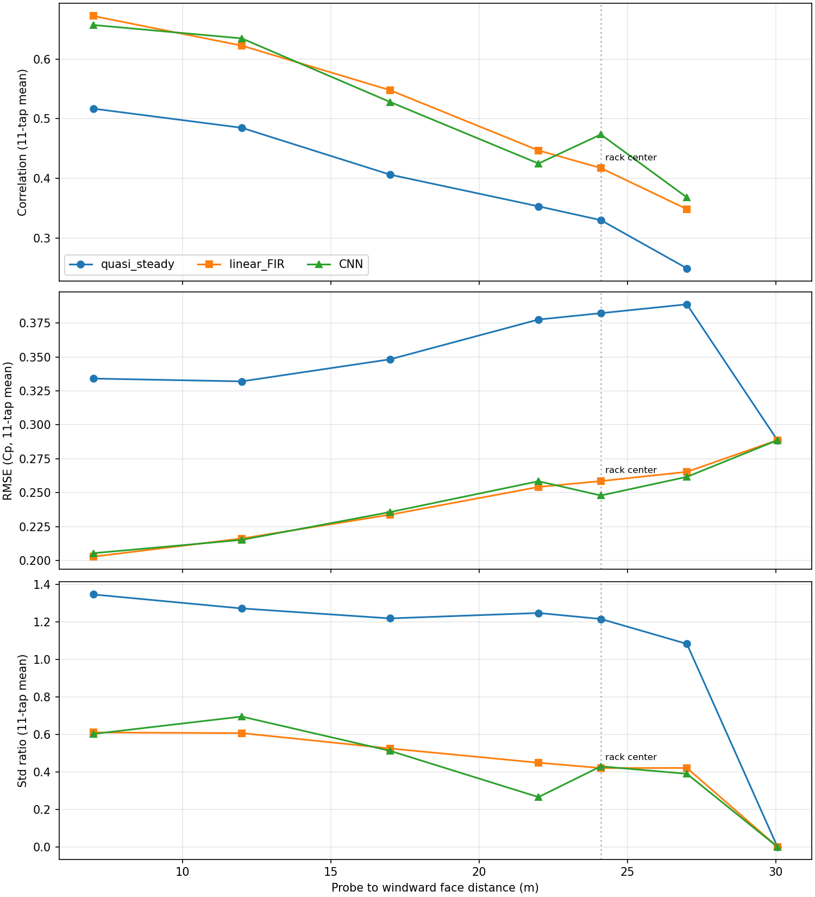
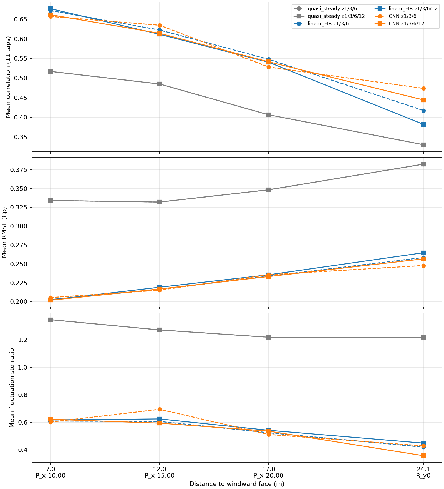

## 目录

- `results/`：结果表与说明
- `reviews/`：多模型审稿人审查后的裁决
- `figures/`：结果图
- `code/`：试验脚本（原样保存，路径已改为相对路径，运行前需按各脚本说明准备数据与环境）
